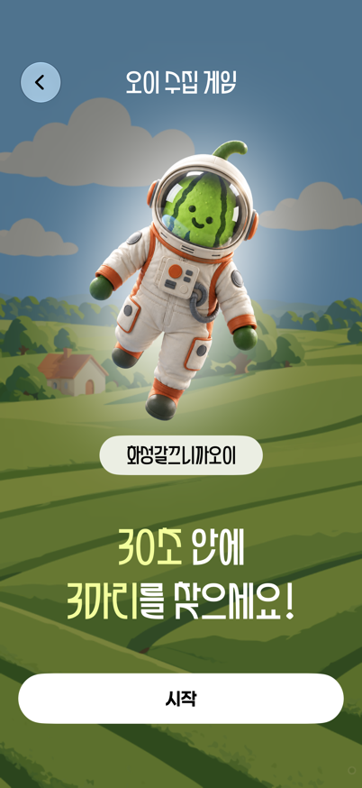
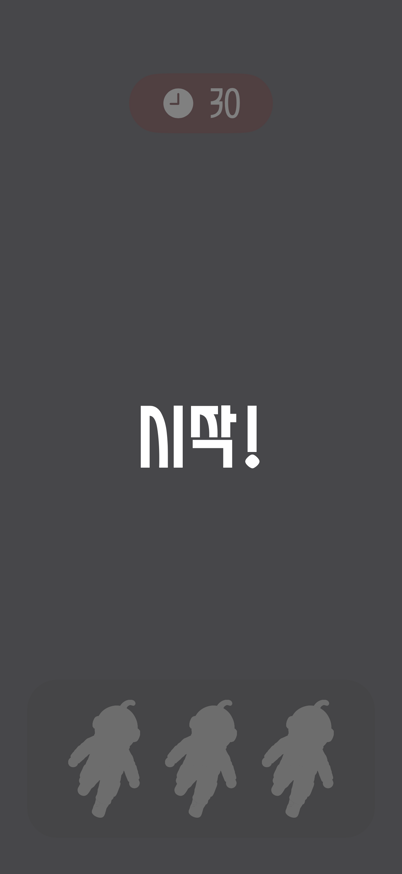
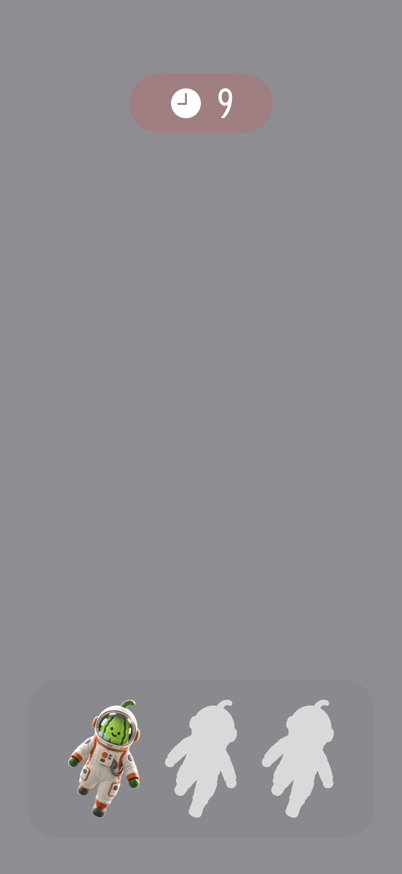
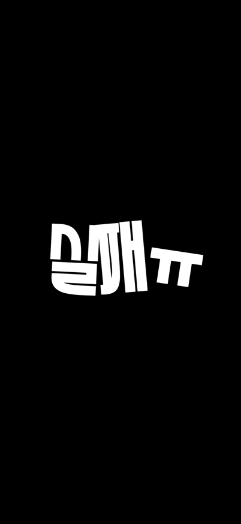
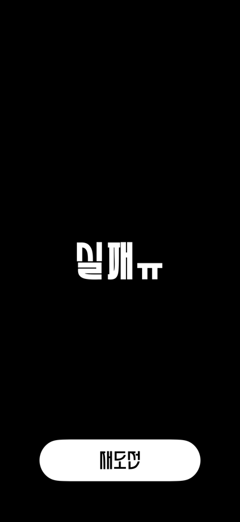
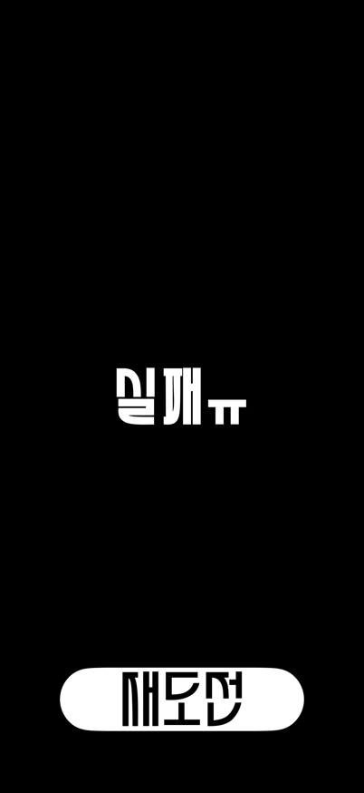
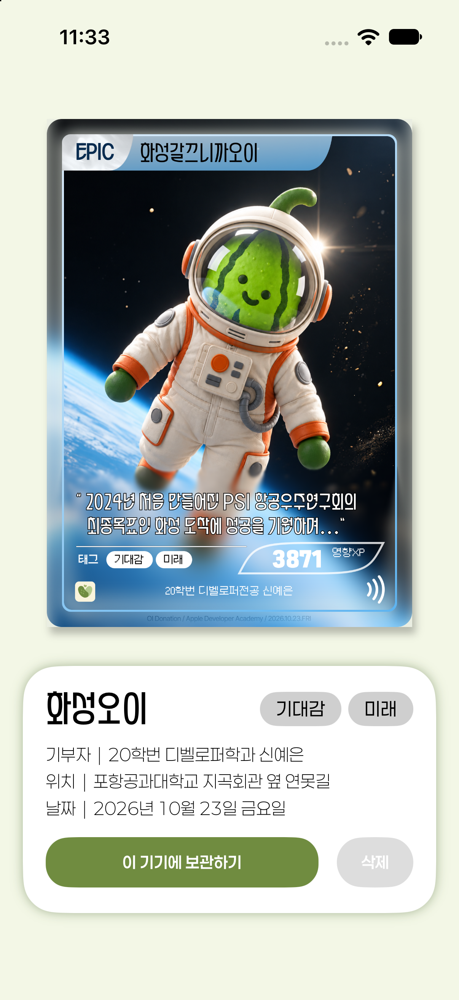
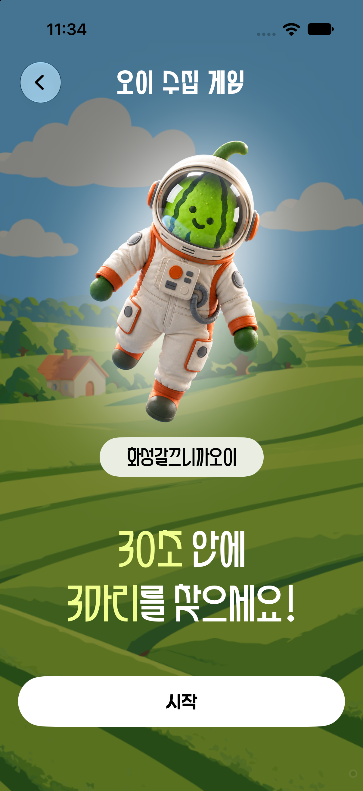

# App Clip 수집 AR 보완

적용 범위: 2026-11-02, #109 / PR #110 작업 브랜치. 실제 AR 동작 검증 완료나 출시 승인을 의미하지 않는다.

## 디자인 기준과 구현

[Figma AR 섹션](https://www.figma.com/design/nEDJaJBFrdzBCa1WcgADHH?node-id=2876-8317)의 402×874pt를 기준으로 한다. 별도의 모션 트랙은 없으며, 원본 프레임의 transform과 프로토타입 reaction에서 확인한 시간·easing을 사용한다.

- 시작: `3739:4308 → 3739:4342`, Ease Out 700ms 조립, 200ms 유지, 400ms 페이드. 카메라 추적과 오이 텍스처·배치가 준비된 후 실행한다. Reduce Motion은 완성 글자만 200ms 표시한다.
- 실패: `3750:1621 → 3747:1593 → 3750:1613 → 3750:1605 → 2869:7163`. 첫 세 전환은 1ms 대기와 Ease Out 400ms, 네 번째 프레임은 100ms 유지 후 300ms 최종 전환이다. 총 1.603초 후 재도전을 표시한다. 네 번째와 최종 화면의 글자 윤곽은 같다.
- 실패는 원본 SVG 글자 `실`, `패`, `ㅠ`만 각각 내려받아 한 `KeyframeAnimator` 시간축에서 위치·크기·회전을 보간한다. 전체 화면 이미지 교체·크로스페이드·확대는 사용하지 않는다. 검은 배경은 고정한다. Reduce Motion에서는 최종 글자와 버튼을 즉시 표시한다.
- 타이머 144×60pt, 수집함 348×158pt, 수집한 오이 72×118pt, 재도전 270×70pt·화면 하단 68pt를 유지한다. 작은 화면에서는 수집함만 화면 너비에 맞춰 축소한다.
- 성공 원의 기준 위치·직경·색은 유지한다. 시작 글자와 성공 화면은 화면 비율 차이로 주요 영역이 잘리지 않도록 reference canvas 전체가 들어가는 배율을 사용한다. 배경은 전체 화면으로 확장한다.

## 카메라와 타이머 소유권

`ARGameFlowView`의 `.starting, .playing`은 같은 분기에서 `ARGamePlayingView`를 표시한다. 이 컨테이너의 `@State`가 컨트롤러를 지연 생성하므로 body 갱신 중 버려지는 새 ARView도 만들지 않는다. `UIViewRepresentable` identity와 컨트롤러·ARView·ARSession은 시작 애니메이션 전후에 유지된다.

`makeUIView`만 idempotent `start()`를 호출한다. 상태 갱신은 수집 입력 허용 값만 바꾼다. `resetTracking`이나 전환 중 pause는 없다. 실제 화면 이탈 시 coordinator의 `stop()`이 텍스처 작업·준비 제한 시간 task를 취소하고, delegate·anchor를 해제한 후 세션을 한 번 pause한다. 추적·텍스처가 15초 안에 준비되지 않거나 세션 오류·중단·앱 비활성화가 발생하면 재시작 안내로 빠진다.

`.task(id: viewModel.state)`가 stable view identity에서도 `.playing` 진입을 감지한다. 타이머 실행 토큰으로 중복 루프를 거부하고 round ID로 이전 라운드의 늦은 tick을 차단한다. `.starting`에서는 컨트롤러 hit test와 ViewModel 수집·tick을 모두 차단한다.

## 이미지와 글꼴

`CucumberArtwork`는 원격 이미지를 최대 2048px로 디코딩하고 완전히 투명한 여백을 제거한 뒤 시작·HUD·AR에서 재사용한다. 빈 이미지·다운로드 실패는 기존 로컬 오이로 대체한다. 다운로드 중에도 로컬 오이를 표시한다. 메모리 캐시는 24MB/12개로 제한한다.

Figma 시작 화면의 캐릭터 crop slot은 212.429×337.504pt지만 실제 alpha 영역은 약 189.331×312.508pt다. 원본 PNG와 로컬 PNG가 같은 크기·alpha 경계임을 확인하고, 정규화한 원격 이미지에도 이 영역과 중심을 적용했다. 기본 글자 크기는 화면 배율만 적용하고, 접근성 크기에서는 Dynamic Type과 세로 스크롤 배치로 전환한다.

기존 glow SVG의 `feGaussianBlur`가 Asset Catalog 렌더링에서 빠져 단단한 흰 타원이 되는 현상을 캡처로 확인했다. SwiftUI에서 원본 stdDeviation 50, AR 텍스처에서는 Core Image로 원본 stdDeviation 35를 복원한다. 임의 spring이나 별도 확대 효과는 추가하지 않는다.

AR 오이는 초기 카메라의 projection matrix와 133×211pt 기준 비율로 크기를 계산하며, 정규화된 이미지 비율을 유지한다. 충돌 영역은 시각적 크기와 별개로 최소 기존 0.36×0.57m를 유지한다. iOS 27의 `ARSession.viewRotationAngle`이 준비된 frame을 사용한다. [Apple 문서](https://developer.apple.com/documentation/arkit/arsession/viewlayer)에 따라 ARView가 viewLayer를 소유한다.

Needs confirmation:
- 저장소에는 `PearToucan-Regular`만 있고 Figma의 실제 Bold 파일은 없다. 시작 제목·성공 문구의 기존 합성 Bold를 임의 폰트로 대체하지 않았다. 실패 문구는 Figma 원본 윤곽 에셋을 사용한다. 실제 Bold 파일과 사용 권한은 디자이너 확인이 필요하다.
- 투영 계산은 초기 크기의 수학적 기준이며, 실기기에서 Figma와 같은 지각 크기인지 확인해야 한다. 기기 이동 후에는 world anchor를 유지하므로 화면상 크기는 거리·시점에 따라 달라진다.

## 검증

설치된 Xcode 27.1 (27A9275), 본 앱 iOS 26.2 / Clip iOS 27.0, Swift 언어 모드 5.0을 유지했다.

```bash
DEVELOPER_DIR=/Applications/Xcode.app/Contents/Developer CLANG_MODULE_CACHE_PATH=/private/tmp/benchmark-ar-109-cache sh apps/ios/Tests/run-app-clip-checks.sh
DEVELOPER_DIR=/Applications/Xcode.app/Contents/Developer xcodebuild -project apps/ios/OiDonation.xcodeproj -scheme OiDonationClip -configuration Debug -destination 'generic/platform=iOS Simulator' -derivedDataPath /private/tmp/benchmark-ar-109-build CODE_SIGNING_ALLOWED=NO build
DEVELOPER_DIR=/Applications/Xcode.app/Contents/Developer xcodebuild -project apps/ios/OiDonation.xcodeproj -scheme OiDonation -configuration Debug -destination 'generic/platform=iOS Simulator' -derivedDataPath /private/tmp/benchmark-ar-109-build CODE_SIGNING_ALLOWED=NO build
DEVELOPER_DIR=/Applications/Xcode.app/Contents/Developer sh apps/ios/Tests/run-ar-game-visual-checks.sh 0717AFE1-3E0E-4BB5-AA25-F938AB908B61 /private/tmp/benchmark-ar-109-visual-complete
```

- 로직 검사: 시작 전 입력·tick 차단, 완료 콜백 중복, 중복 타이머, 취소 직후 tick, 이전 라운드의 늦은 tick, 재도전, 카메라 중단, 3마리 성공→스토리 카드, 타임아웃→실패, 권한 거부·AR 미지원을 검사했다.
- 로직 검사와 Clip·본 앱 Simulator 빌드는 통과했다. AppIntents 의존성이 없다는 메타데이터 추출 경고는 남는다.
- 전용 headless iPhone 17 / iOS 27.0 Simulator에서 402×874, 375×667, 440×956pt를 캡처했다. 실패 최종 글자의 위치·크기와 버튼 위치를 픽셀 검사로도 대조해 통과했다.
- 기본·최대 접근성 글자 크기, 한 자리/두 자리 HUD를 캡처했다. Reduce Motion은 실제 시스템 설정 true를 확인하고 일반 크기는 30ms, 최대 접근성 크기는 300ms에 최종 화면을 캡처·픽셀 검사해 통과했다. 화면 검사 앱과 전용 Simulator는 검증 후 제거했다.

화면 검사는 UIKit에 host한 실제 SwiftUI view의 렌더링이며 라이브 카메라·실기기 AR의 증거가 아니다. 시작 overlay/HUD의 캡처 배경은 검사용 회색이다.

### 실기기 검증 차단 원인

사용자가 시험 이용을 허용한 iPhone 16 Pro(iOS 27.2, Developer Mode 활성, 연결됨)를 확인했으나 새 빌드를 설치하지 못했다.

1. 자동 서명: 기기 대상 `xcodebuild`에 `-allowProvisioningUpdates`를 적용한 실행은 `No Account for Team K8XVU78YCP` / Clip 프로파일 미발견으로 실패했다.
2. 같은 팀의 유효한 로컬 Clip 프로파일이 시험 기기와 사용 가능한 인증서를 포함해 수동 서명을 시도했지만, 프로파일에 `com.apple.security.application-groups` / `group.com.Spero.OiDonation`이 없어 실패했다.
3. Apple Developer 계정 페이지는 브라우저에서 내용이 표시되지 않아 로그인·프로파일 갱신을 진행하지 못했다. 불필요한 탭은 닫았다.

서명 팀, entitlements, App Groups를 변경·삭제해 우회하지 않았다.

Needs confirmation:
- 같은 팀에서 App Groups를 포함하는 개발 프로파일 갱신과 이용 가능한 팀 계정.
- 최초 OS 카메라 허용, 기존 허용, 거부 후 설정 복귀, 라이브 영상 연속성, 시작 전후 실제 터치, 3마리 수집, 실제 타임아웃, 재도전 시 anchor 중복 여부, 초기 투영 크기의 실기기 확인.

## 화면 증거

회색은 카메라를 대체한 검사 배경이며 실기기 사진을 포함하지 않는다.

| 시작 402×874 | 시작 overlay와 HUD | 한 자리 타이머 |
| --- | --- | --- |
|  |  |  |

| 실패 중간 | 실패 최종 | Reduce Motion·최대 글자 크기 |
| --- | --- | --- |
|  |  |  |

최대 접근성 크기의 시작 버튼은 [스크롤 하단 캡처](verification/ar109/intro-accessibility5-bottom.png)로 확인했다. [작은 화면](verification/ar109/intro-375x667.png)과 [큰 화면](verification/ar109/intro-440x956.png)도 같은 자산과 의도된 배율을 사용한다.

## 2026-11-02 후속 전체 점검 — 최초 검증 누락 정정

첨부 피드백에서 성공 카드가 검은 텍스트 박스로 바뀌고 시작 글꼴 굵기가 다른 문제가 확인됐다. `0d8ab51` 충돌 해결이 기존 `StoryCardImage`를 텍스트로 대체한 것이 카드 회귀의 원인이다. 이전 화면 검사에서 성공 원 애니메이션만 보고 성공 카드를 제외한 것은 검증 누락이었다. 검사 앱에 source 폰트를 직접 복사해 실제 Clip의 `Paperlogy-7Bold` 누락까지 가린 점도 수정했다. 앞의 최초 검증 기록을 성공 카드와 실제 번들의 검증 근거로 사용하면 안 된다.

### 수정과 검증 경계

- 카드 URL의 파일/원격 이미지 표시를 복원하고 비율을 유지해 잘리지 않도록 표시한다. 원격 오류 재시도를 제공한다. URL 부재는 실제 상태로 안내하며 타인의 예시 카드로 대체하지 않는다.
- 실제 Clip 타깃에 Paperlogy 7Bold·2ExtraLight를 포함한다. 2ExtraLight는 [공식 배포 페이지](https://freesentation.blog/paperlogyfont)가 연결하는 Freesentation/paperlogy v1.001 원본에서 추가했다. 기존 SIL OFL을 유지하고 원본 파일을 수정하지 않았다.
- 시작 제목과 성공 문구는 Figma 원본 윤곽으로 표시한다. 성공은 프로토타입의 Ease Out 600ms·유지 400ms·카드 전환 300ms로 수정했다. 기존 성공 원의 위치·크기·색은 보존한다.
- 사용하지 않는 Clip의 Griun/KIM/Mona 임베딩을 제외했다. 본 앱의 해당 폰트는 유지한다. clean build 후 Clip에는 실제 사용하는 5개 폰트만 존재하며 CoreText·UIFont가 번들 파일에서 fallback 없이 로드되는지 검사한다.
- 삭제 버튼은 해당 기기 보관 기록도 삭제한다. 권한 거부 후 설정에서 허용하고 돌아오면 같은 experience로 재조회한다. 콘텐츠 조회 오류에는 실제 재시도/처음으로 동작을 제공한다. 구 기획의 명패·NFC 필수처럼 읽히는 문구는 현재 기획에 맞췄다.
- 타이머는 playing 진입 시 기록한 monotonic deadline을 사용한다. 지연 wake가 경과 시간을 누락하지 않고, deadline 이후 터치는 마지막 수집으로 성공할 수 없다. 기존 중복·취소·이전 round 차단도 유지한다.
- 오이 이름 슬롯은 이야기 제목과 구분된 `cucumberName`을 사용한다. 요약 카드 날짜는 한국 시간대로 고정하고 기본보다 큰 글자는 고정 높이를 해제한다. 텍스트에 그림자가 번지지 않도록 카드 단위로 합성한다.
- 실제 공개 저장소는 기존 `cucumber_asset`을 읽어 허용된 4개 프리셋을 원본 PNG로 연결한다. Main Asset Catalog 전체를 Clip에 넣거나 이미지를 복제하지 않고 원본 파일만 Clip Resources에 참조한다. 파일 URL도 공통 정규화·캐시 경로에서 로드한다.
- 기존 설정 스크립트로 같은 프로젝트의 공개 클라이언트 설정을 Git 제외 로컬 plist에 준비했다. 값은 출력·커밋하지 않았다. 공개 카탈로그는 7개(오이 4종), 공개 이야기는 검사 시점 0개로 확인됐다. 원격 DB/Auth/Storage 쓰기는 하지 않았다.

사용자가 공개 호출 도메인과 실제 이야기용 카드 이미지 공급을 팀원이 처리한다고 명시했다. 현재 승인 도메인·카드 URL nil 계약은 임의 변경하지 않는다. 새로운 카드 데이터를 공급하면 기존 `StoryCard.imageURL` 파일/HTTPS 경로로 표시할 수 있다.

Needs confirmation:
- 동적인 오이 이름의 실제 PearToucan Bold 원본 파일·사용 범위는 디자이너 확인 대상이다. 정적 시작/성공 문구는 원본 outline으로 해결했으나 임의 대체 폰트를 추가하지 않았다.
- 실제 기기의 라이브 AR·터치·재도전 anchor/투영 크기는 앞서 기록한 서명 문제 때문에 여전히 통과로 주장하지 않는다.

### 재현 명령

```bash
DEVELOPER_DIR=/Applications/Xcode.app/Contents/Developer CLANG_MODULE_CACHE_PATH=/private/tmp/benchmark-ar-109-cache sh apps/ios/Tests/run-app-clip-checks.sh
DEVELOPER_DIR=/Applications/Xcode.app/Contents/Developer sh apps/ios/Tests/run-app-clip-font-checks.sh /private/tmp/benchmark-ar-109-build/Build/Products/Debug-iphonesimulator/OiDonationClip.app
DEVELOPER_DIR=/Applications/Xcode.app/Contents/Developer xcodebuild -project apps/ios/OiDonation.xcodeproj -scheme OiDonation -configuration Debug -destination 'generic/platform=iOS Simulator' -derivedDataPath /private/tmp/benchmark-ar-109-build CODE_SIGNING_ALLOWED=NO clean build
DEVELOPER_DIR=/Applications/Xcode.app/Contents/Developer sh apps/ios/Tests/run-ar-game-visual-checks.sh 9807D9A4-42EC-47D0-9B44-576BF73E6A87 /private/tmp/benchmark-ar-109-audit-complete /private/tmp/benchmark-ar-109-build/Build/Products/Debug-iphonesimulator/OiDonationClip.app
```

화면 검사는 이제 실제 빌드의 Assets.car·폰트·원본 PNG만 복사하며 소스 자산을 대신 주입하지 않는다. 검은 텍스트 박스가 다시 생기면 실패하도록 카드 그림의 색상 픽셀도 검사한다. URLProtocol fixture로 실제 Repository의 자산 디코딩/매핑을 네트워크 없이 실행하고, 4종 PNG가 실제 loader에서 fallback으로 바뀌지 않는지도 검사한다. 기본/xxxLarge/최대 접근성, 라이트/다크, 카드 URL nil/잘못된 파일, Reduce Motion을 캡처한다. 실제 빌드 자체도 전용 Simulator에 설치해 DEBUG fixture 카드·시작 화면을 확인했다. 이 캡처는 UI·패키징 증거이며 실제 서버 카드나 실기기 AR 증거가 아니다.

| 실제 App Clip 성공 카드 | 실제 App Clip 시작 |
| --- | --- |
|  |  |

[다크 모드 카드](verification/ar109-followup/story-card-402x874-dark.png), [xxxLarge](verification/ar109-followup/story-card-xxxlarge-bottom.png), [최대 접근성](verification/ar109-followup/story-card-accessibility5-bottom.png), [이미지 오류](verification/ar109-followup/story-card-file-error.png)도 확인했다.
