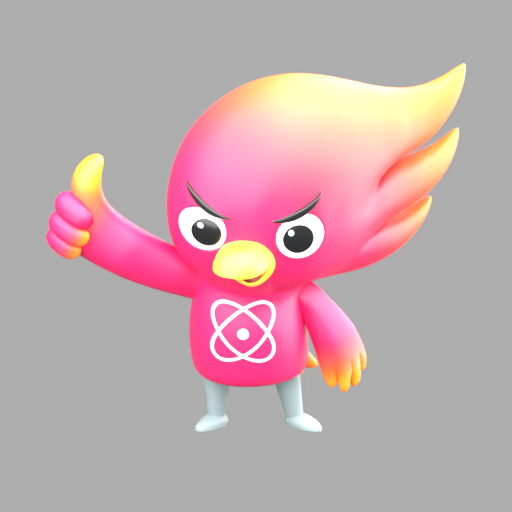
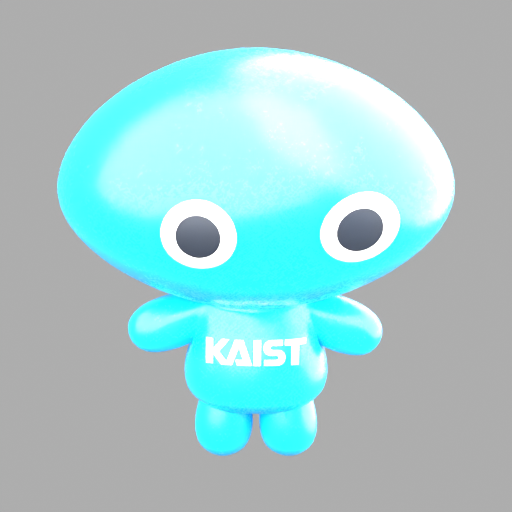
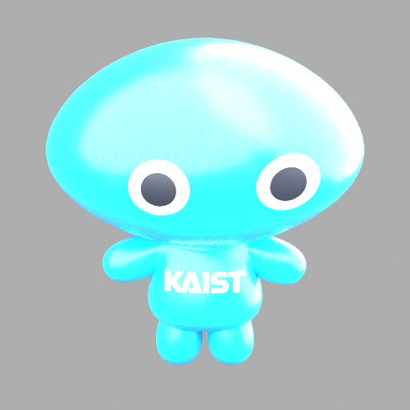
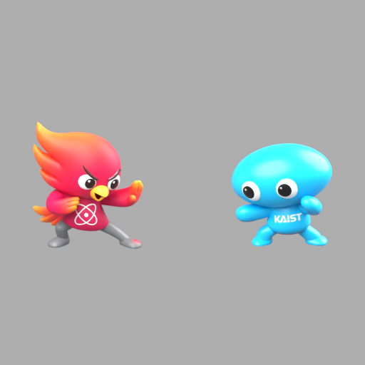

# AR 캐릭터 경량화 — 2026-11-17 / #438

사용자 요청: 외형을 최대한 유지하며 메시·텍스처와 렌더링 비용을 줄이고 iPhone에 반영한다.

## 적용 범위

AR 마스코트 8종은 `Resources/ARModels/ar-*.usdz` 사본을 사용한다. `Resources/Characters`와 `Wardrobe` 원본은 보존한다. 원본 마스코트 3종은 본 앱 리소스 포함에서 제외하고 경량 사본을 포함한다. 의상 원본은 기존 옷장·카드·공개 오이 조립에 계속 필요하다. 지도에서 선택한 사용자 오이의 `ARCameraSubject.loadModel`은 기존 경로를 유지하므로 모든 사용자 의상이 자동으로 경량화됐다는 뜻은 아니다.

| 캐릭터 | 원본 삼각형 | AR 삼각형 | 원본 파일 | AR 파일 |
| --- | ---: | ---: | ---: | ---: |
| 포닉스 | 1,928,847 | 200,000 | 60.91MiB | 9.11MiB |
| 넙죽이 | 97,608 | 97,608 | 13.52MiB | 3.39MiB |
| 포닉스 vs 넙죽이 | 196,440 | 119,999 | 11.69MiB | 6.71MiB |
| 공룡 오이 | 100,000 | 100,000 | 10.88MiB | 10.48MiB |
| 고양이 오이 | 99,999 | 99,999 | 11.10MiB | 10.61MiB |
| 야구복 오이 | 100,000 | 100,000 | 10.65MiB | 9.97MiB |
| 농부 오이 | 99,999 | 99,999 | 11.08MiB | 10.42MiB |
| 운동복 오이 | 99,999 | 99,999 | 10.85MiB | 10.17MiB |

포닉스·대결 메시만 Blender collapse decimation으로 줄였다. 원본 USD 노드·변환·재질 네트워크를 유지하면서 points/indices/normals/UV를 교체한다. UV와 법선의 이음새를 보존해 정점을 분리한 뒤 원본과 같은 vertex 속성 형식으로 압축한다. 탄젠트와 handedness도 미리 계산해 저장한다. 중간 face-varying 버전은 사용하지 않는다. 바운딩 박스 변화는 포닉스 원본 높이 1.5m에서 최대 약 0.12mm다. 이것은 모든 표면의 최대 오차 보장이 아니다.

텍스처는 색상 최대 2048px, 법선 1024px, 거칠기·금속성 512px로 조정한다. 전체 외형·얼굴을 새로 생성하거나 색상 텍스처를 다시 그리지 않는다. 작은 표면 요철·광택 표현은 달라질 수 있다. USDZ 저장 크기와 GPU 메모리는 같은 지표가 아니다.

## 원본 / 경량 외형 비교

동일한 Blender 카메라·조명·512px·Cycles 12 samples에서 0/120/240도 렌더링했다. 아래는 정면 비교다. RealityKit의 실제 AR 카메라 합성·화면 밝기까지 동일함을 보장하는 검사는 아니다.

| 원본 | AR 경량 사본 |
| --- | --- |
|  |  |
|  |  |
|  |  |

## 렌더링 변경

- AR 카메라의 30fps 형식 선택을 위치 모드에도 적용한다. 지원 형식 중 기본 해상도 이하인 것을 선택하며 지원하지 않으면 기본 형식을 사용한다. RealityKit 렌더 FPS 자체를 30으로 강제하는 변경은 아니다.
- 모션 블러·심도·카메라 그레인을 모든 배치 모드에서 끈다. 색상·HDR·조명 세기는 유지한다.
- 조명 입력이 동일하면 재적용하지 않으며, 그림자 사용 여부가 바뀔 때만 shadow component를 재설정한다. 핀치·비율·필터 변경 때 불필요한 광원 갱신을 줄인다.
- 회전은 기존 transform 갱신 경로를 유지한다. 손 인식은 기존 단일 작업·640px·12Hz와 저전력/열 상태 제한을 유지한다.
- 사진 결과/화면 종료/앱 비활성 시 분석·위치 추적·애니메이션을 멈추고 렌더러를 분리하는 경로를 유지한다.

## 재생성·검증

Blender 4.5.9 및 번들 OpenUSD 25.2, macOS `sips` 사용:

```sh
/Applications/Blender.app/Contents/MacOS/Blender --background --factory-startup --python apps/ios/Tools/optimize-ar-assets.py
```

`OI_RESOURCES`, `OI_AR_WORK`로 경로를 지정할 수 있다. 원본을 보존하고 ARModels만 다시 쓴다. [자산 manifest](ar-lightweight/asset-manifest.json)에 파일 크기·삼각형·텍스처 상한·SHA-256을 기록했다.

`Lightweight.xcresult` iOS 27.2 Simulator 6개 검사 통과: 마스코트 3종·의상 5종 실제 로드/바닥·높이 정규화, 투명 썸네일, 회전 중 상태 제한, 손바닥 세션 옵션, 위치 권한/방향 정렬, 중단 시 렌더러 분리·복귀. 원본 파일은 수정하지 않았다. 사용자 의상 전체·장시간 배터리·모든 iPhone의 발열 부재를 검증한 결과가 아니다.

## 최종 실기기 비교 — 2026-11-17 20:39 KST

Jun iPhone(iPhone 17, iOS 26.7.3), Release, Metal System Trace + Activity Monitor 100초. 동일 카메라·광원·배치 모드에서 포닉스를 25cm 높이·앞쪽 65cm의 고정 위치에 표시했다. 손 인식은 잠근 상태이며 실제 손 추적/현장 바닥 인식의 성능 검사가 아니다. 원본→경량→원본→경량을 각 15초 표시하고 화면 종료를 기록했다. 각 전환 직후 2초·마지막 1초는 제외했고 trace에 기록된 시간만 사용했다.

| 상태 | 앱 CPU 평균 | 앱 GPU 실행 / 관찰 시간 | 구간 끝 앱 메모리 |
| --- | ---: | ---: | ---: |
| 원본 1 | 42.13% | 3.774초 / 10.320초 | 525.97MiB |
| 경량 1 | 46.60% | 3.622초 / 12.652초 | 452.24MiB |
| 원본 2 | 42.63% | 4.774초 / 12.319초 | 529.75MiB |
| 경량 2 | 45.28% | 3.378초 / 12.035초 | 456.63MiB |
| 화면 종료 | 0.43% | 0건 / 7.007초 | 415.24MiB |

원본·경량 두 구간씩을 관찰 시간으로 가중하면 앱 GPU 실행 구간의 겹침을 합친 시간은 초당 약 0.378초→0.284초로 약 25% 감소했다. **이 비율은 기기 전체 GPU 사용률·전력 사용률이 아니다.** 메모리는 구간 끝 값 평균 약 528→454MiB였으나 같은 프로세스에서 모델을 교체한 측정이라 캐시·자원 정리의 영향을 포함한다.

**CPU 평균 감소는 확인하지 못했다.** 최종 경량 구간은 원본보다 약 3~4.5%p 높게 관찰됐다. 모델별 렌더러 내부 처리 비용이나 전체 CPU 전력 개선을 이 검사만으로 단정하지 않는다. 조명 갱신 생략은 조작 중 불필요한 상태 적용을 줄이는 코드 변경이며 이 정적 모델 비교는 그 효과를 분리 측정하지 않는다. 프레임 속도를 비공개 API로 강제 제한하지 않았다.

열 상태 표본은 모든 구간에서 Nominal이었다. 장시간 발열 부재·배터리 개선·모든 기기에서의 같은 효과를 보장하지 않는다. 이번 GPU·메모리 개선은 포닉스 고정 표시 조건에 대한 결과다. 이전 손 추적 실험과는 조건이 달라 CPU 수치를 직접 비교하지 않는다.

최종 자산의 정점 재배치 전후 모든 삼각형 모서리의 위치·법선·UV 값 오차가 0임을 별도 검사했다. 최종 vertex 형식의 마스코트 3종·의상 5종 로드/정규화와 회전 회귀 3개를 다시 통과했다(`PackedLightweight.xcresult`). `usdchecker` 8개 통과; 기존 3종 재질의 occlusion 상수 경고는 원본 표현을 유지했다. 손바닥·카메라 수명 주기 Swift 검사도 통과했다. 최종 일반 Release 앱의 서명 검증·Jun iPhone 설치/실행을 확인했다. 측정용 원본 포닉스·진입 화면·배치 코드는 최종 앱과 작업 소스에서 제거했다.

원본 기록은 로컬 `/private/tmp/oi-ar-lightweight/packed.trace`, `packed-events.jsonl`, `packed-summary.json`, `repack-validation.json`에 있다. 사용자 영상·손 이미지·위치 좌표는 기록하지 않았다.
