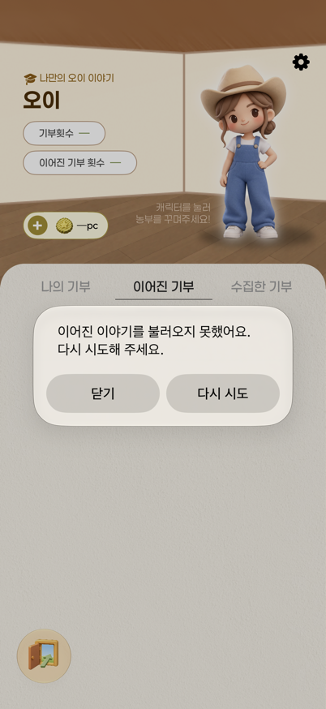
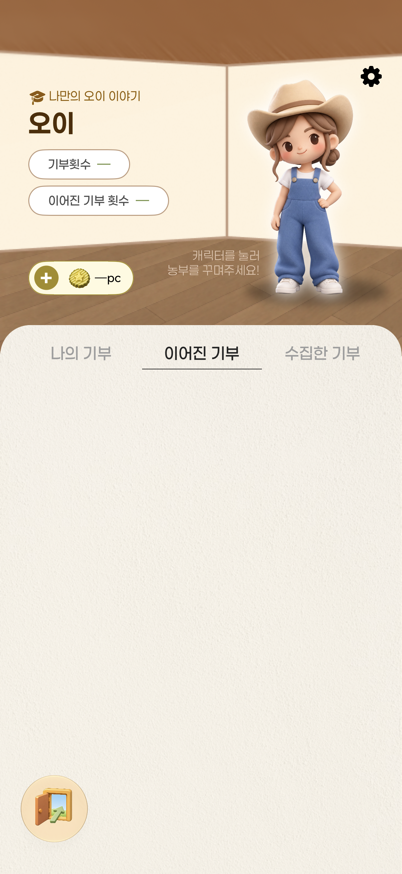

# MY 이어진 기부의 오류 분기와 조회 실패 — #499

## 확인한 원인

MY는 `OiContinuationList.emptyContent`를 성공한 0개 목록에만 적용했다. 404를 미지원으로 변환하거나 다른 오류가 발생하면 부모 이야기 상세용 제목·설명·`ContentUnavailableView`가 MY 안에 표시됐다. 이전 Figma 검사는 200 / 빈 목록만 제공해 이 분기를 놓쳤다.

2026-11-18 운영 52gibu의 최근 24시간 로그에서는 `POST /rest/v1/rpc/oi_story_continuations`의 405가 반복됐다. 같은 시각 PostgreSQL 로그는 `cannot execute SELECT FOR SHARE in a read-only transaction`이었다. 운영 함수는 존재하며 저장소와 본문 해시가 같았다.

`oi_story_continuations`는 STABLE인데, 로그인한 수신 목록 경로는 `oi_actor()`의 계정 멤버십 `FOR SHARE` 잠금을 사용한다. PostgREST는 POST라도 STABLE 함수를 READ ONLY로 실행하므로 SQLSTATE 25006 / HTTP 405가 발생한다. 공개 부모 조회는 이 잠금을 통과하지 않아 성공할 수 있었다. [PostgREST의 실행 모드 표](https://docs.postgrest.org/en/stable/references/transactions.html#access-mode-on-functions)

## 수정

- MY 전용 표시에서는 성공한 0개 목록에만 Figma `6101:7974`의 원래 빈 화면을 쓴다.
- 로딩·실패·미지원·항목 표시에서 공통 제목·납입 설명·기본 빈 상태 UI를 제거한다. 실패는 기존 오류 문구와 시스템 경고의 다시 시도·닫기로 전달한다.
- 부모 이야기 상세의 기존 목록 표현은 유지한다. 실패를 0개 응답으로 바꾸지 않는다.
- 새 마이그레이션은 해당 RPC 하나만 VOLATILE로 바꿔 POST를 READ WRITE 트랜잭션에서 실행하게 한다. 원본 본문 해시·함수 속성을 먼저 확인하며 본문·권한·계정 잠금·검색 경로는 보존한다.
- 마이그레이션 적용 후 PostgREST 스키마 캐시를 갱신한다. 서버 수정은 기존 앱에도 적용할 수 있으며, MY 오류 UI 수정은 새 앱이 필요하다.

## 검증

DB 검사는 psql의 기본 쓰기 트랜잭션만으로 검사하지 않고, 함수 volatility에 따라 실제 PostgREST 실행 모드를 재현한다. 수정 전 READ ONLY의 25006 실패, 수정 후 정상 수신 목록과 익명·구세션·탈퇴 차단을 검사한다. 함수 본문·권한·다른 속성의 동일성, drift 실패의 롤백과 재적용 안전성도 검사한다.

```sh
python3 supabase/tests/run-account-merge-db-checks.py
git diff --check
```

전체 DB 회귀 검사는 양쪽 스키마 이력에서 exit 0이었다. 작업용 PostgreSQL은 검사 직후 정상 종료했고 PID·소켓·임시 폴더 제거 및 프로세스 부재를 확인했다.

UI 회귀는 404·405·503·기능 미지원·보류 중인 요청·재조회 성공과 기존 Figma 빈 화면을 검사한다. 실패 당시 count는 미확정으로 유지되며 200 / 0개 응답에서만 빈 상태가 확정돼야 한다. 캡처 창은 key window를 바꾸지 않고 숨김 창까지 scene에서 분리한다.

Xcode 27.1 / iOS 27.0에서 아래 최종 검사가 **4 tests / 0 failures / TEST SUCCEEDED**로 통과했다. 실제 기기·실제 계정의 서버 재시도는 수행하지 않았다.

```sh
DEVELOPER_DIR=/Applications/Xcode.app/Contents/Developer xcodebuild -project apps/ios/OiDonation.xcodeproj -scheme OiFlowChecks -configuration Debug -destination 'platform=iOS Simulator,id=C79675EB-2B63-45B2-B265-727CE452698C' -derivedDataPath /private/tmp/benchmark-my-481-build -resultBundlePath /private/tmp/benchmark-continuation-499-recheck.xcresult CODE_SIGNING_ALLOWED=NO -parallel-testing-enabled NO -maximum-concurrent-test-simulator-destinations 1 -test-timeouts-enabled YES -default-test-execution-time-allowance 120 -only-testing:OiDonationTests/OiStoryContinuationTests/testMYContinuationFailuresKeepTheFigmaPanelAndRetryOnlyProducesEmptyAfterSuccess -only-testing:OiDonationTests/OiStoryContinuationTests/testMYContinuationLoadingDoesNotShowEmptyOrSharedHeadings -only-testing:OiDonationTests/OiStoryContinuationTests/testRPCUsesPublicReadAuthenticatedInboxBlockedFilterAndStableCursor -only-testing:OiDonationTests/OiFigmaFidelityVisualTests/testMYV4Captures test
```

## 화면 검증 자료

| 시스템 오류 경고 | 경고를 닫은 MY 패널 | 200 / 0개로 복구 후 |
| --- | --- | --- |
|  |  |  |

위 캡처는 가상 서버 응답을 사용하는 테스트 화면이다. 공통 안내 UI를 끼워 넣지 않으며, 실패 후 패널을 성공한 빈 상태로 표시하지 않는다. 공유 검증 시뮬레이터는 별도 #500 검증까지 순차 재사용한 뒤 종료·삭제했고 앱·빌드·테스트 프로세스와 숨김 캡처 창이 남지 않았음을 확인했다. 최대 동시 작업 소유 실행 그룹은 3개였다.

## 운영 적용 상태

운영 함수의 본문 MD5 `b7c004e3c32c7f85bfe126e6c60e8e2f`와 검색 경로가 마이그레이션 guard와 일치함을 읽기 전용으로 확인했다. 운영 DB 변경은 별도 적용 확인 대기이며 아직 수행하지 않았다. 실제 계정의 HTTP 수신 목록 성공과 실기기 재시도는 미검증이다.
