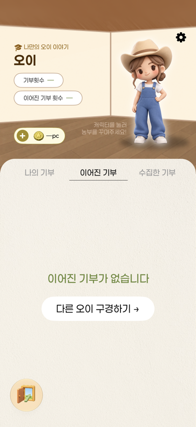
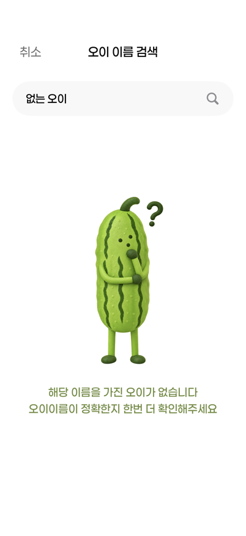

# 조회 실패의 빈 화면과 이어진 기부 수신 조회 수정 — #499

2026-11-18 사용자 확정: 조회·목록을 불러오지 못하면 별도 오류 화면이나 경고창을 만들지 않고 해당 화면의 기존 Figma 빈 상태를 재사용한다. 내부 실패 상태와 실제 데이터·권한 검사는 유지한다.

## 확인한 원인

MY는 `OiContinuationList.emptyContent`를 성공한 0개 목록에만 적용했다. 404를 미지원으로 변환하거나 다른 오류가 발생하면 부모 이야기 상세용 제목·설명·`ContentUnavailableView`가 MY 안에 표시됐다. 검색·알림·카드 요청 등의 조회 실패도 성공한 빈 목록과 다른 오류 UI를 표시했다. 기존 정상 응답과 빈 목록 중심의 화면 검증에서 이 분기를 놓쳤다.

2026-11-18 운영 52gibu의 최근 24시간 로그에서는 `POST /rest/v1/rpc/oi_story_continuations`의 405가 반복됐다. 같은 시각 PostgreSQL 로그는 `cannot execute SELECT FOR SHARE in a read-only transaction`이었다. 운영 함수는 존재하며 저장소와 본문 해시가 같았다.

수정 전 `oi_story_continuations`는 STABLE로 선언되어 있었다. 로그인한 수신 목록 경로는 `oi_actor()`의 계정 멤버십 `FOR SHARE` 잠금을 사용하는데, PostgREST는 POST라도 STABLE 함수를 READ ONLY로 실행하므로 SQLSTATE 25006 / HTTP 405가 발생했다. 공개 부모 조회는 이 잠금을 통과하지 않아 성공할 수 있었다. [PostgREST의 실행 모드 표](https://docs.postgrest.org/en/stable/references/transactions.html#access-mode-on-functions)

## 화면 적용 범위와 보존 조건

| 화면 | 조회 실패 시 표시 |
| --- | --- |
| MY 나의 기부·수집한 기부·이어진 기부 | 각 탭의 기존 Figma 빈 화면. 이어진 기부는 `6101:7974`의 원본 빈 상태를 재사용한다. |
| 다른 이용자의 MY | 기존 이용 불가 화면을 재사용한다. |
| 이야기 목록·농장 | 기존 빈 슬롯과 빈 목록을 재사용한다. |
| 이름·기부자·코드 검색 | 기존 검색 결과 없음 이미지·문구·배치를 재사용한다. |
| 지도 알림함·카드 요청 | 기존 빈 알림·빈 요청 화면을 재사용한다. |
| 지도 구역 목록·건물 쪽지 | 기존 공개 오이 없음·첫 이야기 안내를 재사용한다. |

- 실패를 성공한 0개 응답으로 변환하지 않는다. `hasLoaded`, 실제 오류, 미확정 개수와 잔액은 그대로 유지한다. 조회 실패만으로 0개·0잔액을 확정하거나 기능을 허용하지 않는다.
- 이미 읽은 행이 있으면 보존한다. 실패한 새로고침이나 추가 페이지 조회가 캐시 행·페이지 커서를 지우지 않는다.
- 로딩은 기존 진행 표시를 사용하고, 재조회와 화면 재진입으로 복구할 수 있다. 실패를 보여 주기 위한 새 배너·시스템 경고·기본 오류 화면은 추가하지 않는다.
- 인증·재인증·권한·입력 검증·저장·등록·삭제·수락·거절·처리 결과 미확인 안내는 이 조회 표시 정책과 구분한다. 미확인 요청의 복구 동작과 수락·거절 차단 조건을 유지한다.
- 건물 쪽지는 `loadError`와 등록·삭제의 `error`를 분리한다. 읽기 성공이나 실패가 작성 초안·미확인 전송 ID·등록 및 삭제 오류를 지우지 않는다.
- 화면의 원본 이미지·글꼴·색·여백은 바꾸지 않는다. 이번 UI 변경은 새 앱에 포함돼야 적용된다.

## 서버 수정과 운영 적용

`supabase/migrations/20261118081159_oi_continuation_rpc_transaction_mode.sql`은 원본 본문 MD5 `b7c004e3c32c7f85bfe126e6c60e8e2f`와 함수 속성을 검사한 뒤 해당 RPC만 VOLATILE로 바꾸고 PostgREST 스키마 캐시를 갱신한다. 본문·권한·계정 잠금·검색 경로는 보존한다.

사용자 승인 후 2026-11-18 운영 52gibu에 Supabase MCP `apply_migration`으로 적용했다. 운영에 등록된 이력 버전 `20261118081159`를 기준으로 저장소 파일명을 맞췄다. 적용 전후 `pg_proc` 비교에서 RPC의 `provolatile`만 `s`에서 `v`로 바뀌었으며 `oi_actor()`의 전체 `pg_proc` 행은 같았다.

운영 검증 결과는 다음과 같다.

- 기존 유효 계정 멤버를 사용해 transaction-local claims와 `SET LOCAL ROLE authenticated`를 설정한 SQL 트랜잭션에서 수신 목록 호출이 성공했다. `items`가 배열이고 `total`이 숫자인지만 확인한 뒤 `ROLLBACK`했다. 계정·이야기·읽음 기록을 생성하거나 바꾸지 않았으며 사용자 식별자와 항목 내용은 출력하지 않았다.
- 실제 익명 HTTP `POST /rest/v1/rpc/oi_story_continuations`에서 존재하지 않는 부모 `00000000-0000-0000-0000-000000000000`를 조회해 HTTP 200, `items: []`, `total: 0`을 확인했다.
- 실제 사용자 JWT로 호출한 HTTP 수신 목록과 실기기 재시도는 미검증이다. 인증 역할의 SQL 호출 성공을 이 검증의 대체로 기록하지 않는다.

서버 트랜잭션 모드 수정은 기존 앱에도 적용된다. 이 서버 수정과 별도로 조회 실패 화면 변경은 새 앱 배포가 필요하다.

## 검증 상태

```sh
python3 supabase/tests/run-account-merge-db-checks.py
```

최종 파일명 `20261118081159`가 포함된 전체 DB 회귀 검사는 저장소 이력·배포 호환 이력 양쪽에서 exit 0이었다. 함수 volatility로 PostgREST의 실행 모드를 재현해 수정 전 READ ONLY의 SQLSTATE 25006, 수정 후 수신 목록 성공, 익명·구세션·탈퇴 차단을 검사한다. RPC의 의도한 volatility 외 전체 카탈로그 속성과 `oi_actor()`의 동일성, drift 거절·롤백·재적용 안전성도 확인한다. 검사 후 작업용 PostgreSQL 종료를 확인했다.

Xcode 27.1 / iPhone 17 Simulator(iOS 27.0)에서 App·App Clip을 빌드하고 관련 **41개 검사, 실패 0개**를 확인했다. 실패와 기존 빈 화면의 실제 픽셀 일치, 캐시 행·미확정 개수·등록 및 삭제 오류 보존, 요청 처리 안전장치와 재조회 복구를 검사한다.

첫 통합 실행은 40개 중 3개가 실패했다. 알림 실패 후 자동 재시도 누락을 보완했으며, 지도 검사 2개는 #478의 공개 이야기 기반 마커에 맞는 자료를 주입하고 선택 중 해제·종료 후 마커 복원 계약을 검사하도록 수정했다. 단언을 제거하거나 검사를 건너뛰지 않았다.

```sh
DEVELOPER_DIR=/Applications/Xcode.app/Contents/Developer xcodebuild -project apps/ios/OiDonation.xcodeproj -scheme OiFlowChecks -configuration Debug -destination 'platform=iOS Simulator,id=B9BEEE32-97B2-4FC6-BA81-22527061CE64' -derivedDataPath /private/tmp/benchmark-my-481-build -resultBundlePath /private/tmp/benchmark-read-empty-499-final.xcresult CODE_SIGNING_ALLOWED=NO -parallel-testing-enabled NO -maximum-concurrent-test-simulator-destinations 1 -test-timeouts-enabled YES -default-test-execution-time-allowance 120 -only-testing:OiDonationTests/OiStoryContinuationTests -only-testing:OiDonationTests/CampusBuildingNotesTests -only-testing:OiDonationTests/OiFigmaFidelityVisualTests/testCampusNotificationInboxCaptures -only-testing:OiDonationTests/OiFigmaFidelityVisualTests/testCardRequestInboxCaptures -only-testing:OiDonationTests/OiFigmaFidelityVisualTests/testStoryListReadFailureReusesEmptySlotsWithoutResolvingSeedBalance -only-testing:OiDonationTests/OiFigmaFidelityVisualTests/testCampusSearchReadFailureReusesNoMatchesArtwork -only-testing:OiDonationTests/OiFigmaFidelityVisualTests/testPublicMYReadFailureReusesUnavailableArtwork -only-testing:OiDonationTests/OiFigmaFidelityVisualTests/testCampusSearchStatesDoNotConfusePromptFailureAndEmptyResults -only-testing:OiDonationTests/OiFigmaFidelityVisualTests/testMYV4Captures -only-testing:OiDonationTests/OiFigmaFidelityVisualTests/testFarmCapturesWithOfflineOwnedStory -only-testing:OiDonationTests/OiRemoteStoreTests/testBoundedMetricsOnlyFallbackForMissingRPCAndStopReadingHiddenStories -only-testing:OiDonationTests/OiRemoteStoreTests/testCampusNotificationSheetAutomaticallyRecoversFromFailedLoad -only-testing:OiDonationTests/OiRemoteStoreTests/testV4CardDecisionSurvivesLostResponseAndIsScopedToAccount -only-testing:OiDonationTests/OiRemoteStoreTests/testFarmerOutfitReceiptSurvivesRefreshFailure test
```

마지막 전경 재진입 보호 변경 후 이어진 기부 **13개 검사, 실패 0개**를 다시 확인했다. 진행 중인 같은 조회는 재진입만으로 중복 실행하지 않는다.

```sh
DEVELOPER_DIR=/Applications/Xcode.app/Contents/Developer xcodebuild -project apps/ios/OiDonation.xcodeproj -scheme OiFlowChecks -configuration Debug -destination 'platform=iOS Simulator,id=B9BEEE32-97B2-4FC6-BA81-22527061CE64' -derivedDataPath /private/tmp/benchmark-my-481-build -resultBundlePath /private/tmp/benchmark-read-empty-499-flight.xcresult CODE_SIGNING_ALLOWED=NO -parallel-testing-enabled NO -maximum-concurrent-test-simulator-destinations 1 -test-timeouts-enabled YES -default-test-execution-time-allowance 120 -only-testing:OiDonationTests/OiStoryContinuationTests test
git diff --check
```

작업 소유 실행 그룹은 이번 확장 검증에서 최대 2개(검사기·시뮬레이터), 이 작업 전체에서 최대 3개였다. 임시 DB 검사기는 각 실행 후 자체 종료했으며 PID·소켓 제거를 확인했다. 마지막 테스트 후 검사기·앱 프로세스 부재와 작업 시뮬레이터 `B9BEEE32-97B2-4FC6-BA81-22527061CE64` 삭제를 프로세스 목록과 `simctl list devices`로 확인했다. 작업용 서비스 설정 symlink도 제거했다. 캡처 helper의 가시/숨김 창 분리 단언이 통과했고, Computer Use 세션·커서·브라우저·승인 터미널은 만들지 않았다. 남긴 실행 리소스는 없다.

## 화면 검증 자료

가상 API 응답으로 만든 실제 SwiftUI 캡처다. MY 오류/정상 빈 상태의 원본 종이 패널, 검색 3개 모드, 알림·요청·농장·이야기 목록의 렌더 동일성 검사를 통과했다.

| MY 조회 실패 | MY 정상 빈 응답 | 이름 검색 조회 실패 |
| --- | --- | --- |
|  |  |  |
