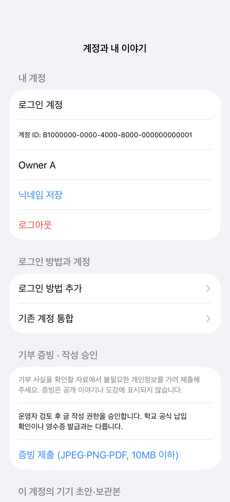
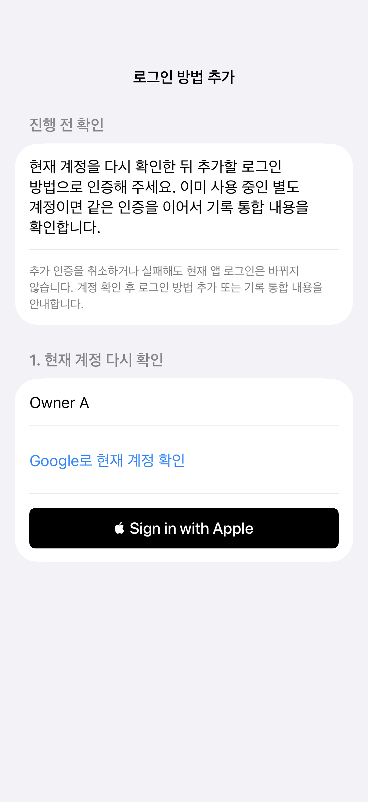
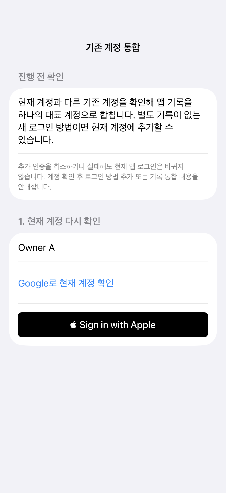

# 앱 전역 fail-safe 점검 — 2026-11-03

관련 이슈: #123, #124. 기준은 `develop`의 실제 실행 경로다. 코드·장애 주입·컴파일·실기기 증거를 구분한다. 실제 사용자의 세션·증빙·기록을 개발 검증을 위해 변경하지 않는다.

## 확인한 결함과 보완

| 경로 | 실제 실패 | 보완 및 회귀 검사 |
| --- | --- | --- |
| 로그인 재진입 | 작업 진행 중 재진입을 설정 누락으로 표시 | busy와 API 존재를 분리, 실제 Store 검사 |
| 로그인 취소 | 정상 브라우저 취소가 전역 연결 경고로 남음 | CancellationError 정규화, 현재 세션 보존 |
| 화면 비활성화 | URLSession의 취소를 일반 연결 오류로 표시 | Foundation·URLSession 취소 공통 판별 |
| 인증 Task 취소 | continuation·진행 상태가 callback까지 남음 | 시도별 단일 종료, 브라우저 취소·핸들 해제, 늦은 성공 거절 |
| 오류 재시도 | 성공 재조회 뒤 오래된 오류가 계속 남음 | 오류 revision으로 이전 오류만 해제, 새 저장 오류 보존 |
| 기기 초안 | 손상 JSON 하나가 전체 목록을 막음 | 손상 파일별 격리·경고·원본 보존, 실제 I/O 실패는 표시 |
| 편집기 복원 | 복원 실패 뒤 편집·저장·정상 나가기 막힘 | 복원 재시도와 원본을 덮어쓰지 않는 나가기 |
| 녹화 export | 변환 실패·백그라운드 취소에도 정상 raw 원본 삭제 | 앱 전용 영구 보관, 정상 export 뒤만 삭제, 명시적 원본 저장·공유·삭제 |
| 앱 계정 통합 | Auth ID와 앱 소유자를 같게 취급하면 기존 사진·승인 조회 실패 | canonical ID 분리, 원래 Storage 소유자 보존, 기기 초안 충돌 경고·원본 보존 |

## 점검한 영역

인증·키체인 저장·세션 갱신·로그아웃·계정 전환, 공개·개인 데이터 조회와 저장, 증빙 중단 재시도, 이야기·사진·초안 보관, AR 카메라의 진입·복귀·권한·중단, 영상 내보내기, NFC 요청 검증, App Clip 진입·수집 모델을 확인했다. 기존 정책을 임의로 변경하거나 미정 수집 조건을 새로 정하지 않는다.

기존 AR lifecycle 검사는 fake recorder를 사용해 원본 삭제 결함을 잡지 못했다. 신규 영상 검사는 실제 파일 보존 helper와 실패·취소·store 재생성을 검사한다. App Clip의 기본 승인 host와 실제 콘텐츠 제공 여부는 별도 배포 설정이며, 비활성 경로의 코드 검사를 현장 수집 검증으로 표시하지 않는다.

## 검증 명령

```sh
DEVELOPER_DIR=/Applications/Xcode.app/Contents/Developer sh apps/ios/Tests/run-oi-service-checks.sh
DEVELOPER_DIR=/Applications/Xcode.app/Contents/Developer sh apps/ios/Tests/run-ar-recovery-checks.sh
DEVELOPER_DIR=/Applications/Xcode.app/Contents/Developer sh apps/ios/Tests/run-ar-camera-lifecycle-checks.sh
DEVELOPER_DIR=/Applications/Xcode.app/Contents/Developer sh apps/ios/Tests/run-app-clip-checks.sh
DEVELOPER_DIR=/Applications/Xcode.app/Contents/Developer sh apps/ios/Tests/run-draft-recovery-checks.sh
DEVELOPER_DIR=/Applications/Xcode.app/Contents/Developer sh apps/ios/Tests/run-draft-adoption-checks.sh
DEVELOPER_DIR=/Applications/Xcode.app/Contents/Developer sh apps/ios/Tests/run-ar-video-recovery-checks.sh
DEVELOPER_DIR=/Applications/Xcode.app/Contents/Developer sh apps/ios/Tests/run-apple-exchange-checks.sh
DEVELOPER_DIR=/Applications/Xcode.app/Contents/Developer sh apps/ios/Tests/run-account-connection-flow-checks.sh
npm --prefix supabase test
python3 supabase/tests/run-account-merge-db-checks.py
```

Store 회귀는 `OiFlowChecks`의 `OiRemoteStoreTests`로 검증했다. Simulator XCTest 25개가 실패·건너뜀 없이 통과했고, Node Edge 검사 56개와 격리 PostgreSQL 18 DB 검사도 통과했다. Xcode 27.1·iOS 27.0 Simulator를 사용했으며 프로젝트의 Swift 언어 모드와 배포 대상을 바꾸지 않았다.

실행한 전체 앱·App Clip·테스트 호스트 빌드 및 XCTest 명령은 다음과 같다. 검증 전용 Simulator는 검증 후 삭제했다. 실제 provider 인증과 서명된 기기 실행의 증거는 아니다.

```sh
DEVELOPER_DIR=/Applications/Xcode.app/Contents/Developer xcodebuild -quiet \
  -project apps/ios/OiDonation.xcodeproj -scheme OiFlowChecks -configuration Debug \
  -destination 'platform=iOS Simulator,id=3D1BAE24-6DF4-42B8-8831-909FE85E0E47' \
  -derivedDataPath /private/tmp/benchmark-failsafe-123-qa/build \
  -resultBundlePath /private/tmp/benchmark-failsafe-123-qa/final-tests.xcresult \
  CODE_SIGNING_ALLOWED=NO -parallel-testing-enabled NO \
  -maximum-concurrent-test-simulator-destinations 1 test
```

로컬 Deno 실행 파일은 없어 Edge Deno 타입 검사는 수행하지 못했다. CI의 `npm --prefix supabase run check`와 PostgreSQL 16 검사를 별도로 확인한다.

## 계정 화면 캡처

실제 Store에 테스트용 API·기기 저장소만 주입한 XCTest 호스트에서 375·402·440pt 폭을 렌더링했다. 실제 사용자 계정·증빙은 캡처하지 않았다. 아래는 402pt 기준이며 전체 폭별 이미지는 [검증 폴더](verification/failsafe-20261103)에 있다. 시스템 Apple 버튼의 언어는 Simulator의 시스템 언어를 따른다.





## 실기기 검증과의 경계

Needs confirmation:
- Apple Developer capability·갱신된 프로파일·Supabase Apple provider의 실제 설정과 계정 인증.
- ReplayKit이 정상 raw를 생성한 뒤의 백그라운드 만료·저장 공간 부족·복구 원본 재생. 파일 생성 전에 OS가 강제 종료한 녹화까지 복구된다고 보장하지 않는다.
- 실제 카메라·마이크·사진 보관함·NFC·AR의 현장 동작.

자동 검사가 통과해도 위 항목을 완료로 처리하지 않는다. 실제 계정 통합은 양쪽 재인증·미리보기·명시적 동의를 거친 경우에만 실행한다.
