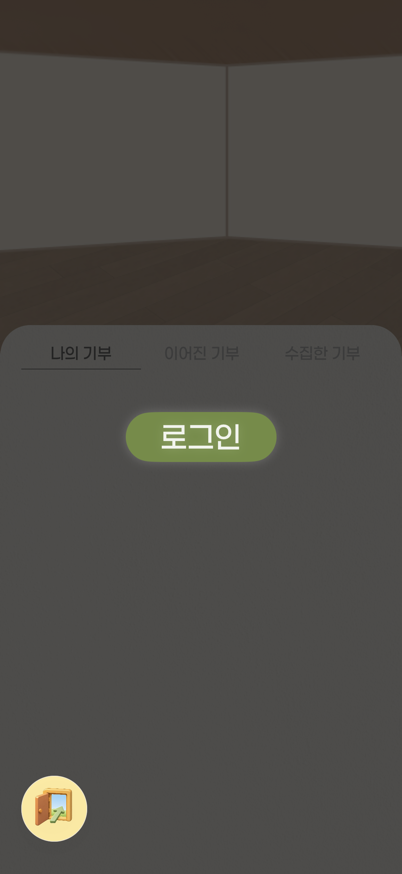
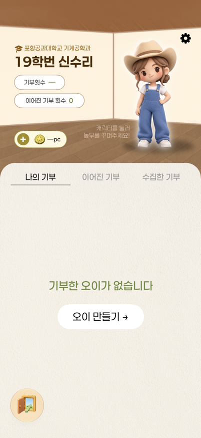
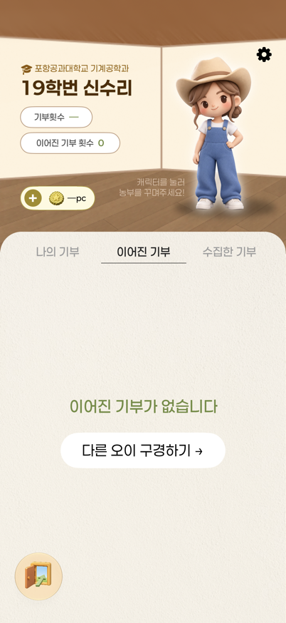
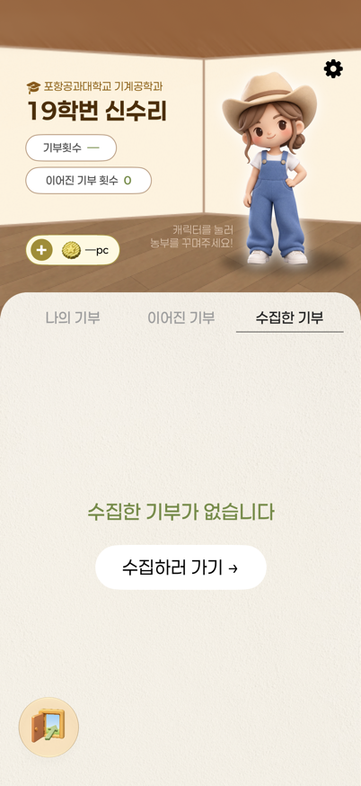

# MY 비로그인·빈 화면 Figma 원본 정합 — #481

2026-11-18 사용자 지정 화면을 Figma 원본과 대조했다. 비로그인은 전용 화면이 빠져 있었고, 세 기부 탭 빈 상태는 문구·버튼이 있어도 줄 높이·위치·밑줄이 원본과 달랐다. 네 상태의 구현과 원본 비교 검사를 보완했다.

## 디자인과 적용

파일: `nEDJaJBFrdzBCa1WcgADHH`. 기준 화면은 시스템 바를 포함한 402×874pt다.

| Figma 노드 | 상태 | 결과 |
| --- | --- | --- |
| [6079:7868](https://www.figma.com/design/nEDJaJBFrdzBCa1WcgADHH?node-id=6079-7868) | 비로그인 | 비어 있는 방·종이·나의 기부 탭 위에 #232323 / 80% 덮개와 중앙 로그인 버튼을 적용 |
| [6079:7945](https://www.figma.com/design/nEDJaJBFrdzBCa1WcgADHH?node-id=6079-7945) | 나의 기부 빈 상태 | 문구 (97,235,209,20), 버튼 (115,282,173,50) 적용 |
| [6101:7974](https://www.figma.com/design/nEDJaJBFrdzBCa1WcgADHH?node-id=6101-7974) | 이어진 기부 빈 상태 | 문구 (97,235,209,20), 버튼 (85,282,232,50) 적용 |
| [6101:7995](https://www.figma.com/design/nEDJaJBFrdzBCa1WcgADHH?node-id=6101-7995) | 수집한 기부 빈 상태 | 문구 (97,234,209,20), 버튼 (106,281,191,50) 적용 |

좌표는 402×549 종이 패널 내부의 (x,y,width,height)다. 원본 레이어를 읽어 문구 Paperlogy Medium22·tracking0.44·줄 높이20, 버튼 Regular20·tracking0.4·줄 높이20·좌우30/상하15 여백을 확인했다. 문구와 버튼 사이 간격은 27pt다. 선택 탭 밑줄은 원본 VECTOR의 회색 0.13916015625·두께0.5·중앙 정렬을 사용한다. 원본 종이 이미지와 번들 `MYProfilePaper`의 SHA-256은 `5b2f04ceae829b650e7e15dc7d1c56fa5fbf94dd1d6ba02feb53bfe86e76df6d`로 동일하다.

`MYProfileRoom`, `MYProfilePaper`, `MYExitDoor`와 Paperlogy 폰트를 재사용한다. 화면 이미지를 앱 배경으로 넣지 않는다. 로그인은 기존 `MYSettingsView`의 인증 진입으로 연결한다. 비로그인 배경의 프로필·농부·목록은 생성하지 않고 탭의 터치와 접근성 탐색을 막는다. 로그인과 나가기는 덮개 위에 남긴다. 나가기의 비로그인 배경은 Figma의 원래 fill·plus-lighter·luminosity 층으로 합성한다.

가로폭에 따라 방 높이를 맞추고 종이 패널은 남은 높이를 채운다. 로그인 버튼은 화면 중앙에 유지하며 글자 크기 설정에 따라 커진다. 비로그인은 어떤 탭 경로로 진입해도 나의 기부 탭을 표시한다. 로그인한 사용자의 프로필·목록·재인증 안내와 인증·서버 계약은 유지한다.

## 검증

Xcode 27.1 / iOS 27.0 Simulator에서 아래 명령이 exit 0, **2 tests / 0 failures**로 통과했다. 프로젝트의 iOS 26.2·Swift 언어 모드 5는 유지했다.

```sh
DEVELOPER_DIR=/Applications/Xcode.app/Contents/Developer xcodebuild -project apps/ios/OiDonation.xcodeproj -scheme OiFlowChecks -configuration Debug -destination 'platform=iOS Simulator,id=F6B0942A-1896-4F68-9C07-B7254FD38CFF' -derivedDataPath /private/tmp/benchmark-my-481-build -resultBundlePath /private/tmp/benchmark-my-481-empty-recheck.xcresult CODE_SIGNING_ALLOWED=NO -parallel-testing-enabled NO -maximum-concurrent-test-simulator-destinations 1 -test-timeouts-enabled YES -default-test-execution-time-allowance 120 -only-testing:OiDonationTests/OiFigmaFidelityVisualTests/testMYV4Captures -only-testing:OiDonationTests/OiFigmaFidelityVisualTests/testMYV4FigmaReferenceCapture test
git diff --check
```

- 402×874·375×667·440×956·accessibility5에서 실제 SwiftUI를 캡처했다.
- 원본 PNG 3개를 `OiDonationTests/Fixtures/MYV4Figma/empty-*.png`에 테스트 전용으로 보관했다. 실제 패널의 문구·버튼·버튼 글자·탭 밑줄 경계를 각 원본 PNG와 직접 비교한다. 모든 모서리 오차는 1pt 이내다. SwiftUI와 Figma의 글리프·도형 안티앨리어싱 경계에 최대 1pt 차이가 남으며 픽셀 완전 일치로 보고하지 않는다.
- 방 원본과 80% 덮개의 합성 픽셀로 프로필·농부 비노출을 검사했다. 중앙 녹색 로그인·밝은 글자·덮개 위 출구·어두운 종이도 검사했다.
- 비로그인 진입 탭의 동일 표시, 이전 계정 카드 비노출, 가상 인증의 로그인→로그아웃, 로딩·조회 오류·공개 프로필 경계를 검사했다.
- 캡처 창은 key window를 변경하지 않으며, 매 캡처 뒤 숨김 창까지 scene에서 분리됐는지 단언한다.
- 실제 Apple·Google 계정 인증 및 실기기 설치는 수행하지 않았다. 기존 Swift 5 동시성 경고와 SDK 진단은 이번 범위에서 변경하지 않았다.

## 캡처

가상 계정 자료를 사용했다. PNG는 원본 픽셀을 보존한 채 압축했다.

| 비로그인 | 나의 기부 | 이어진 기부 | 수집한 기부 |
| --- | --- | --- | --- |
|  |  |  |  |

[작은 화면](assets/my-481/my-v4-signed-out-375x667.png) · [큰 화면](assets/my-481/my-v4-signed-out-440x956.png) · [최대 글자 크기](assets/my-481/my-v4-signed-out-accessibility5.png)

## 리소스 정리

최대 동시 작업 소유 그룹은 3개(전용 시뮬레이터·검증 실행기·순차 캡처 창)였다. 검증 실행기는 종료됐고 캡처 창 정리 단언이 통과했다. 순서대로 사용한 전용 시뮬레이터 `9D1D3948-03C2-4116-A37C-7812B65E3B4A`와 `F6B0942A-1896-4F68-9C07-B7254FD38CFF`는 각각 검증 직후 종료·삭제 후 목록 및 프로세스 트리에서 제거를 확인했다. Computer Use 핸들과 사용자 데스크톱 창은 생성하지 않았다.
