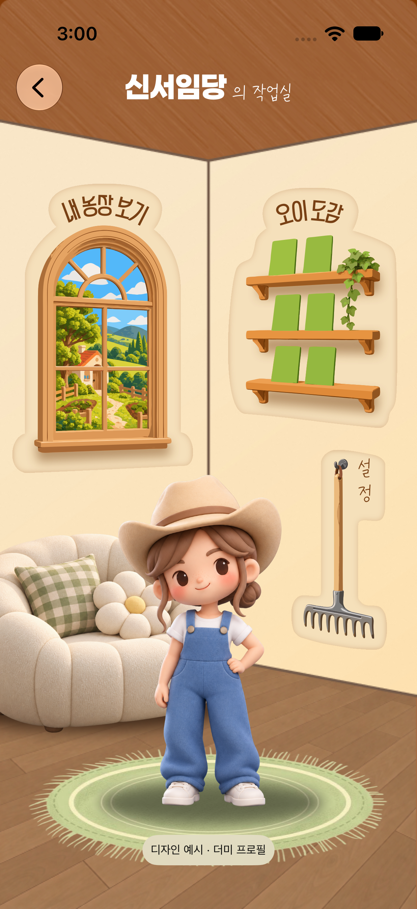
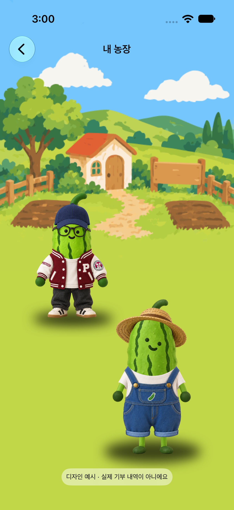
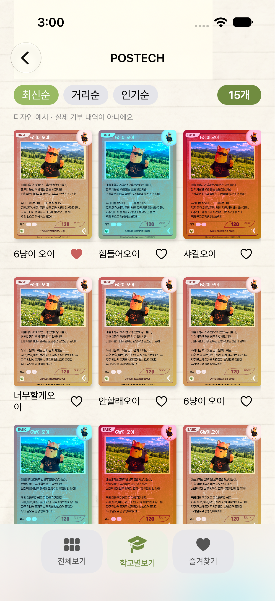

# MY 작업실 더미 화면 — #98

2026-10-28 사용자 요청 범위: 기본맵 좌측 하단 원형 `신서임당` → MY 작업실 → 내 농장·기부도감. `develop`의 3D 캠퍼스와 기존 기능을 유지한다.

## 구현

- 루트 `NavigationStack`이 `MYDestination` 이동을 관리한다. 작업실은 시트가 아닌 화면 이동이며, 뒤로가기로 기존 지도에 복귀한다.
- MY 경로 등록은 지도 소유자인 `HomeView`에 두어 기존 `openCamera()`의 지도 렌더러 해제 경로를 재사용한다. 설정 메뉴에서 카메라를 열 때 루트 경로를 비우고 전체 화면 카메라를 열어, 닫은 뒤 기존처럼 지도로 돌아온다.
- 작업실 창문은 내 농장, 책장은 기부도감, 갈퀴는 기존 프로필 메뉴를 연다. 촬영·사진 테스트·기존 참여 안내·기기 수집 목록을 유지한다.
- `MYDemoStore`는 화면 확인 전용 예시 카드 23개(POSTECH 15, 가상 애플대학교 8)를 제공한다. 폴더 그림의 개수와 일치시키며, 상단 개수는 현재 목록에서 계산한다. Figma 전체보기의 `11개`는 고정값으로 사용하지 않는다.
- 전체보기·학교별보기·학교 내부 목록·즐겨찾기, 최신순·가상 거리순·인기순, 카드 확대·이야기 표시를 제공한다. 즐겨찾기는 루트가 소유한 세션 메모리에만 유지하며 앱 재시작 시 초기화한다.
- 학교 내부에서 하단 분류를 누르면 해당 분류가 선택된 부모 도감으로 돌아온다. 선택한 분류는 같은 세션에서 유지한다.
- MY 더미 카드는 실제 지도 수집 기록, 기부자 권한, 증빙 승인, 학교 공식 납입 확인과 연결하지 않는다. 각 화면에 디자인 예시임을 표시한다.

## 디자인 자산과 적응형 배치

Figma 파일 `nEDJaJBFrdzBCa1WcgADHH`, 섹션 `2876:8320`:

| 자산 | 원본 노드 | 화면 내 기준 위치·크기 |
| --- | --- | --- |
| MYRoom | 2781:2305 | 부모 화면에서 잘린 원본 배경 402×874, 전체 화면 채움 |
| MYRug / MYSofa / MYSofaShadow | 2744:1735 / 2744:1843 / 2744:1849 | 원본 PNG·SVG를 기준 위치에 개별 합성 |
| MYSettingsBoard / MYRake | 2781:2622 / 2781:2621 | (281,432.5), 92×192 영역의 배경·갈퀴 |
| MYCollection | 2781:2073 | (220,180.5), 163×231 |
| MYFarmWindow | 2781:2074 | (12,176.5), 174×278 |
| OiFarmer / MYFarmerShadow | 2744:1741 / 2744:1740 | 기존 투명 농부 PNG (63,441), 264×352와 원본 그림자 |
| MYFarmBackground | 2781:2645 | 농장 상단 일러스트 402×462 |
| MYFarmPostech / MYFarmGardener / MYFarmShadowOne / MYFarmShadowTwo | 2876:8234 / 2876:8237 / 2876:8236 / 2876:8239 | 투명 오이 PNG와 원본 그림자를 개별 합성 |
| MYFolderBack / MYFolderFront / MYFolderMask | 2558:9946 / 2558:9948 / 원본 폴더 마스크 | 원본 SVG 레이어와 카드 이미지를 합성하고 현재 학교의 개수를 표시 |
| MYCollectionPaper | 2558:10111 | 학교별보기 종이 배경 원본 이미지 |
| MYSpaceCard | 2869:7197 | 전체보기 우주복 오이 카드 원본 이미지 |
| MYBasicCard / MYBlueCard / MYRedCard | 2558:10335 등의 카드 이미지 | 학교별 카드 원본 이미지 |

화면 전체 스크린샷을 앱 자산으로 사용하지 않는다. 위 개별 일러스트·카드만 로컬 Asset Catalog로 저장하고 임시 Figma URL을 런타임에서 참조하지 않는다. 새 Swift·이미지는 기존 파일 시스템 동기화 그룹을 통해 전체 앱 타깃에 포함되며 App Clip의 공유 소스 예외 목록은 수정하지 않는다.

Figma 그룹 export가 흰색 배경을 포함하는 것을 Simulator 캡처에서 발견해, 투명 원본 PNG와 원본 SVG 레이어로 교체했다. SVG는 경로·색을 수정하지 않고 PNG로 변환했으며 버튼의 창문·책장·갈퀴와 그림자의 비율을 유지한다. 러그는 Figma 원본의 359×122 표시 비율을 그대로 적용한다.

작업실은 일러스트 안에서 창문·책장·가구의 상대 위치가 중요하므로 402×874 기준 좌표를 사용한다. 실제 루트 크기를 고정하지 않으며 화면에 맞춰 일러스트를 균등 축소·확대하고 배경은 전체 화면을 채운다. 제목과 뒤로가기는 시스템 탐색 영역을 사용한다. 도감은 적응형 Grid·ScrollView로 작은 화면과 큰 글자를 수용하고, 버튼은 최소 44pt 영역을 제공한다. 시스템 상태 표시줄·홈 인디케이터를 그림으로 중복 표시하지 않는다.

Needs confirmation:
- 제목의 `페어 큰부리새` 글꼴 파일이 저장소에 없고 제목 노드의 Figma export·screenshot은 빈 이미지를 반환한다. 사용자는 2026-10-28 원본 글꼴 파일을 제공한 뒤 정확히 적용하기로 선택했다. 현재 Paperlogy/Griun 표시는 검증용 임시 상태이며 최종 글꼴 적용 완료로 간주하지 않는다. Regular·Light 원본 파일과 앱 임베딩 라이선스 확인 후 교체해야 한다.
- 농부 꾸미기의 화면·아이템 규격은 이번 요청에 포함되지 않았다. 캐릭터는 장식 이미지이며 Figma의 ‘캐릭터를 눌러주세요’ 문구를 동작 없이 노출하지 않는다.
- 설정 노드는 빈 프레임이므로 기존 메뉴를 그대로 연결한다. 새로운 설정 항목·로그인·서버 연동을 추가하지 않는다.

## 검증 명령

```sh
DEVELOPER_DIR=/Applications/Xcode.app/Contents/Developer sh apps/ios/Tests/run-my-checks.sh
DEVELOPER_DIR=/Applications/Xcode.app/Contents/Developer sh apps/ios/Tests/run-campus-checks.sh
DEVELOPER_DIR=/Applications/Xcode.app/Contents/Developer sh apps/ios/Tests/run-architecture-checks.sh
DEVELOPER_DIR=/Applications/Xcode.app/Contents/Developer xcodebuild \
  -project apps/ios/OiDonation.xcodeproj -scheme OiDonation -configuration Debug \
  -destination 'generic/platform=iOS Simulator' CODE_SIGNING_ALLOWED=NO build
```

MY 검사는 카드 ID 유일성, 학교 개수, 즐겨찾기 추가·해제·교집합, 정렬과 세션 격리를 확인한다. 실기기·실제 기부·인증·학교 데이터는 이 검증의 대상이 아니다.

### 2026-10-28 확인 결과

- Xcode 27.0, 저장소의 기존 Swift 언어 모드·deployment target을 유지했다. generic iOS Simulator Debug 빌드와 MY·campus·architecture 검사 스크립트가 통과했다.
- 임시 XCTest UI 타깃을 별도 프로젝트에 구성해 저장소의 `.pbxproj`를 수정하지 않고 검사했다. iPhone 17(402×874), iPhone SE 3세대(375×667), iPhone 17 Pro Max(440×956), iOS 27.0에서 MY → 농장 → 도감 → 즐겨찾기 → 학교 → 카드 확대·이야기 → 설정 → 지도 복귀를 확인했다. 각 실행은 실패 0건이다.
- 최종 iPhone 17 UI 검사에는 학교 내부 분류에서 전체 도감으로 복귀, 설정 메뉴의 AR 카메라 진입·닫기·지도 복귀도 포함했다. Simulator에서 화면 이동을 검사한 것이며 실제 카메라 영상·AR 추적을 검증한 것은 아니다.
- 원본 글꼴 적용은 파일 수령 대기다. 아래 캡처의 제목·설정 글자는 임시 글꼴이며 최종 디자인 승인 자료로 간주하지 않는다.
- 원본 자산과 목록 참조를 검사했고 임시 Figma URL·새 패키지·개인 서명 설정은 추가하지 않았다. 기존 `StoryRepository`의 non-final Sendable 경고는 그대로 남아 있다.

임시 UI 검사에 실제 사용한 명령:

```sh
DEVELOPER_DIR=/Applications/Xcode.app/Contents/Developer xcodebuild \
  -project /private/tmp/benchmark-my-98-qa/OiDonation.xcodeproj -scheme MYQA \
  -configuration Debug \
  -destination 'platform=iOS Simulator,id=8AE132F6-6418-485B-94BD-8A378AEF3695' \
  -parallel-testing-enabled NO -derivedDataPath /private/tmp/benchmark-my-98-build \
  -resultBundlePath /private/tmp/benchmark-my-98-qa/final.xcresult CODE_SIGNING_ALLOWED=NO test
```

초기 임시 프로젝트 설정 오류(테스트 산출물 이름·Info.plist 상대 경로)를 수정한 뒤 성공했다. 제한 환경의 Swift 매크로 실행 오류는 동일 검사 스크립트를 적절한 권한으로 실행해 해소했다. 생성한 세 QA 기기는 각 검사 후 종료·삭제했다. 테스트 앱은 XCTest의 종료 정리로 중지했고, 마지막 프로세스·기기 조회에서 남은 QA 앱·실행 기기가 없음을 확인했다. Computer Use 핸들·사용자 창은 생성하지 않았다. 최대 동시 작업 리소스는 세 그룹(빌드·테스트 실행기, 전용 Simulator, 테스트 앱)이며 의도적으로 남긴 실행 리소스는 없다.




