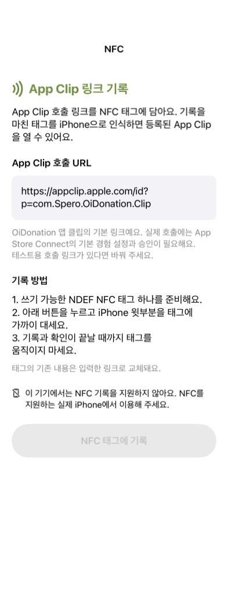

# NFC 태그에 App Clip 호출 링크 기록

2026-10-22 / #89

홈의 `사진 테스트` 바로 아래 `NFC` 버튼에서 기록 화면으로 이동한다. OiDonation App Clip 번들 ID에 맞춘 Apple 기본 링크 `https://appclip.apple.com/id?p=com.Spero.OiDonation.Clip`을 미리 입력한다. 사용자는 필요한 호출 URL로 바꿀 수 있으며, 입력한 HTTPS URL을 Core NFC의 NDEF URI 레코드 하나로 기록한다. 기존 태그의 NDEF 내용은 교체하며 태그를 영구 잠금하지 않는다.

## 동작과 상태

- URL은 외부 공백을 정리하고 HTTPS, 호스트, 포트, 자격증명·내부 공백·제어문자·잘못된 escape 여부를 검사한다. URL의 경로와 쿼리는 보존한다. 도메인·콘텐츠 ID·App Clip 등록 여부는 이 검사로 확인하지 않는다.
- `NFCNDEFReaderSession`을 메인 큐에서 한 개만 유지한다. delegate와 태그 completion이 세션 큐에서 실행된다는 Core NFC 계약에 따라 메인 actor에서 상태를 갱신한다.
- 단일 태그 연결 → NDEF 쓰기 가능 여부와 용량 검사 → 기록 → 재읽기 순서로 처리한다. 재읽은 레코드 수·TNF·type·identifier·payload가 모두 일치해야 성공으로 표시한다.
- 미지원 기기, 여러 태그, 읽기 전용, 미지원 형식, 용량 부족, 연결·기록·검증 실패와 취소를 안내하고 다시 시도할 수 있다.
- 쓰기 시도 후 검증 전에 실패·취소하면 태그가 이미 변경되었을 수 있음을 알린다. 같은 링크를 다시 기록하고 확인할 수 있다.
- 화면 이탈·앱 백그라운드 전환 시 세션을 무효화한다. 무효화 콜백 전에는 새 세션을 시작하지 않고, 종료 중 또는 이전 세션의 콜백은 무시한다.
- 입력 URL을 저장하거나 서버로 전송하지 않는다. 링크를 여는 동작이나 App Store Connect·도메인·프로비저닝 변경은 수행하지 않는다.

## 타깃과 호출 전제

`OiDonation` 본 앱의 Debug/Release에만 `OiDonation.entitlements`의 `NDEF` 권한과 `NFCReaderUsageDescription`을 추가했다. NFC 소스는 본 앱의 filesystem synchronized group에 포함하며 App Clip 공유 파일 목록에는 추가하지 않는다. 기존 서명 방식·프로필 이름·배포 대상은 유지한다.

태그 기록 성공은 App Clip 호출 설정 완료를 뜻하지 않는다. Apple에서 발급한 기본/데모 링크 또는 등록한 웹 호출 URL을 사용해야 한다. 커스텀 웹 URL은 Associated Domains와 AASA 등 해당 호출 방식의 설정이 필요하다. 개발 기기에서는 로컬 경험으로 시험할 수 있다. 전체 앱이 설치되어 있으면 태그 호출이 전체 앱으로 연결될 수 있다.

현재 App Clip 코드는 `example.com/stories/<plaqueID>`만 허용하는 초기 구현이며, 운영 URL·원격 콘텐츠 연결은 확정되지 않았다. NFC 화면은 Apple의 기본 링크 형식에 실제 Clip 번들 ID를 넣어 미리 표시한다. 2026-10-22 App Store Connect 확인 시 기본 경험·기본 링크·데모 URL은 미설정 상태였다. 기본 링크 표시는 해당 링크의 활성화를 의미하지 않으며, 실제 호출에는 기본 경험 설정과 승인이 필요하다. 현재 Clip 파서는 Apple 기본 링크를 아직 해석하지 않으므로 실제 호출 URL과 App Clip의 링크 처리·콘텐츠 구성이 서로 맞는지 별도 확인해야 한다.

## 검증 명령

```bash
DEVELOPER_DIR=/Applications/Xcode.app/Contents/Developer \
CLANG_MODULE_CACHE_PATH=/private/tmp/benchmark-nfc89-module-cache \
sh apps/ios/Tests/run-nfc-checks.sh

DEVELOPER_DIR=/Applications/Xcode.app/Contents/Developer \
CLANG_MODULE_CACHE_PATH=/private/tmp/benchmark-nfc89-module-cache \
sh apps/ios/Tests/run-architecture-checks.sh

DEVELOPER_DIR=/Applications/Xcode.app/Contents/Developer \
xcodebuild -project apps/ios/OiDonation.xcodeproj -scheme OiDonation \
-sdk iphonesimulator -configuration Debug -destination 'generic/platform=iOS Simulator' \
-derivedDataPath /private/tmp/benchmark-nfc89-build CODE_SIGNING_ALLOWED=NO build

DEVELOPER_DIR=/Applications/Xcode.app/Contents/Developer \
xcodebuild -project apps/ios/OiDonation.xcodeproj -scheme OiDonation \
-sdk iphoneos -configuration Release -destination 'generic/platform=iOS' \
-derivedDataPath /private/tmp/benchmark-nfc89-build CODE_SIGNING_ALLOWED=NO build
```

시뮬레이터는 NFC를 지원하지 않으므로 실제 기록 성공을 검증하지 않는다. 실제 iPhone에서 NFC 권한을 포함한 서명으로 빌드한 뒤, 쓰기 가능한 태그와 읽기 전용 태그·용량 부족·복수 태그·접촉 손실·취소·재시도를 확인해야 한다. 등록한 호출 URL을 기록하고 전체 앱이 설치되지 않은 iPhone에서 App Clip 카드와 콘텐츠 진입도 확인한다.

## 화면 검증

393pt 너비에서 실제 SwiftUI 화면을 격리된 시뮬레이터 앱으로 렌더링한 결과다. 시뮬레이터의 NFC 미지원 안내와 비활성 기록 버튼을 포함한다. 실물 태그 기록 화면의 성공 상태를 나타내지 않는다.



## Apple 근거

- [Core NFC 태그 읽기·쓰기 예제](https://developer.apple.com/documentation/corenfc/building-an-nfc-tag-reader-app)
- [App Clip 경험과 호출 URL 구성](https://developer.apple.com/documentation/appclip/configuring-the-launch-experience-of-your-app-clip)
- [App Clip 로컬 호출 시험](https://developer.apple.com/documentation/appclip/testing-the-launch-experience-of-your-app-clip)
