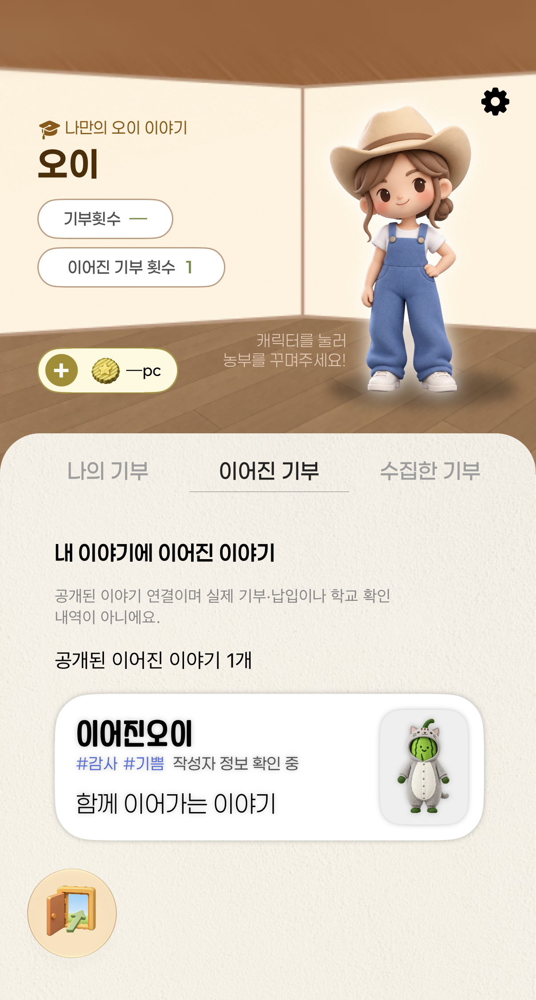

# 이어진 이야기 연결 검증 — #418

2026-11-17, 가상 계정·이야기만 사용했다. 운영 DB 쓰기·마이그레이션 적용·실제 사용자 알림 발송은 수행하지 않았다. PR #415의 선택 UI를 작업 브랜치에 통합했으며 해당 PR의 develop 병합은 수행하지 않았다.

## 서버

`python3 supabase/tests/run-account-merge-db-checks.py` 전체 통과. 저장소 이력·배포 호환 이력 각각에 새 마이그레이션과 `supabase/tests/oi-story-continuations.sql`을 실행했다. 작업 전용 PostgreSQL을 종료하고 PID·소켓 정리를 확인했다.

- 정상 지정·구버전 필드 생략 보존·명시적 null 해제, 자기·숨김·미존재 대상 및 순환 거절.
- 공개 원시 테이블의 부모 열 부재·비공개 테이블 권한·anon 수신 알림 거절.
- 실제 service-only AI 검수 → 검수 중 부모에게 비노출 → 작성자 심기 후 공개 목록·부모 수신 목록·알림·개수 확인.
- 부모 관계 변경 후 기존 AI snapshot으로 심기 거절. 연결이 없는 이야기의 snapshot은 기존 delegate와 동일함을 비교.
- 부모·자식 숨김/작성자 제한/기기 차단 필터 제외, 타인·차단 알림 열기 거절, 읽음 멱등·공개 조회의 읽음 비노출.
- 부모에 여러 자식, 동일 공개 시각의 UUID 커서 20+5 페이지, 목록과 전체 개수 일치.
- canonical 계정 통합 후 본인 초안 대상·공개 연결 유지. 부모 논리 삭제·실제 계정 탈퇴에 따른 물리 삭제에서 자식 보존·연결 해제.
- mutator·snapshot·capability 미지 변경 각각에서 스키마 생성 전 drift 실패·rollback.
- 기존 계정 통합·탈퇴·PNG/JPEG 카드·Storage 읽기/검수·건물 쪽지·증빙 접수 종료·AI 자동검수 회귀 통과.

운영 함수 해시를 직접 조회한 결과가 아니다. 운영 DB는 PR 리뷰 후 별도 drift 확인·적용이 필요하다. 심사 NFC `test-01`·지정 이야기 상태와 연결을 변경하지 않았다.

`npm --prefix supabase test`의 Node 검사 71개도 통과했다. 로컬 `npm --prefix supabase run check`는 Deno가 설치되어 있지 않아 실행하지 못했다. CI의 Deno 설치·타입 검사를 별도로 확인한다.

## iOS

Xcode `OiFlowChecks`, Debug, iPhone 18 Pro / iOS Simulator에서 선택한 20개 검사 통과(실패·skip 0). 결과 번들: `/private/tmp/oi-418-client-final.xcresult`.

- `OiStoryContinuationTests` 6개: payload 생략/지정/null·옛 Codable 호환, 공개/인증 RPC·차단·커서·원자적 읽음 DTO, capability별 저장 전송·본인 대상 복원, 최근 30일 표시·알림 캡처, 부모 목록·MY 캡처와 로그아웃 후 늦은 알림 응답 폐기, 비공개 부모 ID가 가려져도 명시적 해제 전송 보장.
- `OiRecentStoriesTests` 4개: PR #415의 계정별 최근 기록·5개 대상·옛 초안 회귀.
- 기존 알림/카드 요청 8개: 목록·오류·큰 글자·시트 캡처 4개, 요청 영수증·다른 이야기 영수증 거절·로그아웃 후 응답·404 충돌 4개.
- 기존 AI 승인 후 명시적 심기, JPEG 5개 파일 업로드·검토·조회 2개.

최신 develop `decaa7b` 병합 후 위 검사를 다시 통과했다. 이후 capability 중단·재활성화에서 오래된 개수가 복원되지 않도록 공개 상태 키를 확장하고 관계 검사 6개를 추가 실행해 모두 통과했다(`/private/tmp/oi-418-client-privacy.xcresult`). 같은 테스트 빌드에 포함된 본 앱·App Clip의 Debug Simulator 빌드도 성공했다.

화면은 가상 공개 응답을 사용하는 실제 SwiftUI 뷰다. DB에서 공개 조건을 검증한 검사와 앱의 HTTP fixture 검사를 분리했으며, 실제 두 계정을 운영 서버에서 공개한 end-to-end 검사가 아니다. 실기기 빌드·사용자 공개 흐름·운영 RPC 배포·APNs 푸시는 확인하지 않았다. 검증용 창은 캡처 후 숨기고 scene에서 분리했다.

## 후속 운영 적용·공개 경계 점검 — 2026-11-17

PR #425를 develop `6de0205`에 병합하고 운영 52gibu에 `20261117010000`을 적용했다. 세 기존 함수 해시를 사전 확인하고 마이그레이션 안에서 재검사했다. 원래 mutator delegate 해시를 보존했고, 운영 이력 SQL SHA256은 병합 파일과 동일하다. 적용 이력은 새 버전 한 개만 추가했다.

운영 DB에서 가상 계정·가상 파일 메타데이터만 사용해 저장/옛 payload/명시적 해제, AI 검수 준비·승인·명시적 심기, 공개 전 비노출, 공개 목록·개수·수신 알림·읽음·타인/차단 거절·부모 삭제를 실제 RPC로 검사하고 전체 롤백했다. AI 외부 API를 호출한 검사는 아니다. 자료 정리도 별도로 확인했다. 실제 REST 공개 조회 둘은 200, 익명 수신 알림은 401 차단을 확인했다. `test-01`과 지정 심사 이야기는 전후 해시가 동일하다.

추가 점검에서 탈퇴 준비 중의 RLS 경계를 빠뜨린 부분을 발견했다. 기존 구현에서 새 회귀가 실패함을 재현하고 별도 변경 불가능 마이그레이션으로 보완한다. 원래 리뷰가 이 경계를 놓쳤음을 기록하며, 수정과 추가 검증을 별도 후속 PR로 남긴다. 앱 소스는 바꾸지 않는다.

Jun iPhone용 Release 서명 빌드·설치는 완료했다. Xcode 계정 자동 서명 대신 기존 유효한 프로파일·인증서를 임시 xcconfig에서만 사용했다. 저장소 서명 설정은 수정하지 않았다. 설치 후 폰 잠금 때문에 자동 실행은 아직 확인하지 못했다.

후속 결과: PR #428을 develop에 병합하고 운영 `20261117020000`에 적용했다. 다섯 함수 drift·SQL 이력 해시를 확인하고, 운영 롤백 검증에서 탈퇴 준비 중인 부모·자식의 원시 RLS·목록·개수·초안 UUID·새 대상 지정·알림 읽음 차단까지 통과했다. 가상 계정·스토리·파일 메타데이터가 남지 않았음을 확인했다.

앱에서는 비공개 부모가 가려진 서버 초안에도 `선택 없이 진행하기`를 제공해 사용자가 명시적으로 null을 보낼 수 있도록 보완했다. 자동 해제는 하지 않는다. `/private/tmp/oi-425-reset-ios.xcresult`에서 기존 선택 회귀 20개가 다시 통과했다.
