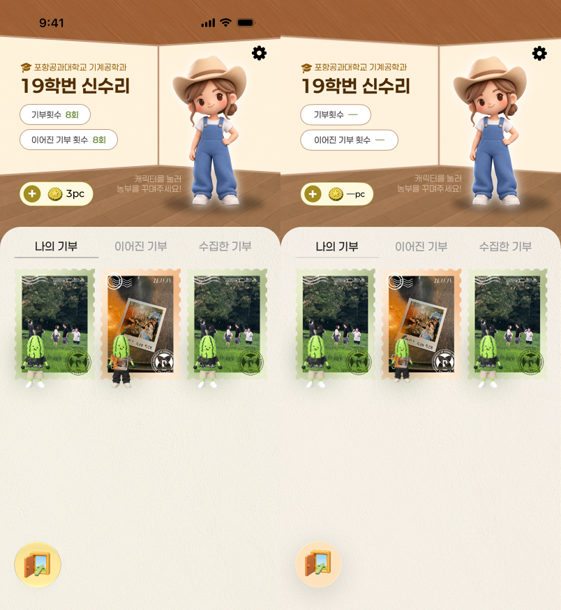

# MY ver.4 구현 및 화면 검증 — #379

## 기준과 범위

- 요청: 최신 `main`에서 작업 브랜치를 만들고 `develop` 대상 Draft PR을 생성한다.
- 분기점: `9fcb6006296dd3e35436946601ca23827e2229bd` (`main`), 작업 브랜치 `feat/#379-my-v4`.
- Figma: [프로토타입 ver.4](https://www.figma.com/design/nEDJaJBFrdzBCa1WcgADHH?node-id=5400-4605), [MY 본인 화면](https://www.figma.com/design/nEDJaJBFrdzBCa1WcgADHH?node-id=5400-14427), [수집 탭](https://www.figma.com/design/nEDJaJBFrdzBCa1WcgADHH?node-id=5903-10611).
- 기준 프레임은 402×874pt이다. Figma MCP의 레이어/수치/원본 이미지를 읽고 SwiftUI로 구현했다. 전체 디자인 스크린샷은 비교 자료로만 쓰며 앱에 넣지 않는다.
- 설정·농부 꾸미기·이야기 관리·기존 전체 도감은 기존 화면을 연결한다. 타인 프로필 신규 공개 API와 새 기부/코인 데이터 계약은 추가하지 않는다.

## 확정된 정책 차이

2026-11-16 사용자 결정에 따라 디자인 문구는 유지한다. `기부횟수`, `이어진 기부 횟수`는 `—`, 피클코인은 `—pc`와 접근성 사용 불가 안내, `이어진 기부` 탭은 미제공 안내다. Figma의 `8회`·`3pc`를 실데이터로 표시하지 않는다.

`나의 기부`는 본인 이야기, `수집한 기부`는 기존 계정 수집 카드를 보여준다. 납입·공식 기부 확인을 의미하지 않는다. 이름/학번/학과는 공개용 필드만 읽으며 비공개 학교 자료 입력값으로 대체하지 않는다. 공개 이름이 없으면 기존 농장 이름을 사용한다.

## 레이어와 자산 대응

| 디자인 | 구현/재사용 | 기준 geometry |
| --- | --- | --- |
| 작업실 배경 `5894:10512` | `MYProfileRoom` 배경만 MCP 내보내기 | 402×356, 상단 프로필 높이 325 |
| 여자 농부 `5400:14430` | 기존 `OiFarmer` 및 `MYFarmerArtwork` | x213, y69, 177.75×237 |
| 농부 그림자 `5400:14429` | `MYProfileFarmerShadow` | 원본 blur 포함 166×49 PNG |
| 학적/이름 | 기존 Paperlogy Regular12/Bold26, 공개 프로필 | x28, y90/103 |
| 집계 배지 | Paperlogy Medium/Semibold12 | x28, y149/185, 너비102/141 |
| 피클코인 `5903:10550` | `MYProfileCoin` | 24.609×24.609 이미지, 미제공 값 |
| 종이 패널 `5903:10530` | `MYProfilePaper` 원본 질감 | y325, 상단 반경30 |
| 탭 | Paperlogy Medium16, tracking0.32 | x21/142/263, y337, 너비120 |
| 카드 | 기존 `MYCardArtwork` 및 원격 승인 이미지 | 3열, 115×159, 간격8.5 |
| 오이 | 기존 원격 portrait 및 프리셋 | 카드 기준 x8/y87, 43×85 |
| 오이 그림자 `5400:14586` | `MYProfileCardShadow` | blur 포함 122×159, 카드 기준 x−31/y50 |
| 설정 | MCP 지정 `gearshape.fill` | 20pt, 44pt 조작 영역 |
| 나가기 `5903:10556` | 기존 `MYExitDoor` | 50×50, 원형 조작 영역66×66 |

농부와 나가기 이미지의 SHA-256이 기존 파일과 완전히 동일함을 확인했다. 새 배경/종이/코인/농부 그림자/오이 그림자 5종은 로컬 imageset으로 추가해 임시 Figma URL을 런타임에서 사용하지 않는다. 기존 폰트·계정 저장소·농부 의상 저장·카드 상세·고정 기능을 재사용한다.

상단 방·농부는 가용 폭에 맞춰 비례 배치한다. 본문은 가변폭 3열 그리드로 만들고 짧은 화면은 스크롤한다. 큰 글자나 긴 공개 프로필은 세로 배치로 전환하며 텍스트를 자르지 않는다. 확대 상태에서도 설정과 닫기, 로그인 안내가 유지된다.

Liquid Glass는 [Apple의 `glassEffect` 안내](https://developer.apple.com/documentation/swiftui/applying-liquid-glass-to-custom-views)에 따라 네이티브 효과를 사용한다. [Apple 접근성 지침](https://developer.apple.com/design/human-interface-guidelines/accessibility)에 맞춰 글자 확대와 조작 영역·접근성 이름/상태를 제공한다. Figma의 합성 유리층을 픽셀 그림으로 버튼에 덮지 않는다.

## 검증

실제 사용 도구체인: Xcode 27.1 / iOS Simulator 26.5. 저장소의 iOS 26.2 배포 대상과 Swift 5.0 언어 모드는 유지했다.

전용 시뮬레이터: `BenchMark MY v4 379`, `F01A8DF6-D293-4A40-8ABF-A8412C0DF41C`.

```sh
DEVELOPER_DIR=/Applications/Xcode.app/Contents/Developer \
SWIFT_MODULECACHE_PATH=/private/tmp/benchmark-my-v4-379-evidence/modulecache \
CLANG_MODULE_CACHE_PATH=/private/tmp/benchmark-my-v4-379-evidence/modulecache \
sh apps/ios/Tests/run-my-checks.sh

DEVELOPER_DIR=/Applications/Xcode.app/Contents/Developer xcodebuild \
  -project apps/ios/OiDonation.xcodeproj -scheme OiFlowChecks -configuration Debug \
  -destination 'platform=iOS Simulator,id=F01A8DF6-D293-4A40-8ABF-A8412C0DF41C' \
  -derivedDataPath /private/tmp/benchmark-my-v4-379-evidence/build \
  -resultBundlePath /private/tmp/benchmark-my-v4-379-evidence/my-v4-reviewed.xcresult \
  CODE_SIGNING_ALLOWED=NO -parallel-testing-enabled NO \
  -only-testing:OiDonationTests/OiFigmaFidelityVisualTests/testMYV4Captures \
  -only-testing:OiDonationTests/OiFigmaFidelityVisualTests/testMYV4FigmaReferenceCapture test
```

`run-my-checks.sh`는 계정 도감·App Clip 기록·계정 분리 검사를 통과했다. 최초 제한 샌드박스 실행은 모듈 캐시/Swift 매크로 실행 권한 문제로 실패했고, 동일 검사를 정상 Xcode 실행 권한에서 통과했다. 검사를 약화하거나 생략하지 않았다.

화면 테스트는 본인 이야기만 표시, 로그아웃 후 이전 도감 숨김, 로딩/오류/빈 상태 구별, 미제공 탭, 공개 프로필의 비공개 학적 정보 독립성을 검증한다. 402×874, 375×667, 440×956, accessibility5 및 긴 프로필을 캡처한다. 캡처 창은 key window를 빼앗지 않으며 사용 후 숨김 창까지 scene에서 분리됐음을 assert한다.

최종 `xcodebuild` 결과는 **2 tests, 0 failures / TEST SUCCEEDED**이다. 디자인 카드 3개를 테스트 번들에서만 공급하는 별도 캡처를 추가해, 원격 카드/오이 이미지 로딩 경로도 검증했다. 프로덕션 데이터나 스토리 업로드는 수행하지 않는다.

## 픽셀 비교 결과

[원본](reference.png)과 [구현](actual.png)을 402×874, 1pt=1px로 비교했다. 리사이즈·좌표 보정·마스크로 오차를 숨기지 않았으며, sRGB/흰색 배경 알파 합성만 동일하게 적용했다. 아래 수치는 자동 합격 기준이 아닌 최종 측정 결과다.

| 영역 | 평균 절대 RGB 오차(0–255) | 최대 채널 차이 >10인 픽셀 |
| --- | ---: | ---: |
| 전체 | 3.7579 | 8.3646% |
| 상단 방 빈 영역 | 0.4305 | 0.0000% |
| 농부 | 3.1351 | 8.5358% |
| 종이 빈 영역 | 1.2693 | 0.0014% |
| 탭 | 5.5936 | 11.7809% |



- [50% 겹침](comparison/overlay-50-percent.png) · [픽셀 차이 지도](comparison/absolute-diff-heatmap.png) · [원시 측정값](comparison/metrics.json)
- [작은 화면](authored-375x667.png) · [큰 화면](authored-440x956.png) · [큰 글자](authored-accessibility5.png) · [긴 공개 프로필](long-public-profile-402x874.png)
- [수집 탭](collected-402x874.png) · [미제공 탭](connected-unavailable-402x874.png) · [로그아웃](signed-out-402x874.png) · [오류](error-402x874.png)

최종 검토에서 패널 좌우 여백(21/19), 상단 반경30과 모서리 뒤 방 배경, Paperlogy 광학 기준선, 카드·오이 그림자를 보정했다. 그림자는 터치에서 제외하고 카드 버튼의 입력 범위를 명시했다.

남은 차이는 다음과 같다.

- Figma의 9:41/배터리 등 시스템 표시줄은 앱 뷰 캡처에 합성하지 않는다. 실제 기기에서는 시스템이 표시한다.
- 사용자 결정에 따른 `—`/`—pc`와 `8회`/`3pc`의 차이는 의도된 결과다.
- Figma는 오이 예시마다 43×85/52×88을 사용한다. 실제 데이터는 동일한 43×85 슬롯에서 원본 비율을 보존하므로 두 번째 예시는 크기가 다르다. 카드별 임의 좌표를 저장하는 새 데이터 계약은 추가하지 않는다.
- 네이티브 Liquid Glass, SwiftUI/Core Text의 글리프·질감 보간·그림자 렌더링은 Figma 합성 결과와 픽셀 단위로 완전히 같지 않다. 특히 닫기 버튼의 색/반사와 탭 글리프 차이가 있다.

재현 명령(저장소 루트):

```sh
DEVELOPER_DIR=/Applications/Xcode.app/Contents/Developer \
SWIFT_MODULECACHE_PATH=/private/tmp/benchmark-my-v4-379-evidence/modulecache \
CLANG_MODULE_CACHE_PATH=/private/tmp/benchmark-my-v4-379-evidence/modulecache \
xcrun swift apps/ios/docs/verification/my-v4-379/compare-my.swift \
  apps/ios/docs/verification/my-v4-379/reference.png \
  apps/ios/docs/verification/my-v4-379/actual.png \
  /private/tmp/my-v4-comparison

git diff --check
plutil -lint apps/ios/OiDonation.xcodeproj/project.pbxproj
```

비교 스크립트와 두 정적 검사는 모두 통과했다. 실기기·실계정 서버 통합·실제 탭/스크롤/화면 이동 UI 자동화는 수행하지 않았다. 화면 캡처는 시뮬레이터 테스트 호스트에서 실제 SwiftUI 뷰를 렌더링한 결과이며, 가상 백엔드의 상태 검증과 실제 서버 검증을 구분한다. `xcodebuild` 로그에는 기존 RealityKit 시뮬레이터 셰이더/SDK 메타데이터 진단이 있었으나 테스트는 성공했고 캡처 이미지에서 렌더링 결과를 확인했다.

## 실행 자원 정리

작업 소유 동시 실행 그룹은 최대 2개(빌드/테스트, 전용 시뮬레이터)였다. 빌드/테스트 프로세스는 종료됐고 전용 시뮬레이터 `F01A8DF6-D293-4A40-8ABF-A8412C0DF41C`는 종료 후 삭제하여 장치 목록에 없음을 확인했다. 캡처용 UIWindow는 테스트마다 숨긴 뒤 scene에서 분리하고 숨김/표시 창 목록에서 해제 여부를 검사했다. Computer Use 핸들·브라우저·서버는 생성하지 않았으며, 남긴 실행 자원은 없다. 다른 작업의 프로세스와 원래 체크아웃의 변경은 보존했다.
