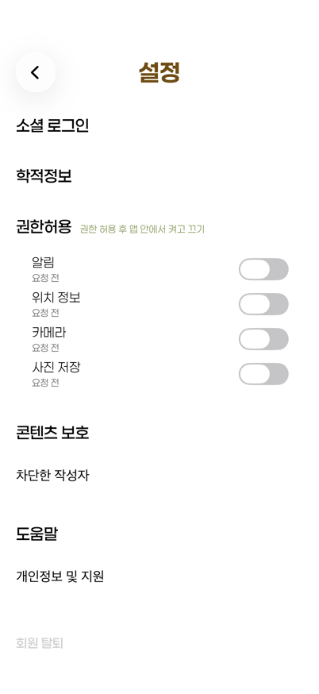

# 설정 토글 동작 개선 — #477

2026-11-18, Xcode 27.1 / iOS 26.5 Simulator / iPhone 17에서 검증했다. 프로젝트의 iOS 26.2 배포 대상과 Swift 5 언어 모드를 유지했다.

## 변경

- 캡슐을 그리는 버튼을 실제 `UISwitch`로 교체했다. 터치·드래그·손잡이 전환은 시스템 컨트롤이 처리한다. [`UISwitch` 공식 문서](https://developer.apple.com/documentation/uikit/uiswitch)의 색상 API를 사용한다.
- ON은 `CampusStyle.green`, OFF는 `UIColor.tertiaryLabel`, 손잡이는 흰색으로 유지한다. OFF 배경을 중복 합성하지 않는다.
- 이미 허용된 기능은 권한 전체 조회를 기다리지 않고 `OiFeatureUsage`에 선택한 값을 즉시 저장한다. 미허용 권한만 기존 시스템 요청·iPhone 설정 안내로 진행한다. 권한을 얻기 전에는 ON으로 표시하지 않는다.
- 설명 영역을 눌러도 전환할 수 있고, VoiceOver에는 중복 버튼 대신 이름과 ON/OFF 상태를 가진 시스템 스위치를 제공한다. 외부 상태 동기화는 Reduce Motion을 따른다.

## 검증

아래 명령은 **4 tests, 0 failures / TEST SUCCEEDED**로 완료됐다. 본 앱·App Clip·테스트 타깃 빌드도 포함한다.

```sh
DEVELOPER_DIR=/Applications/Xcode.app/Contents/Developer xcodebuild \
  -project apps/ios/OiDonation.xcodeproj -scheme OiFlowChecks -configuration Debug \
  -destination 'platform=iOS Simulator,id=34DDE4FC-4433-44D1-A933-5B8FCC73A888' \
  -derivedDataPath /private/tmp/benchmark-settings-toggle-477-evidence/build \
  -resultBundlePath /private/tmp/benchmark-settings-toggle-477-evidence/verified.xcresult \
  CODE_SIGNING_ALLOWED=NO -parallel-testing-enabled NO \
  -only-testing:OiDonationTests/OiFigmaFidelityVisualTests/testSettingsSwitchNativeInteractionAndPalette \
  -only-testing:OiDonationTests/OiFigmaFidelityVisualTests/testSettingsSwitchLayoutCaptures \
  -only-testing:OiDonationTests/OiRemoteStoreTests/testFeatureUsagePersistsWithoutChangingOtherFeatures \
  -only-testing:OiDonationTests/OiRemoteStoreTests/testDisabledFeaturesBlockLocationCameraAndPhotoStorage test

git diff --check
```

- 이전 캡슐 표현과 새 스위치의 ON/OFF 트랙 내부 픽셀을 직접 비교했다(채널당 허용 오차 1/255). 손잡이 흰색·네이티브 이벤트 연속 전환·즉시 저장·재생성 후 복원을 확인했다.
- 권한 요청 중 바인딩이 ON을 허용하지 않는 경우 스위치가 OFF로 돌아오는 것을 검사했다.
- 기존 기능 차단 검사는 위치·카메라·사진 저장의 OFF 동작을 확인한다.
- 402×874·375×667·440×956 및 접근성 최대 글씨 렌더링을 확인했다. 큰 글씨에서는 기존 세로 스크롤로 이어진다.
- 최초 검사의 전체 화면용 색상 수 판정은 단색 스위치에 맞지 않아 실패했다. 화면 검증을 원본 픽셀 비교로 바꾸고 권한 요청 후 복귀 애니메이션 완료를 기다리도록 수정한 뒤 위 검사를 통과했다. 검증 기준을 제거하지 않았다.
- 기존 코드의 동시성 경고와 AppIntents 메타데이터 안내는 별개이며 이 작업에서 언어 모드나 경고 설정을 바꾸지 않았다.

## 색상 비교

| 상태 | 이전 | 시스템 스위치 |
| --- | --- | --- |
| ON |  |  |
| OFF |  |  |

## 설정 화면



[작은 화면](settings-375x667.png) · [큰 화면](settings-440x956.png) · [접근성 최대 글씨](settings-accessibility5.png)

## 검증 한계와 정리

Needs confirmation:
- 실제 iPhone에서의 터치·드래그 조작감, VoiceOver 음성 안내, 최초 권한 팝업·설정 앱 복귀. 자동 검사는 네이티브 이벤트와 바인딩·렌더링을 검증하며 실제 손가락 입력을 대체하지 않는다.

작업 소유 리소스는 최대 동시 2개 그룹(전용 시뮬레이터와 빌드/테스트 실행기)이었다. 캡처 창은 매번 key window를 차지하지 않고 숨은 창까지 `scene.windows`에서 제거됐는지 검사했다. 전용 시뮬레이터는 종료·삭제했으며 실행기·앱 프로세스가 남지 않았음을 확인했다. 빌드 도우미 `ibtoold` PID 86113의 수동 종료는 공유 가능성 때문에 자동 승인 검토에서 거부됐고, 이후 읽기 전용 점검에서 자체 종료를 확인했다. 기존 Xcode와 CoreSimulator 공유 서비스는 유지했다.
