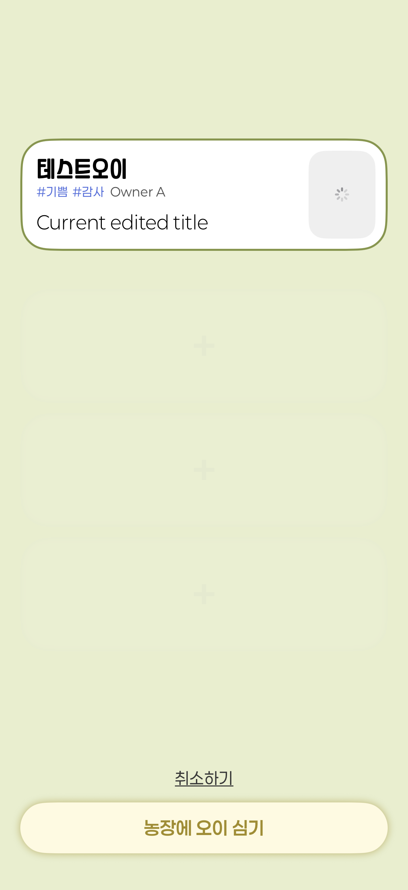

# 쇼케이스 TF 공개 검증 — #508

2026-11-18, Xcode 27.1 / Swift 6.4.2. 저장소의 iOS 26.2·Swift 5 언어 모드는 변경하지 않았다.

## 결과

- 전용 iPhone 17 Pro / iOS 27.0 Simulator에서 아래 6개 테스트 통과, 실패·건너뜀 0개.
- TF 의존성 주입: 미검토·거부된 이야기의 직접 공개, 실패 시 초안 보존, 서버 응답 유실 복구, 기기 초안의 실제 사진·카드 준비와 목록 심기 확인.
- 일반 경로: TF 기능 불가와 기존 AI 검수→승인→명시적 심기 확인.
- `node --test supabase/tests/showcase-publication.test.mjs supabase/tests/story-moderation.test.mjs`: 19개 통과.
- 전체 마이그레이션을 적용한 전용 로컬 PostgreSQL에서 `oi-showcase-publication.sql`, `oi-story-ai-only-review.sql` 통과. 기본 꺼짐·미검토/거부/구 pending 공개·역할·소유권·세션·리비전·작성 중지·제한 계정·사진 누락을 확인했다.
- iPhoneOS SDK의 Release StoreKit 분기 타입 검사 통과. Apple 공식 검증기로 5개 미서명/위조 거래 거부 확인.
- 서비스 검사 원본은 선행 #507의 `OiStoryLikeError` 소스 누락으로 실패했다. 같은 검사에 기존 `OiStoryLikes.swift`를 포함한 임시 스크립트로 계약·기기 초안·첨부 복구 검사 통과. 관계없는 원본 스크립트는 수정하지 않았다.
- `git diff --check` 통과. 기존 Swift 6 이행·테스트 좌표 API 경고와 Xcode 진단 수집 오류는 남아 있으나 최종 결과 번들은 테스트 성공을 확인했다.

## 실행한 iOS 명령

```bash
DEVELOPER_DIR=/Applications/Xcode.app/Contents/Developer xcodebuild -quiet -project apps/ios/OiDonation.xcodeproj -scheme OiFlowChecks -configuration Debug -destination "platform=iOS Simulator,id=A6F5B32B-530A-4B26-A44D-E5CAF3A9AEBB" -derivedDataPath "/private/tmp/benchmark-showcase-508/build" -resultBundlePath "/private/tmp/benchmark-showcase-508/tests.xcresult" CODE_SIGNING_ALLOWED=NO -parallel-testing-enabled NO -test-timeouts-enabled YES -default-test-execution-time-allowance 120 -maximum-test-execution-time-allowance 180 \
-only-testing:OiDonationTests/OiRemoteStoreTests/testShowcasePublishesUnreviewedAndRejectedStoriesWithoutAI \
-only-testing:OiDonationTests/OiRemoteStoreTests/testShowcaseFailureKeepsDraftAndLostReceiptRecoversWithoutAI \
-only-testing:OiDonationTests/OiRemoteStoreTests/testRegularBuildCannotPublishThroughShowcase \
-only-testing:OiDonationTests/OiRemoteStoreTests/testShowcasePlantButtonPublishesLocalDraftWithUnchangedReviewLabels \
-only-testing:OiDonationTests/OiRemoteStoreTests/testAutomaticReviewKeepsDraftPrivateUntilExplicitPlanting \
-only-testing:OiDonationTests/OiRemoteStoreTests/testStoryListRequestsReviewAndShowsResultInPlace test
```

실행 결과: `/private/tmp/benchmark-showcase-508/tests.xcresult`, 요약: `/private/tmp/benchmark-showcase-508/test-summary.json`. 서버 SQL 로그: `/private/tmp/benchmark-showcase-508/db-tests-final.log`.

## 화면

가상 초안의 심기 선택 화면이다. `검토 전`·`내용 검토 요청하기` 원문은 테스트의 선택 전 상태에서 확인했다. 선택 상태는 기존 디자인대로 검토 UI를 숨긴다. 캡처 시 오이 미리보기는 준비 중이며 캐릭터 렌더링 검증을 의미하지 않는다.



## 검증 한계 및 정리

Needs confirmation: 실제 TF 서명 거래, Edge 런타임 배포, 운영 DB 활성화, 실기기 등록·타 계정 공개 지도 확인은 수행하지 않았다. 운영 변경과 TF 업로드는 이번 PR 작업 범위에 포함하지 않았다.

작업 소유 동시 리소스는 최대 3개 그룹(빌드·테스트 프로세스, 전용 Simulator, 전용 PostgreSQL)이었다. 각 재시도 전 기존 자원 종료를 확인했다. 최종 Simulator shutdown·delete, DB fast shutdown 후 PID 파일·Unix socket 소멸, 빌드·테스트 프로세스 종료를 확인했다. 테스트 UIWindow는 hidden 처리 후 rootViewController·windowScene을 해제하고 Simulator 자체를 삭제했다. Computer Use 세션·커서·별도 Simulator 앱 창은 생성하지 않았다. 유지한 실행 리소스는 없다.
