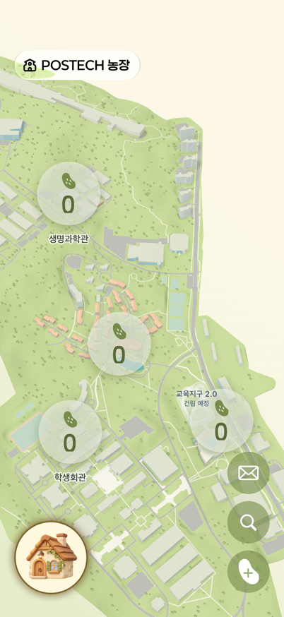

# 캠퍼스 지도 색상 복사본

2026-11-11 사용자 선택: 5개 색상 시안 중 3번 **살구 크림**을 기존 POSTECH 3D 지도 복사본에 적용한다.

## 앱 동작

2026-11-13 #305: 메인 지도 전체·지역 화면의 팔레트 버튼을 제거하고 살구 크림으로 고정한다. 예전에 저장한 `campus.map.appearance` 값은 읽거나 갱신하지 않는다. 원본 색상 렌더링은 비교 회귀 검사에서만 사용한다. `CampusMeshLoader`의 `campus-mobile.oimesh` 원본은 유지한다. `CampusMapAppearance`가 엔티티를 복제하고 복사본 재질만 변경한다. 메시 리소스는 공유하므로 21MB 지도 파일을 앱에 중복 탑재하지 않는다. 카메라, 지형 높이, 건물 이름, 위치 좌표, 오이/스토리 배치는 유지한다.

같은 날 시안 비교 후, 시안 이미지에 보이는 연두 잔디·녹색 수목·살구 건물·청록색 물을 기준으로 앱 조명 아래의 재질 색상을 보정했다. 지도 밖에는 크림 살구(`#FFF6E5`)에서 옅은 연녹색(`#E4EDC8`)으로 이어지는 화면 기준 그라데이션을 둔다. 배경은 투명한 RealityKit 뷰 아래에 배치하므로 카메라를 회전해도 방향과 색이 변하지 않는다. 기존 색상 모드의 배경은 원래 단색을 유지한다.

## 조명과 그림자 (2026-11-11)

사용자 요청에 따라 비 AR 지도에 고정된 중립 주광 환경을 추가했다. 128×64 환경광 이미지를 한 번 생성해 캐시하고, 주광 1,800lux / 보조광 650lux / 환경광 지수 1을 사용한다. 약한 따뜻한 주광(`#FFFAF1`)과 환경광을 함께 사용해 나무의 어두운 면을 밝히면서 입체감을 남긴다. 앱 배경색은 조명에 영향을 주지 않는다.

2026-11-16 후속에서는 살구 크림의 환경광 지수를 0.8로 낮춰 밝은 면이 지나치게 희게 보이지 않도록 조정한다. 주광·보조광과 원본 색상 모드의 조명은 유지한다.

주광 그림자 범위는 카메라 거리의 2.2배를 20m 단위로 조절하며 60~650m로 제한한다. 깊이 바이어스 1로 잔디·연못에 나타나던 자기 그림자 줄무늬를 줄인다. 색상 전환과 AR 종료 후 지도 복원에서도 조명을 함께 복원한다. 원본 색상은 기존 주광 2,200lux / 보조광 900lux와 기본 환경으로 되돌린다.

재질의 RGB와 화면 픽셀의 RGB는 조명·표면 방향·톤 매핑 때문에 다르다. 시안의 색상 칩을 그대로 복사하는 대신 확대·전체 지도 렌더를 시안과 비교해 재질을 보정했다. 시안은 생성 이미지라 건물·수목 형상과 음영까지 원본 모델과 완전히 일치하지 않는다. 카메라와 지형을 바꾸지 않고 색감·명암을 근접시키는 범위다.

## 재생성

`scripts/campus-apricot-palette.json`은 원본 Blender의 73개 재질 이름 및 70개 고유 선형 RGB에 대응하는 sRGB 색상이다.

```sh
python3 scripts/recolor-campus.py --output-dir /tmp/postech-apricot-copy
```

원본을 덮어쓰지 않고 독립 `postech-campus-apricot-cream.oimesh`와 `validation.json`을 출력한다. 앱용 `Resources/Campus/campus-apricot-cream.json`(507개 조각, 약 5KB)도 재생성한다. 변경한 RGB 바이트를 되돌려 전체 페이로드가 원본과 같은지 검사하고 재압축 결과도 다시 해제해 확인한다.

원본 지도 자체를 새로 내보내면 조각 순서가 달라질 수 있으므로 팔레트도 함께 재생성해야 한다. 로더는 조각 개수가 다른 팔레트를 거부한다.

## 검증

- 변환 스크립트: 507개 조각, 지형·법선·인덱스·알파 불변, 원본/복사본 SHA256 기록.
- `CampusMapInteractionTests/testMapStartsInApricotCreamDespiteLegacyPreference`: 이전 색상 선택값 유무에 관계없이 새 지도는 살구 크림으로 시작한다.
- `OiFlowChecks` → `CampusMapInteractionTests/testMapAppearancePreservesCameraGeometryAndOriginalColors`: 원본 재질 보존, 지도 경계/카메라 불변, 원본 복귀, 렌더러 재생성 후 색상·배경·환경광·그림자 유지, 전체 지도·연못·낮은 각도 이미지 첨부.
- 기존 캠퍼스 이야기, 지도 명칭/클러스터/제스처 계산, 배치 좌표 검사 스크립트.

2026-11-11 기기 검증: iOS 26.7.2 Jun iPhone에 서명된 Debug 빌드를 설치·실행하고 실제 화면 캡처에서 살구 크림 전체 지도 표시를 확인했다. 시뮬레이터에서는 확대·낮은 각도·전체 렌더 및 지도 상호작용 테스트 5개를 검증했다.

2026-11-13 #305 검증: iOS 27.2 시뮬레이터에서 이전 색상 저장값 무시, 색상·조명·렌더러 복원, 핀치·회전, 전체 지도 공개 오이 선택 테스트 4개가 통과했다. 본 앱·App Clip 컴파일과 `run-campus-checks.sh`, `run-app-clip-checks.sh`도 통과했다. 실제 iPhone 설치·확인은 이번 변경에서 수행하지 않았다.

## 2026-11-16 표시와 로딩 최적화

같은 날 패널 투명도 후속: 낮은 지도 각도에서 사용하는 각진 구역 패널도 원형 배경과 같은 불투명도 60%로 표시한다. 기존 각도별 형태 전환 비율에 표면 불투명도를 곱하며, 별도 레이어인 숫자·오이 아이콘과 패널 위치·터치 영역은 유지한다.

관련 작업: #382. 아래 화면은 공개 이야기가 없는 로컬 검증 데이터로 캡처했다. 숫자 0은 운영 서버의 집계가 아니다.



사용자가 첨부한 지도 피드백과 Figma `5934:4877`을 기준으로 작업 브랜치에 구현한다. 농장 버튼은 clear glass·좌우 14pt 여백, 구역 숫자는 `YANGJIN`을 사용한다. 집 위 닉네임 버튼은 제거한다. 집 버튼은 원·테두리·그림자를 포함한 원본 컴포넌트를 투명 PNG로 내보낸다(402×402px, 3배율, 그림자 여백 포함 논리 크기 134pt·원의 크기 100pt). 별도의 원·테두리·혼합 효과를 덧씌우지 않는다.

잔디는 `#B9D48D`에서 `#B1CE83`, 흰 벽은 `#FFF5DF`에서 `#F9EFD8`, 밝은 지붕은 `#D9DECA`에서 `#D0D7C0`으로 조금 진하게 조정한다. 나뭇잎은 `#5C9442`/`#8DB354`에서 `#79A45C`/`#A1BD74`, 줄기는 `#9C8259`에서 `#A38E6B`로 밝게 한다. 수목 개수와 원본 메시 파일은 유지하며 수목만 동적 그림자 생성에서 제외한다.

기존 로딩은 약 22MB 압축 메시 해제, 약 96MB 버퍼 해석·부지 정리, 교육지구 구슬 버퍼 생성이 메인 액터에 집중됐다. CPU 계산을 불변 Sendable 입력의 백그라운드 작업으로 옮기고 교육지구 준비와 겹쳐 실행한다. Entity 생성은 메인 액터에 남기며 비동기 메시 업로드는 네 개씩 제한한다. 지도 템플릿과 교육지구의 진행 중 작업을 공유하고, 같은 색의 재질을 재사용한다. 카메라 관성·스프링의 CADisplayLink는 최대 60Hz로 제한하고 기존 정지·화면 이탈 해제 동작은 유지한다.

처리된 공개 지형 버퍼는 `Library/Caches/CampusGeometry-v1`에 LZFSE로 압축해 원자적으로 저장한다. 캐시 키는 처리 버전·번들 메시·정렬된 지도 메타데이터·높이 원본의 SHA256이다. 파일 자체의 SHA256·개수·인덱스·길이를 검증하며 손상·용량 부족·디렉터리 접근 실패 시 원본으로 다시 준비한다. 최신 캐시 두 개만 유지한다. 부지 정리 알고리즘을 바꾸면 처리 버전도 올려야 한다. 이 캐시는 사용자 초안·사진·인증 자료를 포함하지 않으며 삭제되어도 앱이 동작한다.

시뮬레이터 Debug 측정(iPhone 18 Pro / iOS 27.2, 각각 새 테스트 프로세스): 변경 전 지도 준비 9.80초·메인 액터 최대 응답 간격 3.43초, 변경 후 디스크 캐시 없음 8.79초·0.42초, 디스크 캐시 있음 3.01초·0.41초였다. 이전 반복 측정의 캐시 사용 지도 준비는 3.08~3.95초였다. GPU·서버 데이터·실기기 발열을 대신하는 수치는 아니며, 새 설치의 최초 메시 준비 비용은 남아 있다.

검증 완료: `OiFlowChecks`에서 `CampusMapInteractionTests`, `CampusEducationDistrictTests`, 홈 두 크기 캡처·집 에셋 경계 검사 총 29개가 통과했다. 캐시 원본 변경·손상·저장 불가·취소를 포함한다. `run-campus-checks.sh`, `run-campus-label-checks.sh`, `run-campus-placement-checks.sh`, `run-campus-nearby-checks.sh`, `run-campus-card-location-checks.sh`도 통과했다. 팔레트 재생성은 원본 507개 조각의 지형·법선·인덱스·알파 불변을 확인했다.

iOS 26.7.3 / Jun iPhone(iPhone 17)에 App Clip을 포함한 Release 빌드를 설치하고 본 앱을 실행해 새 설치 경로의 프로세스가 유지됨을 확인했다. 실행 후 Activity Monitor 약 21.5초 프로파일에서 CPU 평균 10.6%(6.7~13.8%), physical footprint 482~607MiB, 시스템 열 상태는 전 구간 `Nominal`이었다. 이는 짧은 실행 후 측정이며 지도 제스처·AR·장시간 사용의 발열이나 개선 전 대비 소비 전력을 검증한 결과는 아니다. 실제 디자인 캡처는 시뮬레이터에서 확인했다.

### 60% 수목 감소 — 사용자 선택

2026-11-16 비교 시안 중 60% 감소를 선택했다. 위의 기존 수목 개수 유지 설명과 측정은 이 선택 이전 버전이다. 현재 지도는 교육지구 부지 정리 후 3,000그루 중 1,800그루를 제거하고 1,200그루를 표시한다. 줄기와 두 잎 재질을 완전한 연결 성분으로 묶고, 줄기 중심의 고정 해시·시드 `331305`로 시안과 같은 나무를 남긴다. 매 실행 때 무작위로 위치가 달라지지 않는다.

`CampusTreeDensity`는 백그라운드 준비 단계에서 실행한다. 비수목 조각은 그대로 반환하고 수목 조각만 사용 중인 정점·법선을 압축하여 인덱스를 다시 매긴다. 감소 후 나무 삼각형은 95,639개다. 나무의 수를 기준으로 60%를 줄이며 삼각형 수의 감소율과 구분한다. 번들 `campus-mobile.oimesh`·팔레트 조각 번호·건물·길·높이·오이 배치 좌표는 유지한다. 캐시 처리 버전은 `campus-geometry-v2-trees60-seed331305`로 갱신하며 기존 폴더의 이전 캐시는 새 키에서 읽히지 않는다. 캐시를 다시 읽을 때 이미 감소한 지형에 감소 처리를 중복 적용하지 않는다.

검증: 기존 지도·교육지구·디자인 검사 29개와 새 수목·캐시 검사 2개가 통과했다. 고정 시드의 완전한 줄기·잎 선택, 비수목 보존, 업로드 정점 압축, cold/warm 모두 1,200그루 유지를 확인했다. 기존 배치 검사도 2,081개 좌표 왕복·높이·경계·저장 검사를 통과했다. 실제 수목 정점은 676,922→268,155개, 삼각형은 239,200→95,639개로 감소했다. iOS 26.7.3 Jun iPhone에 감소 버전의 Release 앱을 설치·실행했다. 이전 CPU·열 상태 측정은 3,000그루 버전의 기록이며 이 버전의 장시간 발열 검증으로 해석하지 않는다.
