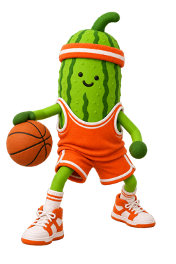
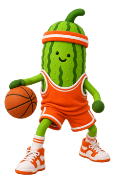
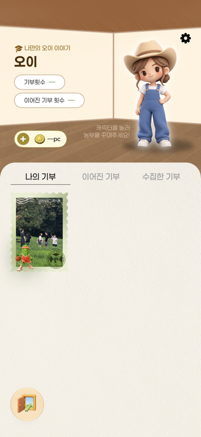
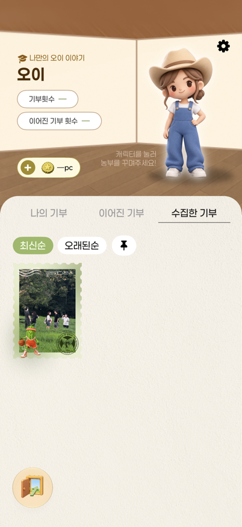

# MY 캐릭터 투명 배경 — #500

`MYWorkshopCardArtwork`는 승인된 카드 이미지 위에 `cucumberPortraitPath`의 오이를 별도 43×85pt 슬롯으로 합성한다. 과거 서버 초상이 불투명 PNG이면 이 슬롯에 흰 사각형이 그대로 나타났다. PNG 확장자나 바깥쪽 알파 여백만으로 누끼 완료 여부를 판단할 수 없다.

`OiCucumberPortraitImage`의 캐릭터 전용 옵션만 `OiCharacterPortraitCutout`을 거친다. 기존 투명 PNG는 원본 객체·해상도·색·알파를 유지하고, 불투명 초상은 Apple Vision의 foreground instance mask로 분리한다. 흰색 색상 임계값을 사용하지 않아 흰 신발·양말·의상은 전경으로 보존한다. 이미지 경로별 최대 8개·32MiB 메모리 캐시를 사용하며, 인증 이미지 로더를 통과한 뒤에만 캐시를 읽는다. 취소·화면 이탈·백그라운드 전환 후 결과를 게시하지 않고, 실패한 결과는 캐시하지 않는다. 이야기 목록은 분리 후 알파 여백을 정규화한다.

승인된 완성 카드·사진 경로에는 옵션을 켜지 않는다. 카드 사진에 이미 합성돼 저장된 내용은 다시 분리하거나 덮어쓰지 않는다. MY의 나의 기부·수집한 기부는 같은 캐릭터 슬롯을 사용하며, 구형 카드 합성과 공개 초상에도 같은 처리를 적용한다. 서버 파일·계약·레이아웃은 변경하지 않는다.

## 실제 native 마스크 검증

저장소 루트에서 macOS의 실제 Vision을 실행한다. UIKit 없는 **앱과 동일한 production core**를 검증기에 함께 컴파일한다. 투명한 번들 `OiPoka`를 흰 배경에 합성한 뒤 원본 알파와 비교한다. 결과 PNG는 지정한 임시 디렉터리에만 쓴다.

```bash
DEVELOPER_DIR=/Applications/Xcode.app/Contents/Developer xcrun swiftc \
  -module-cache-path /private/tmp/benchmark-cutout-swift-cache \
  apps/ios/OiDonation/Shared/Components/OiCharacterForegroundMask.swift \
  tools/wardrobe/validate_portrait_cutout.swift \
  -o /private/tmp/benchmark-validate-cutout
/private/tmp/benchmark-validate-cutout \
  apps/ios/OiDonation/Resources/OiSampleAssets.xcassets/OiPoka.imageset/5eda0.png \
  /private/tmp/benchmark-cutout-validation
```

2026-11-18 Apple M5/macOS 실제 요청 결과:

| 검사 | 결과 | 통과 기준 |
| --- | --- | --- |
| 배경 제거 | 64017/64608, 99.085% | 95% 초과 |
| 얼굴·의상·소품 유지 | 31421/31424, 99.990% | 95% 초과 |
| 흰 의상 유지 | 1231/1231, 100% | 95% 초과·100px 초과 |
| 평균 RGB 차이 | 0.01463/255 | 4 미만 |

실제 native 요청 전·후(번들 캐릭터만 사용):

| 흰 배경 입력 | 실제 Vision 출력 |
| --- | --- |
|  |  |

## iOS 검증 범위

실제 기기 XCTest에는 `testCharacterCutoutUsesNativeMaskAndPreservesWhiteClothing`과 `testMYLegacyOpaquePortraitsRenderWithoutWhiteBoxes`를 남긴다. iOS 27.0 Simulator에서는 기본 요청과 지원 CPU 선택을 각각 실행했지만 둘 다 `com.apple.Vision Code=9: Could not create inference context`를 반환했다. 해당 두 테스트만 Simulator에서 컴파일하지 않으며, fake mask·성공 응답·assertion 완화는 없다. 효과 없던 CPU 선택 분기는 제품 코드에서 제거했다.

Simulator에서는 다음을 별도 검증한다.

- `testCharacterCutoutPreservesTransparentPixelsAndCancellation`: 투명 원본 객체 보존·취소
- `testCharacterCutoutRejectsUnreadableSourcesWithoutPoisoningCache`: 이미지 오류·다음 로드 복구
- `testMYTransparentPortraitsRenderWithoutWhiteBoxes`: 실제 인증/PNG 디코딩 경로·원본 카드 픽셀 불변·MY 양쪽 탭의 투명 캐릭터 합성
- `testStoryListPortraitNormalizesTransparentMargins`: 기존 이야기 목록의 알파 여백 정규화

최종 `OiFlowChecks` 검증은 iPhone 17/iOS 27.0 Simulator에서 본 앱·App Clip 빌드 및 위 4개 테스트가 **0 failures**로 통과했다. 다음 캡처는 투명 PNG 경로의 MY 합성 결과이며, 서버 mock과 기존 저장소 Figma 카드 fixture를 사용했다. 사용자가 첨부한 실계정 화면은 저장소에 추가하지 않았다.

| 나의 기부 | 수집한 기부 |
| --- | --- |
|  |  |

Needs confirmation: 실제 iPhone에서 두 native 테스트 및 사용자 계정의 해당 서버 초상을 검증해야 한다. macOS 실제 요청·가상 서버/Simulator 검증을 실제 계정·기기 확인으로 간주하지 않는다.

API 근거: [foreground instance mask](https://developer.apple.com/documentation/vision/vngenerateforegroundinstancemaskrequest), [masked image 생성](https://developer.apple.com/documentation/vision/vninstancemaskobservation/generatemaskedimage(ofinstances:from:croppedtoinstancesextent:)).
