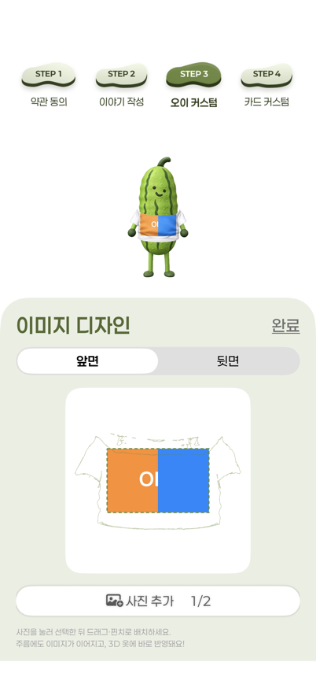

# STEP 3 상의 사진 디자인 — #490

2026-11-18 사용자 요청. 기준 디자인은 Figma [상의](https://www.figma.com/design/nEDJaJBFrdzBCa1WcgADHH?node-id=5719-9981), [이미지 디자인](https://www.figma.com/design/nEDJaJBFrdzBCa1WcgADHH?node-id=5719-9584)이다. 기준 프레임은 402×874pt, 사진 패널은 402×462pt다. 기존 화면·Paperlogy·색상·아이콘을 사용한다. 옷과 사용자 사진은 현재 선택값이며 Figma 예시 사진을 제품 이미지로 넣지 않는다.

## 동작과 보관

- 반팔티·후드티·가디건·포스텍 과잠을 입고 `직접 이미지 추가`를 누른다. 미착용 상태에서는 상의를 먼저 선택하도록 비활성화한다.
- 기존 사진 편집기에서 앞·뒷면 각각 최대 2장을 선택하고 드래그·핀치·회전으로 배치한다. 길게 눌러 삭제·복제·반대 면 이동·순서를 조절한다.
- `완료`는 사진 디자인을 기기 초안에 저장한다. 패널 밖을 누르면 현재 편집을 취소한다. 사진 삭제와 전체 되돌리기는 원래 의상 재질을 복원한다.
- 사진은 `PHPickerViewController`로 사용자가 선택한 항목만 가져온다. 전체 사진첩 권한을 새로 요청하지 않는다. [Apple Photos picker 안내](https://developer.apple.com/documentation/photokit/selecting-photos-and-videos-in-ios).
- 원본과 미착용 의상 디자인은 기존 보호된 `OiWardrobeArtwork`에 보관한다. 공개 seed에는 디자인 UUID·상의 색만 넣고 착용 상의의 합성 2048×1024 PNG만 기존 경로로 제출한다.
- STEP 3·카드·이야기 목록·내 지도·공개 지도/AR은 같은 seed 모델과 사진 좌표를 사용한다. 공개 모델은 로컬 원본을 참조하지 않는다.

## 렌더링과 재생성

`OiSeedGarmentPhotoMaterial`이 현재 상의의 원래 UV에 사진을 합성해 baseColor만 바꾼다. 추가 메시를 만들지 않으며 피부·형상·UV·법선·다른 재질 채널은 유지한다. 옷감에 선택 색을 적용한 뒤 사진을 합성하므로 사진 자체가 옷 색으로 물들지 않는다. 앞뒤가 공유하는 UV 경계 픽셀은 원래 천을 유지한다.

```bash
python3 tools/wardrobe/seed_catalog/prepare_seed_top_photo_uv.py . /tmp/seed-top-photo-assets
python3 tools/wardrobe/seed_catalog/prepare_seed_top_photo_uv.py . apps/ios/OiDonation/Resources/WardrobePhotoUV --verify
```

NumPy·Pillow와 macOS `usdcat`이 필요하다. `--verify`는 원본 SHA, base PNG 바이트, 2048² 좌표맵, 앞뒤 경계 보호와 가이드 범위를 검사한다. 과잠 base PNG는 기존 바이트가 같은 자료를 참조한다. 새 좌표맵·가이드·base PNG 19개는 17.10MiB이며 기존 USDZ는 변경하지 않는다.

## 서버 적용

`20261118055730_oi_seed_top_photo_appearance.sql` 적용 후 새 앱을 배포한다. 이전 seed·일반 의상 계약을 유지하면서 지원 상의 4종의 사진 버전·색상·topTexture만 허용한다. 원본 데이터·알 수 없는 키·누락 미디어·상의/색상 불일치는 거부한다. 운영 DB 적용과 실제 게시 테스트는 이 작업에서 수행하지 않는다.

## 검증

- 생성기 `--verify`: 상의 4종 통과.
- `PATH=/opt/homebrew/opt/postgresql@18/bin:$PATH python3 supabase/tests/run-account-merge-db-checks.py`: canonical/운영 호환 이력, drift 거부 및 기존 공개·미디어·AI·탈퇴 회귀 통과.
- 실제 설치된 Xcode 27.1 / Swift 6.4로 iOS 26.5 시뮬레이터 대상 테스트 빌드 통과. 저장소의 Swift 언어 모드와 배포 타깃은 변경하지 않았다.
- iPhone 17 / iOS 26.5: 새 상의 사진 8개 + 화면 3개 + 지도/배치 3개, 최종 14개 테스트 통과. 기존 의상 사진 13개·옷장 7개도 통과했다. 최초 새 검사 2개는 UIColor 색 공간 객체 비교 때문에 실패해 실제 RGBA 수치 비교로 수정했고 최종 재실행에서 통과했다.
- 402×874·375×667·440×956pt의 상의 탭과 실제 사진 편집 패널을 캡처했다. Figma의 사진 진입·패널·색·타입·가이드 위치를 확인했다. 기존 단계 표시와 오이 크기 차이는 이번 사진 기능에서 변경하지 않았다.
- Xcode는 성공한 테스트 종료 후 별도 시뮬레이터 진단 수집에서 `simctl` 조회 경고를 냈다. 테스트 결과 14/14·종료 코드 0과 xcresult 성공을 확인했으며 추가 진단 수집 경고를 테스트 실패로 숨기지 않았다.

```bash
DEVELOPER_DIR=/Applications/Xcode.app/Contents/Developer xcodebuild build-for-testing \
  -project apps/ios/OiDonation.xcodeproj -scheme OiFlowChecks \
  -destination 'platform=iOS Simulator,id=F60A8102-4911-4E94-B898-E1FAA0FEB3EB' \
  -derivedDataPath /private/tmp/oi-seed-top-photos-build CODE_SIGNING_ALLOWED=NO
```

Needs confirmation:
- 실기기 사진 선택·제스처와 운영 서버 적용 후 실제 공개 지도/AR 확인.

## 화면

[기준 크기](images/seed-top-photos-490/step3-top-photo-402x874.png) · [작은 크기](images/seed-top-photos-490/step3-top-photo-375x667.png) · [큰 크기](images/seed-top-photos-490/step3-top-photo-440x956.png)


