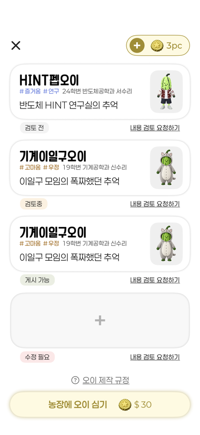
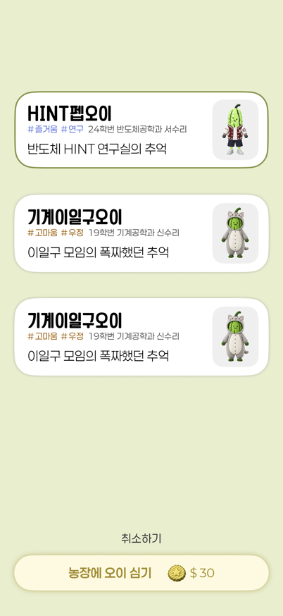
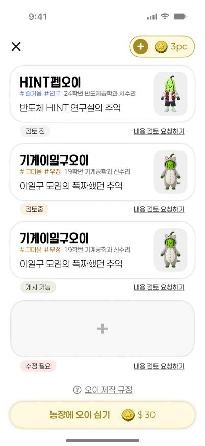
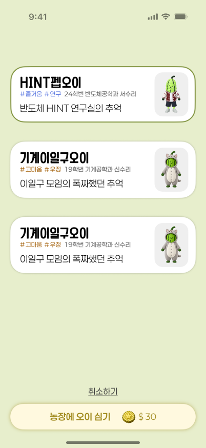
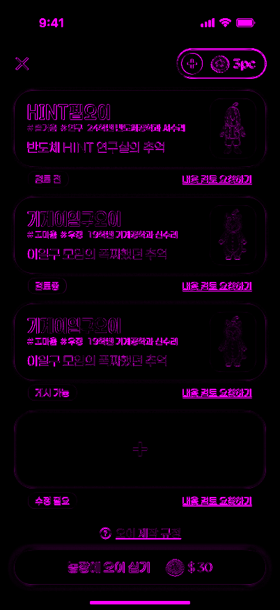
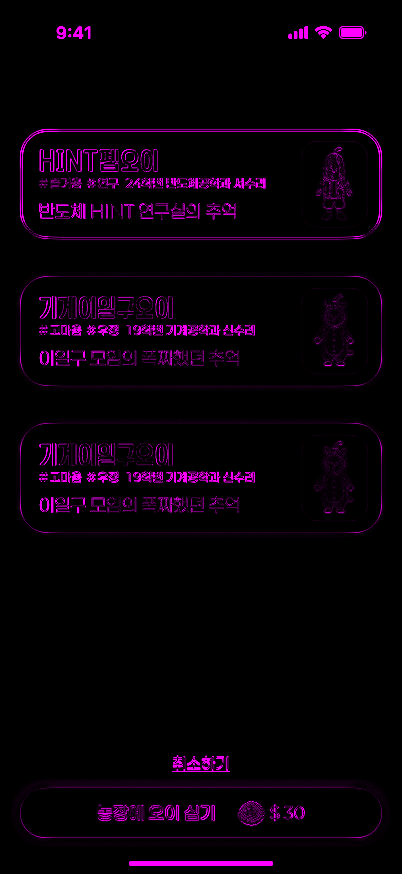

# 이야기 목록·심기 선택 Figma 대조 — 2026-11-18 / #516

## 기준과 구현

- [일반 목록 5400:7644](https://www.figma.com/design/nEDJaJBFrdzBCa1WcgADHH?node-id=5400-7644)
- [심기 선택 6101:9370](https://www.figma.com/design/nEDJaJBFrdzBCa1WcgADHH?node-id=6101-9370)
- 기준402×874pt. 전체 레이어 수치는 [spec.json](spec.json)에 기록했다. 앱 루트 너비·높이는 고정하지 않는다.
- 일반 목록은 흰 배경·닫기·실제 잔액·검토 행·제작 규정을 표시한다. 선택은 연두 배경·2pt 선택선·취소를 표시하고 헤더와 검토 행을 숨긴다. 숨긴 행의 공간은 원본대로 유지한다.
- 카드 시작 y=129, 일반 다음 카드 y=282/435, 선택 다음 카드 y=276/423. 버튼 x=20/y=788/w=362/h=50, 제목과 금액 간격20, 코인30×30, 코인·금액 간격4.
- 버튼은 원본의 `농장에 오이 심기` + 코인 이미지 + `$ 30`이며, 접근성 값은 최초 공개30 피클코인으로 읽는다.
- 22pt 양진체를20pt 줄 상자에 넣을 때 SwiftUI가 자동 축소하던 문제를 제거했다. 원본 줄 높이·태그 `#` 폭10·서체·자간을 적용한다. 공용 카드의 기본 지도 스타일은 보존한다.
- 반려 슬롯의 빈 카드 외형과 검토 행을 복원하고, 원래 이야기 편집/삭제 및 오류 사유 경로를 유지한다. 실제 빈 슬롯에 반려 상태를 만들어 넣지 않는다.

## 원본 에셋과 데이터

원본 이미지는 Figma의 imageHash와 다운로드 PNG SHA-1이 일치함을 확인했다.

| 용도 | SHA-1 | 적용 |
|---|---|---|
| 코인 | `1deda3b33e6ca9e4b0671c912377a6b9f1f46856` | 기존 `MYProfileCoin` 그대로 재사용 |
| 첫 캐릭터 | `cbd42410597ae0ecda8afac8b46200fba847ca54` | XCTest 전용 fixture |
| 둘째 캐릭터 | `e3b07c9977726705a6cfae12bfe05ea81b4e9350` | XCTest 전용 fixture |

원본 캐릭터·비교 화면4개 PNG는 기존 테스트 리소스 폴더 `OiDonationTests/Fixtures/MYV4Figma`에만 포함된다. 실제 앱에는 사용자별 서버/기기 이미지와 실제 잔액을 사용한다. 정적 레이아웃 검사는 원본 이미지 캐시를 주입하며, 기부나 실제 사용자 자료를 사용하지 않는다.

## 픽셀 대조 결과

동일 데이터·폰트·원본 이미지의 실제 SwiftUI 화면을1pt=1px로 캡처했다. CoreGraphics sRGB8비트 RGB 채널의 절대차 평균은 다음과 같다. iOS가 그리는 상태바62pt·홈 영역34pt를 제외한 앱 영역(402×778)의 모든 픽셀을 비교한다.

| 화면 | 앱 영역 채널 평균 절대차(0–255) | 버튼 영역 평균 절대차 | 채널차8 초과 픽셀 비율 |
|---|---:|---:|---:|
| 일반 목록 | 3.1171 | 2.4415 | 7.2254% |
| 심기 선택 | 2.0896 | 2.6370 | 5.8247% |

[일반 상세 수치](list-metrics.json) · [선택 상세 수치](plant-metrics.json)

텍스트·곡선·그림자·이미지 보간 주변에 렌더링 잔차가 남는다. 완전한0픽셀 차이는 아니다. 레이어 좌표·원본 에셋·폰트 크기를 대조하고, 이름 잉크 경계는 원본의 x40/y150/maxX157/maxY171에1px 이내로 검사한다. 전체 평균4/255 미만, 버튼3/255 미만을 회귀 기준으로 삼는다. 배경색과 숨김 헤더는 개별 픽셀로 추가 검사해 평균값에 오류가 묻히지 않도록 했다.

| 일반 목록 | 심기 선택 |
|---|---|
|  |  |
|  |  |
|  |  |

## 반응형과 동작 검증

- 402×874, 375×667, 440×956, 접근성5에서 두 화면 캡처10장. 작은 화면은 목록을 스크롤하고, 큰 화면은 카드·버튼 너비와 여백을 유지하며 확장한다.
- 접근성 크기는 카드 내용을 세로로 재배치하고 텍스트를 줄바꿈한다. 버튼은 스크롤 내용에 포함해 전체 내용 뒤에 도달할 수 있다. 추정 행 높이가 안정된 실제 마지막 위치까지 스크롤한 캡처도 확인했다.
- 최종5개 테스트와 반려 편집1개 테스트가 모두 통과했다. 픽셀 비교·그림자/내용 분리·TF 일반/무제한 심기·검토 상태/선택/게시·반려 편집 경로를 검증했다.
- TF 테스트가 게시 직후 목록 갱신 완료 전에 URLSession을 닫던 정리 경합이1회 발생했다. `isBusy=false`까지 기다리도록 수정하고 같은5개를 재실행해 성공했다. 실패 번들: `/private/tmp/benchmark-figma-story-516/verified.xcresult`, 최종 성공: `complete.xcresult`.
- 최종 xcresult는5개 성공·실패0·건너뜀0, 별도 `rejected-edit.xcresult`는1개 성공이다. 빌드 로그의 기존 진단 도구 문구를 성공 판정에 사용하지 않았다.

```bash
python3 /private/tmp/benchmark-pickle-run.py figma-story-ios xcodebuild -quiet -project apps/ios/OiDonation.xcodeproj -scheme OiFlowChecks -configuration Debug -destination 'platform=iOS Simulator,id=CCA2B42D-8954-4C77-AF26-51B348EC132C' -derivedDataPath /private/tmp/benchmark-plant-516-derived-data -resultBundlePath /private/tmp/benchmark-figma-story-516/complete.xcresult CODE_SIGNING_ALLOWED=NO -parallel-testing-enabled NO -test-timeouts-enabled YES -default-test-execution-time-allowance 120 -maximum-test-execution-time-allowance 180 -only-testing:OiDonationTests/OiFigmaFidelityVisualTests/testStoryListAndPlantSelectionMatchFigmaFrames -only-testing:OiDonationTests/OiFigmaFidelityVisualTests/testStoryListCardShadowDoesNotAffectItsContents -only-testing:OiDonationTests/OiRemoteStoreTests/testShowcasePlantButtonPublishesLocalDraftWithUnchangedReviewLabels -only-testing:OiDonationTests/OiRemoteStoreTests/testUnlimitedShowcasePlantButtonPublishesWithoutReviewOrCoinConfirmation -only-testing:OiDonationTests/OiRemoteStoreTests/testStoryListRequestsReviewAndShowsResultInPlace test
python3 /private/tmp/benchmark-pickle-run.py figma-story-ios xcodebuild -quiet -project apps/ios/OiDonation.xcodeproj -scheme OiFlowChecks -configuration Debug -destination 'platform=iOS Simulator,id=CCA2B42D-8954-4C77-AF26-51B348EC132C' -derivedDataPath /private/tmp/benchmark-plant-516-derived-data -resultBundlePath /private/tmp/benchmark-figma-story-516/rejected-edit.xcresult CODE_SIGNING_ALLOWED=NO -parallel-testing-enabled NO -test-timeouts-enabled YES -default-test-execution-time-allowance 120 -maximum-test-execution-time-allowance 180 -only-testing:OiDonationTests/OiRemoteStoreTests/testRejectedStoryCardOpensExistingStoryEditorDirectly test-without-building
DEVELOPER_DIR=/Applications/Xcode.app/Contents/Developer xcrun xcresulttool get test-results summary --path /private/tmp/benchmark-figma-story-516/complete.xcresult --format json
DEVELOPER_DIR=/Applications/Xcode.app/Contents/Developer xcrun swiftc docs/verification/figma-story-list-516/compare.swift -o /private/tmp/benchmark-figma-story-516/compare
/private/tmp/benchmark-figma-story-516/compare docs/verification/figma-story-list-516/list-reference.png docs/verification/figma-story-list-516/figma-story-list-402x874.png /private/tmp/benchmark-figma-story-516/reproduced-list
/private/tmp/benchmark-figma-story-516/compare docs/verification/figma-story-list-516/plant-reference.png docs/verification/figma-story-list-516/figma-story-plant-402x874.png /private/tmp/benchmark-figma-story-516/reproduced-plant
git diff --check
```

Xcode27.1, iPhone17Pro/iOS26.5, 프로젝트의 iOS26.2 대상·Swift5 모드를 유지했다. wrapper가 `DEVELOPER_DIR=/Applications/Xcode.app/Contents/Developer`를 설정한다. 테스트 리소스는 기존 폴더 참조로 XCTest Resources에 포함되며 앱/Clip에는 추가하지 않았다. 새 검증 Swift 파일은 CLI 모듈 `compare`이며 앱 타깃 소스가 아니다.

## 정리와 적용 범위

이번 화면 수정의 동시 소유 리소스 최대2그룹(전용 Simulator·테스트). 모든 캡처 창은 root/scene 연결을 해제하고 숨은 창까지 해제됨을 검사한다. 전용 Simulator `CCA2B42D-8954-4C77-AF26-51B348EC132C`는 shutdown/delete했고 앱·테스트 PID와 기기 목록에서 해제를 확인했다. CUA 핸들·커서0, 유지 런타임0. 다른 프로젝트의 빌드/앱과 원본 체크아웃의 서명 변경은 보존했다.

Needs confirmation:
- 실제 TF/실기기 설치와 화면 검증은 미실시다. 이 UI는 패치 포함 앱 빌드부터 적용된다.
