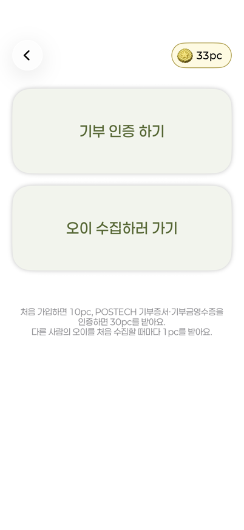
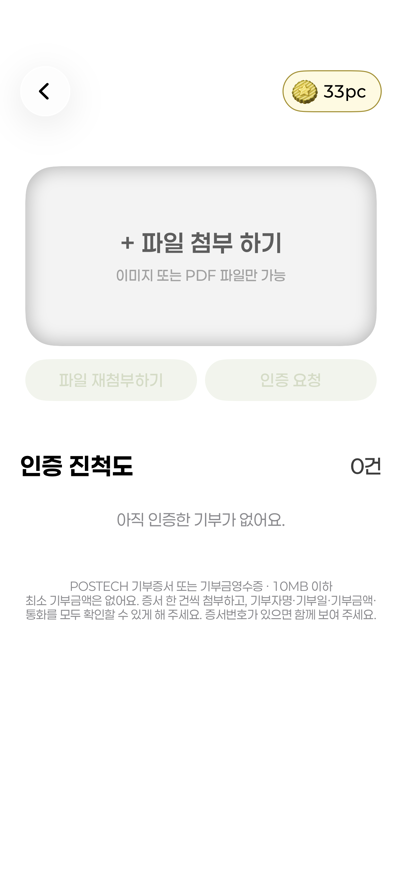
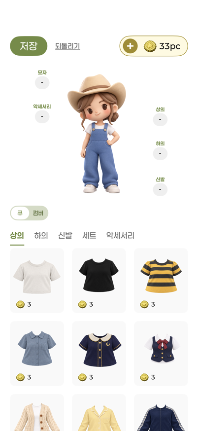

# 피클코인 검증 — #506

2026-11-18. `develop`의 `91a07f4c`를 병합한 뒤 아래 XCTest를 실행했다. 이후 좋아요·MY 수정이 포함된 `2501d8cb`를 `73ab1cbd`로 추가 통합하고 앱 일반 빌드와 DB 전체 검사를 다시 통과했다. Xcode 27.1(27A9275), iOS 26.5의 작업 전용 iPhone 17 Pro에서 실행했다. 프로젝트의 iOS 26.2 배포 대상과 Swift 언어 모드 5는 유지했다.

## 결과

| 검사 | 결과 |
| --- | --- |
| DB 전체 migration·권한·동시성·계정 통합·탈퇴 | PASS, exit 0 |
| Edge 기부 인증·종료 경로·학교 자료·이야기 검수 | PASS, 88개 |
| 독립 서비스·MY 검사 | PASS |
| iOS Simulator 일반 빌드 | PASS |
| 최종 선택 XCTest | 192개: 통과 183, 건너뜀 4, 기존 실패 5, exit 65 |
| 신규 코인 XCTest | 11개 모두 PASS |
| 코인 화면 렌더링 | 1개 검사에서 12개 화면 PASS |
| 이어진 이야기 / 건물 쪽지 | 13개 / 16개 모두 PASS |

기부 AI의 실제 제공자 호출과 실제 증서, 실기기 설치·터치는 검증하지 않았다. 네트워크 없는 가상 응답과 격리 DB 자료는 운영 데이터가 아니다.

## 실행 명령

저장소 루트에서 다음 검사를 실행했다.

```bash
python3 supabase/tests/run-account-merge-db-checks.py
node --test --test-timeout=10000 --test-reporter=dot supabase/tests/pickle-certificate-analysis.test.mjs supabase/tests/donation-evidence-retired.test.mjs supabase/tests/school-evidence-analysis.test.mjs supabase/tests/story-moderation.test.mjs
DEVELOPER_DIR=/Applications/Xcode.app/Contents/Developer sh apps/ios/Tests/run-oi-service-checks.sh
DEVELOPER_DIR=/Applications/Xcode.app/Contents/Developer sh apps/ios/Tests/run-my-checks.sh
DEVELOPER_DIR=/Applications/Xcode.app/Contents/Developer xcodebuild -project apps/ios/OiDonation.xcodeproj -scheme OiDonation -configuration Debug -destination 'generic/platform=iOS Simulator' -derivedDataPath /private/tmp/benchmark-pickle-coins-506-build CODE_SIGNING_ALLOWED=NO build
DEVELOPER_DIR=/Applications/Xcode.app/Contents/Developer xcodebuild -project apps/ios/OiDonation.xcodeproj -scheme OiFlowChecks -configuration Debug -destination 'platform=iOS Simulator,id=FBDE4A13-AEB2-42E6-A3F9-691D7A897FE9' -derivedDataPath /private/tmp/benchmark-pickle-coins-506-build -parallel-testing-enabled NO -maximum-concurrent-test-simulator-destinations 1 -resultBundlePath /private/tmp/benchmark-pickle-coins-506-final-tests.xcresult -only-testing:OiDonationTests/OiRemoteStoreTests -only-testing:OiDonationTests/OiStoryContinuationTests -only-testing:OiDonationTests/CampusBuildingNotesTests -only-testing:OiDonationTests/OiFigmaFidelityVisualTests/testPickleCoinScreenCaptures CODE_SIGNING_ALLOWED=NO test
git diff --check
```

시뮬레이터 UDID는 이 작업에서 생성·정리한 기기다. 같은 명령을 재실행할 때는 별도의 격리 기기를 선택해야 한다. 첫 빌드의 공개 클라이언트 설정 누락은 원래 checkout의 검증된 Git 제외 설정을 재사용해 해결했고, 공개 심기 영수증의 중복 초기화 컴파일 오류도 수정 후 통과했다.

## 기존 XCTest 실패

처음 6개 실패를 기준 커밋 `c7520756`의 별도 clean worktree에서 동일 기기·설정으로 실행했고 모두 재현했다. 최신 `develop` 통합 뒤 알림 재시도 검사는 통과했으며 아래 5개는 남았다. 기존 테스트를 제거하거나 기대를 완화하지 않았다.

| 테스트 | 기존 구현과 기대의 차이 |
| --- | --- |
| `testCustomizationNavigationRequiresDoneAndCardNextOpensPlacement` | 화면에 맞추는 기본 내용 탭에 넘치는 `UIScrollView`를 요구 |
| `testLateFarmWriteCannotReplaceAnotherAccountFarm` | 정상 조회된 B 계정 프로필을 `nil`로 기대 |
| `testLateFarmerOutfitWriteCannotReplaceAnotherAccountOutfit` | 정상 조회된 B 계정 의상을 `nil`로 기대 |
| `testLegacyOpaqueCardPortraitRegeneratesWithoutChangingTheDraft` | 기존 필수 우표 자동 초기화 뒤에도 우표 값 `nil`을 기대 |
| `testPublicationUsesLatestSavedContentAndRevision` | AI 검수 뒤 비공개 `draft`인데 캠퍼스 등록 여부 `true`를 기대 |

작업 소유 로그·결과: `/private/tmp/benchmark-pickle-coins-506-final-tests.log`, `/private/tmp/benchmark-pickle-coins-506-final-tests.xcresult`. 기준 비교 결과: `/private/tmp/benchmark-pickle-coins-506-baseline-summary.json`.

## 화면

가상 계정의 잔액 33pc로 실제 production View를 렌더링했다. 402×874·375×667·440×956와 접근성 최대 글자를 확인했고, 각 캡처 창은 key window를 바꾸지 않고 hidden 창까지 scene에서 분리되는지 검사했다. 별도 CUA·Simulator GUI 창은 열지 않았다.

| 지갑 | 기부 인증 | 의상 구매 |
| --- | --- | --- |
|  |  |  |

나머지 크기는 같은 폴더의 `375x667`, `440x956`, `accessibility5` PNG를 참고한다. 지갑 카드 그림자를 배경에만 적용하고 큰 글자에서 플러스가 코인 값과 겹치지 않도록 보완한 최종 결과다.

## 자원 정리

동시 최대 3그룹(DB 검사·Xcode 검사·전용 시뮬레이터)을 사용했다. 각 DB와 클라이언트, Xcode 및 테스트 앱을 종료했고 작업 전용 시뮬레이터 `FBDE4A13-AEB2-42E6-A3F9-691D7A897FE9`를 삭제했다. DB PID 파일·Unix 소켓·기록된 프로세스 부재와 기기 목록에서 UDID 부재를 확인했다. 기준 비교 worktree만 제거했으며 기본 checkout의 사용자 변경과 다른 작업의 자원은 보존했다.
