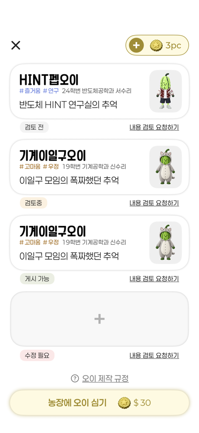

# 심기 항상 활성화·설치 경로 구분 없는 즉시 게시 — 2026-11-19 / #527

`origin/develop` 057e1c12를 기준으로 수정했다. **최종 설치본은 TF/internal/직접 설치·Debug/Release와 관계없이 검토 없이 심기로 공개한다.** 이전 e3323254의 버튼 전용 패치에서 남았던 TF 거래 확인과 검토 승인 조건까지 제거했다.

## 검증 결과

- 최종 iOS 회귀9개 성공, 실패0, 건너뜀0. TF 거래/설치 경로를 주입하지 않은 실제 OiRemoteStore와 화면을 테스트한다.
- 미검토·AI 거부 게시, 검토 기능이 꺼진 선택 진입, 직접 설치의 거래 없는 공개, 일반/무제한 코인 확인, 중복 탭 공개1회/AI0회, 실패 시 초안 보존·응답 유실 복구를 검증했다.
- 로딩·빈 목록·조회 실패·작업 진행 중 버튼 영역은 활성 기준과 변경 픽셀0. 기준은 Figma 버튼 영역의 RGB 채널 평균차3/255 미만으로 검사했다.
- 두 Figma 화면은402×874·375×667·440×956·접근성5 및 하단 캡처 회귀 통과. 캡처는 XCTest 가상 자료다.
- Node 서버 테스트144개 성공, 실패0. 거래 필드가 없는 요청과 예전 TF 클라이언트의 선택 필드 모두 호환된다. 인증·세션·소유권/RPC·오류/코인 계약을 보존한다.
- 실제 운영 Edge v2 ACTIVE/verify_jwt=true. 다시 내려받은 런타임3개 파일이 로컬과 일치한다. 서버 스위치true, anon/authenticated 직접 RPC 실행false, service_role만true 확인.
- 실제 HTTPS의 미로그인 게시 요청은403으로 거부됐다. 처음401만 예상한 검사 조건은 실패했고, Auth의 실제401/403 거절 계약으로 바로잡아 다시 확인했다.
- Release iPhoneOS 빌드 exit0, 앱/App Clip codesign deep/strict 검증 통과. Xcode27.2, iOS26.2 대상·Swift5 모드 유지. 기존 concurrency/deprecation 경고는 남아 있다.
- 최종 결과 번들: `/private/tmp/benchmark-527-direct-tests.xcresult`, `/private/tmp/benchmark-527-direct-device-build.xcresult`.

## 실행 명령

```bash
DEVELOPER_DIR=/Applications/Xcode.app/Contents/Developer xcodebuild -quiet -project apps/ios/OiDonation.xcodeproj -scheme OiFlowChecks -configuration Debug -destination 'platform=iOS Simulator,id=055DB441-0ECD-4CD3-9772-C93F8C11F047' -derivedDataPath /private/tmp/benchmark-527-derived -resultBundlePath /private/tmp/benchmark-527-direct-tests.xcresult CODE_SIGNING_ALLOWED=NO -parallel-testing-enabled NO -test-timeouts-enabled YES -default-test-execution-time-allowance 90 -maximum-test-execution-time-allowance 120 -only-testing:OiDonationTests/OiFigmaFidelityVisualTests/testPlantButtonStaysVisibleAndUndimmedWhileLoadingEmptyFailedAndBusy -only-testing:OiDonationTests/OiFigmaFidelityVisualTests/testStoryListAndPlantSelectionMatchFigmaFrames -only-testing:OiDonationTests/OiRemoteStoreTests/testPlantPickerOpensWithModerationDisabledAndEmptyTapExplainsNextStep -only-testing:OiDonationTests/OiRemoteStoreTests/testShowcasePlantButtonPublishesLocalDraftWithUnchangedReviewLabels -only-testing:OiDonationTests/OiRemoteStoreTests/testUnlimitedShowcasePlantButtonPublishesWithoutReviewOrCoinConfirmation -only-testing:OiDonationTests/OiRemoteStoreTests/testDirectInstallationPublishesWithoutAppTransaction -only-testing:OiDonationTests/OiRemoteStoreTests/testShowcasePublishesUnreviewedAndRejectedStoriesWithoutAI -only-testing:OiDonationTests/OiRemoteStoreTests/testShowcaseFailureKeepsDraftAndLostReceiptRecoversWithoutAI -only-testing:OiDonationTests/OiRemoteStoreTests/testStoryListRequestsReviewAndShowsResultInPlace test
npm --prefix supabase test
DEVELOPER_DIR=/Applications/Xcode.app/Contents/Developer xcrun xcresulttool get test-results summary --path /private/tmp/benchmark-527-direct-tests.xcresult
DEVELOPER_DIR=/Applications/Xcode.app/Contents/Developer xcodebuild -quiet -project apps/ios/OiDonation.xcodeproj -scheme OiDonation -configuration Release -destination 'generic/platform=iOS' -derivedDataPath /private/tmp/benchmark-527-device-derived -xcconfig /private/tmp/benchmark-527-device.xcconfig -resultBundlePath /private/tmp/benchmark-527-direct-device-build.xcresult build
codesign --verify --deep --strict --verbose=2 /private/tmp/benchmark-527-device-derived/Build/Products/Release-iphoneos/OiDonation.app
git diff --check
```

실제 xcodebuild는 각각900초 제한의 작업 소유 wrapper가 같은 인자로 호출했다. 로컬 xcconfig는 기존 팀/앱/App Clip 개발 프로파일을 이번 명령에만 지정하며 저장소의 서명 설정·비밀키를 변경하거나 커밋하지 않는다.

## 화면

| 로딩·처리 중에도 활성 | 기존 검토 표시와 활성 버튼 |
|---|---|
|  |  |

이전 버튼 패치부터 유지한 동일 UI이며 최종9개 검사에서 다시 픽셀 대조했다. 원본 Figma 에셋·서체·레이아웃은 유지한다.

## 기기 설치

대상은 무선 localNetwork로 연결한 `이돈혁의 iPhone` / iPhone16Pro / iOS27.2다. 최종 Release 실행 파일 UUID는 `74ADEDAC-77F2-34FD-ACDE-F9C35AA3C07C`다. 앱 메타데이터는 저장소의1.2.0(20261114)을 유지하며 소스는 설치 경로 구분을 제거한 이번 패치다.

설치 결과: 두 번째 설치의 exit0/`outcome=success`를 확인했다. 전송 한도180초의 첫 시도는 timeout 후 원격 설치 종료까지 확인했고, 같은 앱을900초 한도로 다시 전송했다. 사용자가 유선 연결로 전환한 뒤 설치 완료를 확인했으며 최종 연결은 `wired`다. 기기의 설치 경로가 설치 성공 응답의 아래 경로와 일치했다. 소스 커밋은 `21984a80`이다.

`file:///private/var/containers/Bundle/Application/96CCC1F2-B735-4349-95C5-7485829C839C/OiDonation.app/`

```bash
/Applications/Xcode.app/Contents/Developer/usr/bin/devicectl device install app --device 00008140-000258D836DB001C --timeout 900 --json-output /private/tmp/benchmark-527-wireless-install.json /private/tmp/benchmark-527-device-derived/Build/Products/Release-iphoneos/OiDonation.app
DEVELOPER_DIR=/Applications/Xcode.app/Contents/Developer xcrun devicectl device info apps --device 00008140-000258D836DB001C --bundle-id com.Spero.OiDonation --include-default-apps --timeout 30 --json-output /private/tmp/benchmark-527-installed-final.json
```

Needs confirmation:
- 실제 사용자 계정으로 폰에서 게시한 뒤 타 계정에서 조회하는 상호작용은 수행하지 않았다. 설치/서명과9개 앱 회귀·144개 서버 검증, 운영 Edge 상태를 구분한다.

## 자원

이 후속 작업의 최대 동시 소유 자원은3그룹(전용 Simulator·회귀 빌드/테스트·기기 Release 빌드)이다. 최종 테스트 캡처는 root/scene 연결을 해제하고 숨은 창 제거를 검사했다. 전용 Simulator `055DB441-0ECD-4CD3-9772-C93F8C11F047`는 테스트 직후 shutdown/delete했다. 빌드·테스트·설치 클라이언트는 모두 종료했고 기록한3개 프로세스 그룹과 두 전용 기기 ID를 재조회해 잔여0을 확인했다. 불필요하게 남긴 실행 자원은 없다. 기존 CoreDevice 공유 서비스·사용자 앱/창은 유지한다. Computer Use 핸들·커서는 생성하지 않았다.
