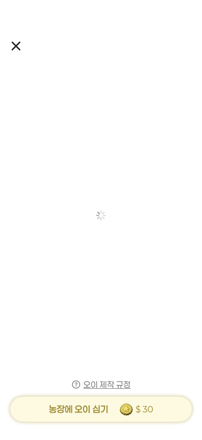

# 심기 버튼 항상 활성화 검증 — 2026-11-19 / #527

최신 `origin/develop`의 `057e1c12`에서 수정했다. 검토 결과·기능 플래그로 버튼/선택 진입을 막던 조건과 버튼의 진행 중 비활성화·흐림을 제거했다. 로딩 중에도 같은 하단 버튼을 유지한다.

## 결과

- Xcode 27.2, iPhone 17 Pro / iOS 26.5 Simulator. 기존 iOS 26.2 대상·Swift 5 모드를 유지했다.
- 최종 테스트 9개 성공, 실패0, 건너뜀0. 테스트 빌드도 성공했다.
- 로딩·빈 목록·조회 실패·작업 진행 중 버튼 영역은 활성 기준과 변경 픽셀0이다. 활성 기준은 Figma 원본 버튼 영역과 RGB 채널 평균차3/255 미만으로 검사했다.
- 목록/선택 두 화면은 402×874·375×667·440×956·접근성5 및 접근성 하단 캡처로 기존 픽셀 회귀 검사를 통과했다.
- 검토 기능 플래그가 없어도 미검토 두 오이를 선택할 수 있다. 빈 목록은 작성 방법을 안내한다. 일반 설치의 서버 공개 제한은 유지한다.
- TF 주입 테스트는 일반/무제한 계정에서 미검토 초안의 실제 앱 업로드·공개 파이프라인, 코인 확인, 중복 탭 안내와 공개1회/OpenAI0회를 검증했다. 별도 저장소 테스트는 검토 거부·응답 유실 복구·오류 시 초안 보존을 확인했다.
- 처음 빌드는 RootTabView에 남은 canPlant 인자로 실패해 호출부를 수정했다. 다음 실행은9개 중8개 성공이며 새 테스트가 로컬 초안 저장만으로 목록 갱신을 기대해 실패했다. 서버 저장을 포함한 실제 갱신 흐름으로 테스트 준비를 수정하고 동일9개를 모두 재실행해 통과했다. 실패를 숨기거나 검증을 완화하지 않았다.
- 최종 xcresult: `/private/tmp/benchmark-527-complete.xcresult`. 기존 테스트의 UIKit actor/deprecation 경고는 남아 있다.

## 실행 명령

```bash
DEVELOPER_DIR=/Applications/Xcode.app/Contents/Developer xcodebuild -quiet -project apps/ios/OiDonation.xcodeproj -scheme OiFlowChecks -configuration Debug -destination 'platform=iOS Simulator,id=DB812701-E16B-47C5-BA0A-899283CCE6A9' -derivedDataPath /private/tmp/benchmark-527-derived -resultBundlePath /private/tmp/benchmark-527-complete.xcresult CODE_SIGNING_ALLOWED=NO -parallel-testing-enabled NO -test-timeouts-enabled YES -default-test-execution-time-allowance 90 -maximum-test-execution-time-allowance 120 -only-testing:OiDonationTests/OiFigmaFidelityVisualTests/testPlantButtonStaysVisibleAndUndimmedWhileLoadingEmptyFailedAndBusy -only-testing:OiDonationTests/OiFigmaFidelityVisualTests/testStoryListAndPlantSelectionMatchFigmaFrames -only-testing:OiDonationTests/OiRemoteStoreTests/testPlantPickerOpensWithoutReviewCapabilityAndEmptyTapExplainsNextStep -only-testing:OiDonationTests/OiRemoteStoreTests/testShowcasePlantButtonPublishesLocalDraftWithUnchangedReviewLabels -only-testing:OiDonationTests/OiRemoteStoreTests/testUnlimitedShowcasePlantButtonPublishesWithoutReviewOrCoinConfirmation -only-testing:OiDonationTests/OiRemoteStoreTests/testRegularBuildCannotPublishThroughShowcase -only-testing:OiDonationTests/OiRemoteStoreTests/testShowcasePublishesUnreviewedAndRejectedStoriesWithoutAI -only-testing:OiDonationTests/OiRemoteStoreTests/testShowcaseFailureKeepsDraftAndLostReceiptRecoversWithoutAI -only-testing:OiDonationTests/OiRemoteStoreTests/testStoryListRequestsReviewAndShowsResultInPlace test
DEVELOPER_DIR=/Applications/Xcode.app/Contents/Developer xcrun xcresulttool get test-results summary --path /private/tmp/benchmark-527-complete.xcresult
DEVELOPER_DIR=/Applications/Xcode.app/Contents/Developer xcrun xcresulttool export attachments --path /private/tmp/benchmark-527-complete.xcresult --output-path /private/tmp/benchmark-527-attachments
git diff --check
```

실제 실행은900초 제한의 작업 소유 Python wrapper가 위 xcodebuild를 같은 인자로 호출했고 exit0을 확인했다.

## 화면

캡처는 XCTest 가상 자료이며 실제 사용자 자료가 아니다. 원본 Figma 정적 에셋·폰트·레이아웃을 재사용하며 추가 프로덕션 리소스는 없다.

| 로딩·처리 중에도 활성 | 기존 검토 표시와 활성 버튼 |
|---|---|
|  |  |

## 운영·정리 경계

운영 읽기로 쇼케이스 스위치true와 게시 Edge v1 ACTIVE/JWT 검증 유지 상태를 확인했다. 서버 변경·배포는 하지 않았다.

최대 동시 소유 자원2그룹(전용 시뮬레이터와 빌드/테스트). 테스트 캡처 창은 기존 helper와 새 테스트에서 root/scene 연결을 해제하고 숨은 창까지 scene.windows에서 제거됨을 검사했다. 전용 기기 `DB812701-E16B-47C5-BA0A-899283CCE6A9`는 shutdown/delete 후 기기 목록에서 제거됐고 기록한 build/launchd PID가 종료됨을 확인했다. Computer Use 핸들·커서0, 유지 런타임0. 원본 체크아웃의 서명 변경과 다른 작업 자원은 보존했다.

Needs confirmation:
- 실제 TF 설치·Apple Sandbox 거래 온라인 확인·타 계정의 실서버 공개 조회는 이번 시뮬레이터 검증으로 입증하지 않는다.
- UI 수정은 이 패치가 포함된 새 빌드부터 적용된다. PR 병합·TestFlight 업로드는 이번에 수행하지 않았다.
