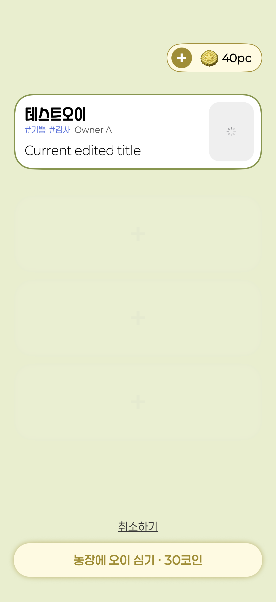
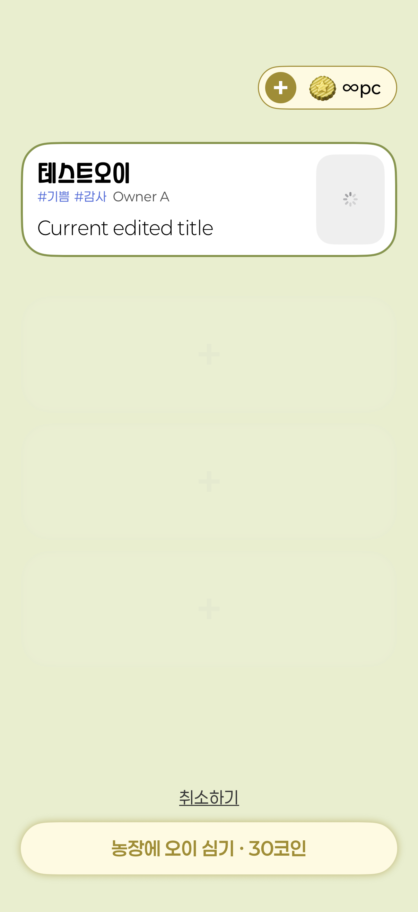

# TF 심기와 코인 회귀 — #516

## 결과

- iOS:6/6 통과, 실패·건너뜀0. TF 일반 계정의 비용 확인 후 미검토 게시, 무제한 계정의 바로 게시, 미검토·거부 게시, 응답 유실 복구, 일반 빌드 AI 조건 유지.
- Node:21/21 통과. 서명·세션·역할, OpenAI 미호출, DB 오류 전달과 잔액 부족402.
- 전체 SQL harness 통과. 저장소 이력2개와 실제 운영 base 캡처를 재현해 TF 최초30·재심기0·무제한0·권한·운영자 기존 게시·감사·리비전 확인.
- 운영: Supabase `kfzfzarslqdqmrazohej` DB2개 마이그레이션 적용, Edge v1 ACTIVE/JWT 유지, 임시 TF 스위치 true 확인. 배포한4개 소스는 저장소와 일치한다. 일반·anon의 서비스 RPC 실행은 false다.
- 최초 DB 검증의 테스트 역할 오류와 운영 base 이력 재현 누락을 바로잡은 뒤 재검증했다. 운영의 첫 마이그레이션 시도는 알려진 source 차이로 롤백됐으며, 실제 소스를 재현한 로컬 검증 후 배포에 성공했다.

## 실행 명령

```bash
node --test supabase/tests/showcase-publication.test.mjs supabase/tests/story-moderation.test.mjs
python3 /private/tmp/benchmark-pickle-run.py plant-db env PATH=/opt/homebrew/opt/postgresql@18/bin:/usr/bin:/bin:/usr/sbin:/sbin:/opt/homebrew/bin python3 supabase/tests/run-account-merge-db-checks.py
python3 /private/tmp/benchmark-pickle-run.py plant-ios xcodebuild -quiet -project apps/ios/OiDonation.xcodeproj -scheme OiFlowChecks -configuration Debug -destination 'platform=iOS Simulator,id=32FCA739-8455-46BC-82B7-2AEB5432248F' -derivedDataPath /private/tmp/benchmark-pickle-coins-506/build -resultBundlePath /private/tmp/benchmark-plant-516-tests.xcresult CODE_SIGNING_ALLOWED=NO -parallel-testing-enabled NO -test-timeouts-enabled YES -default-test-execution-time-allowance 120 -maximum-test-execution-time-allowance 180 -only-testing:OiDonationTests/OiRemoteStoreTests/testShowcasePlantButtonPublishesLocalDraftWithUnchangedReviewLabels -only-testing:OiDonationTests/OiRemoteStoreTests/testUnlimitedShowcasePlantButtonPublishesWithoutReviewOrCoinConfirmation -only-testing:OiDonationTests/OiRemoteStoreTests/testShowcasePublishesUnreviewedAndRejectedStoriesWithoutAI -only-testing:OiDonationTests/OiRemoteStoreTests/testShowcaseFailureKeepsDraftAndLostReceiptRecoversWithoutAI -only-testing:OiDonationTests/OiRemoteStoreTests/testRegularBuildCannotPublishThroughShowcase -only-testing:OiDonationTests/OiRemoteStoreTests/testAutomaticReviewKeepsDraftPrivateUntilExplicitPlanting test
DEVELOPER_DIR=/Applications/Xcode.app/Contents/Developer xcrun xcresulttool get test-results summary --path /private/tmp/benchmark-plant-516-tests.xcresult --format json
git diff --check
```

`benchmark-pickle-run.py`는 `DEVELOPER_DIR=/Applications/Xcode.app/Contents/Developer`를 설정하고 소유 PID/PGID·명령·작업 폴더·로그·종료 상태를 기록한다. Xcode27.1, iPhone17Pro/iOS26.5, 프로젝트 대상/언어 모드는 유지했다. 기존 deprecation/Swift 이행 경고는 남아 있으며 xcresult의6개 성공을 별도로 확인했다.

## 화면

아래는 비용 표시의 최초 검증 기록이다. 사용자 지정 두 Figma 화면과 대조한 최종 UI와 픽셀 측정은 [Figma 정합 후속](../figma-story-list-516/README.md)을 따른다.

가상 초안과 주입된 TF 거래로 실제 SwiftUI 목록을 실행했다. 선택 화면에서 버튼에30코인 표시를 확인했고, 일반 계정의 비용 확인 전 공개0회·확인 후 공개1회, 무제한 계정은 추가 확인 없이 공개1회임을 assertion으로 확인했다. 캡처 시 오이 초상은 준비 중이며 외형 로딩 검증을 주장하지 않는다.




## 리소스 정리

동시 소유 리소스 최대3개 그룹(DB·테스트·Simulator). 로컬 PostgreSQL은 harness finally에서 종료 후 PID 파일·socket 제거를 확인했다. 테스트 창은 hidden/rootViewController=nil/windowScene=nil로 해제했다. 전용 Simulator `32FCA739-8455-46BC-82B7-2AEB5432248F`는 shutdown/delete했고 앱·테스트 프로세스 종료를 확인했다. CUA 핸들·커서·입력 제어 리소스0개, 의도적으로 유지한 런타임0개다. 로그·xcresult·캡처만 임시 폴더에 남긴다.

Needs confirmation:
- 실제 TF 기기의 Apple 서명 거래 온라인 검증과 타 계정 공개 지도/카드 조회는 미실시다.
- 버튼 문구는 패치 앱 빌드부터 적용된다. TF 업로드·PR 병합은 수행하지 않았다.
