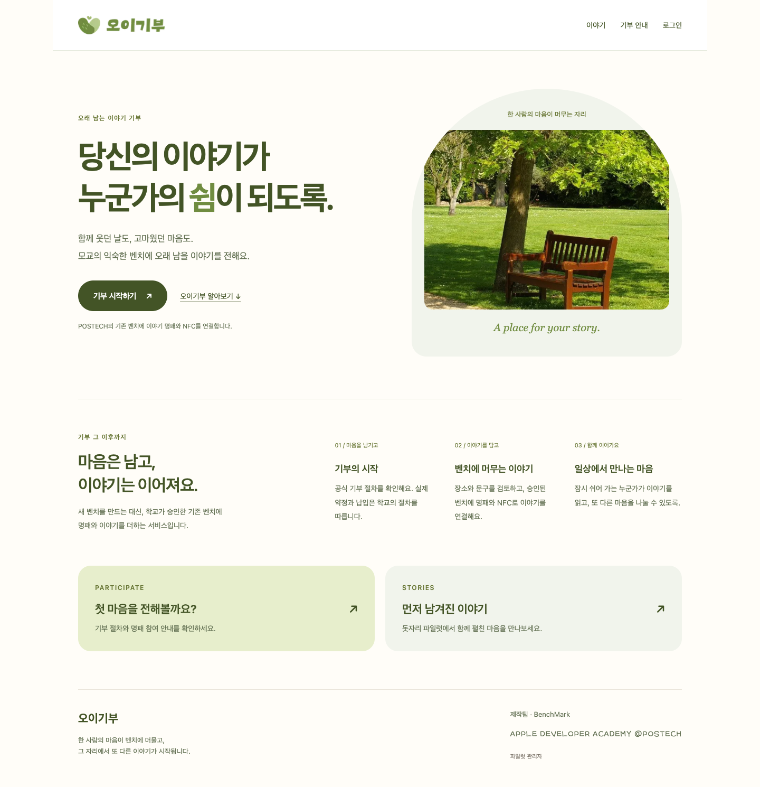
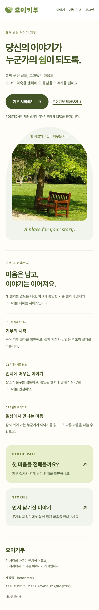
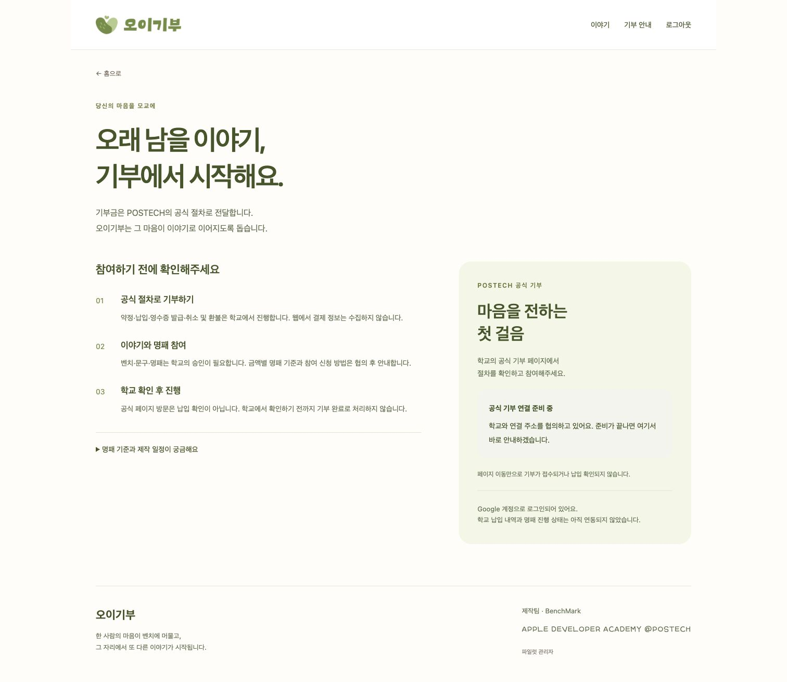
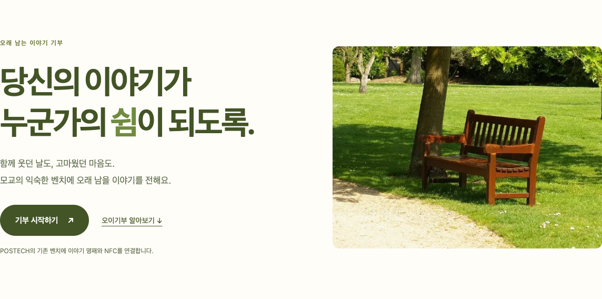
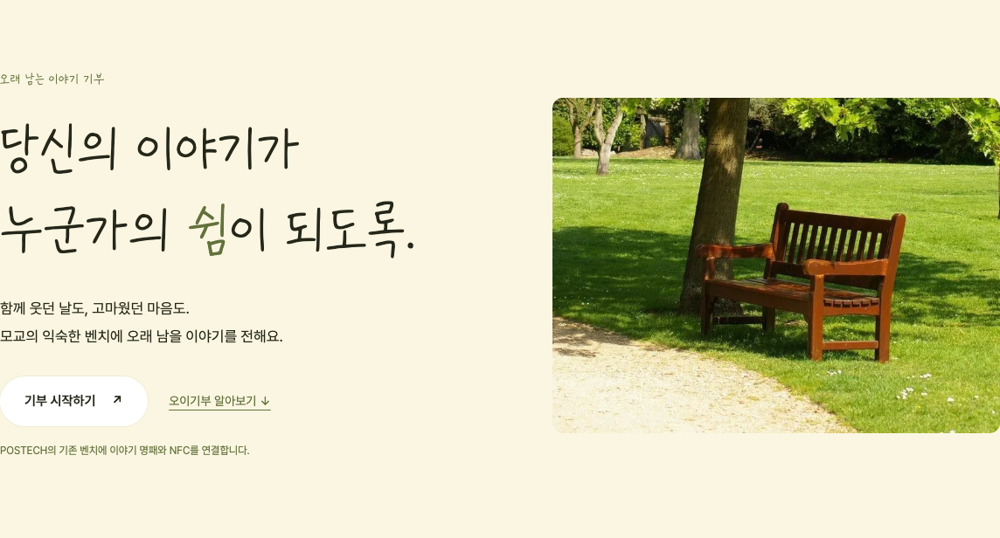

# 오이기부 웹 — 로그인·기부 안내

2026-10-12, 이슈 #64. Android의 오이기부 로고·벤치 사진은 유지하고, 기존 BenchMark 확정 웹의 서체·크림/올리브 색상을 재사용해 웹 간 통일감을 만든다. 앱 화면을 복제하지 않고 데스크톱에서는 소개·이미지와 안내·행동을 나란히 배치하며 작은 화면에서는 세로로 읽는다. 이미지는 기존 앱 디자인 자산이며 승인된 실제 캠퍼스 벤치나 부착 실적의 증거가 아니다.

## 경로와 기존 기능

- `/`: 오이기부 소개, 기부 시작, 파일럿 이야기 연결
- `/donate`: 공식 기부 안내; 로그인 없이 열람 가능
- `/login`: Android #44와 같은 Supabase 프로젝트의 Google PKCE 로그인
- `/auth/callback`: 일회성 코드 교환; 성공하면 `/` 또는 `/donate`로 복귀
- `/pilot`: 이전 첫 화면의 돗자리 이야기 읽기
- `/stories`, `/stories/:id`, `/reserve`, `/admin`, `/camera` 및 API·저장 데이터는 보존

루트 `/`와 `/about`의 도착 화면은 새 홈으로 변경된다. 기존 이야기 고유 URL은 유지된다. 예약 폼은 기존 돗자리 파일럿용이며 벤치 참여 신청이나 학교 기부 확인으로 사용하지 않는다.

## 서버 환경 설정

`.env.example`의 설정을 `apps/web/.env.local` 또는 배포 서비스 환경에 지정한다. 실제 키를 커밋하지 않는다.

```dotenv
APP_ORIGIN=http://127.0.0.1:3000
SUPABASE_URL=
SUPABASE_PUBLISHABLE_KEY=
POSTECH_DONATION_URL=
```

- `SUPABASE_URL`, `SUPABASE_PUBLISHABLE_KEY`: Android와 같은 프로젝트. publishable 또는 기존 anon 공개 키만 사용한다. service_role/secret key를 사용하지 않는다.
- `APP_ORIGIN`: 배포 HTTPS origin, 경로·끝 슬래시 제외. 로컬 HTTP는 localhost/127.0.0.1만 허용한다.
- Supabase Auth URL Configuration의 Redirect URLs에 정확한 `${APP_ORIGIN}/auth/callback`을 등록한다. Google OAuth 공급자가 활성화되어 있어야 한다. Android 콜백 목록을 보존한다.
- `POSTECH_DONATION_URL`: 학교와 합의한 HTTPS `postech.ac.kr` 또는 하위 도메인 URL. 비어 있거나 잘못된 값이면 준비 중 안내를 표시한다. 운영 연결 주소는 아직 미정이다.

로그인은 서버 전용 쿠키 클라이언트를 사용한다. PKCE verifier·세션 쿠키는 HttpOnly·SameSite=Lax이며 운영 HTTPS에서는 Secure다. Proxy가 토큰을 갱신하고 `getUser`로 검증한다. 인증 응답은 private/no-store이며 사용자 세션을 관리자 권한으로 사용하지 않는다. 로그아웃은 웹 세션만 종료해 Android 세션을 유지한다. 로그인 서버 액션은 Next.js의 Origin 검증 및 정확한 APP_ORIGIN 검사를 적용한다.

학교 사이트 이동은 납입 완료로 처리하지 않는다. 결제·약정·영수증·취소·환불은 학교가 처리한다. 웹 계정과 납입·명패 상태의 서버 연동은 이번 범위에 포함되지 않는다.

## 검증 결과 — 2026-10-12

- lint·타입 검사·production build 성공, 단위 테스트 12개 및 격리 PostgreSQL API 통합 테스트 2개 통과
- 기존 카메라 2개·스토리/관리자/예약 1개·새 웹 반응형/탐색 1개, 브라우저 테스트 4개 통과
- 실제 Android 설정으로 Google 로그인 서버 액션의 authorize URL·PKCE challenge·HttpOnly/Secure/SameSite 쿠키 검사 1개 통과. OAuth 이동은 브라우저에서 가로채 실제 계정 인증을 수행하지 않았다.
- 실제 Supabase `/auth/v1/settings`: HTTP 200, Google enabled true
- npm audit: 기존 Next.js·sharp·eslint 관련 9건(critical 1/high 8). 신규 Supabase 패키지 관련 항목은 없다. 이 PR에서는 무관한 라이브러리 업그레이드를 하지 않았다.

## 검증 명령

```bash
npm run lint
npm run typecheck
npm test
npm run build
npm run test:integration
cd apps/web
npx --no-install playwright test
# Auth-configured server, without logging in to a real account:
TEST_AUTH_CONFIGURED=true npx --no-install playwright test google-login.spec.ts
```

통합·기존 스토리 브라우저 테스트는 이름이 `benchmark_mat_test`인 격리 DB를 요구한다. 환경 변수와 서버 시작 절차는 `.github/workflows/mat-web.yml`을 참고한다. `oi-web.spec.ts`는 공식 기부 URL 미설정·로그인 미설정 상태를 검증하므로 해당 두 설정을 비운 서버에서 실행한다.

Needs confirmation:
- 운영 정식 도메인이 확정되면 해당 origin과 콜백을 별도 등록
- 학교가 승인한 기부 URL 및 벤치 참여 신청·학교 확인 계약




## 개편 웹 미리보기

Railway `benchmark-mat-pilot` / `design-preview` / `oi-web-preview`를 사용한다. `OI_WEB_PREVIEW=1`이면 검색 제외 헤더를 제공하고 `/stories`, `/pilot`, `/reserve`, `/admin`은 기존 파일럿 운영 주소로 이동한다. 운영 DB·관리자 변수·마이그레이션은 복제하지 않는다. 기존 `main-concepts` 서비스와 운영 서비스는 별도로 유지한다.

서비스 이름은 **오이기부**, 제작팀 이름은 **BenchMark**다. 공개 제목·로고·주요 안내는 서비스명을 사용하며 팀 이름은 제작팀 표기에만 사용한다.

### 공개 배포 확인 — 2026-10-12

- URL: https://oi-web-preview-design-preview.up.railway.app
- 배포 소스: `eda45cc`, Railway deployment `4d31e895-972f-409d-981e-9fc24a7be2c3` SUCCESS
- `/`, `/donate`, `/login` HTTP 200, 제작팀 표시 및 noindex/nofollow 확인
- `/stories`, `/pilot`, `/reserve`, `/admin`: 기존 운영 파일럿으로 HTTP 307 연결 확인
- 공개 URL에서 `TEST_AUTH_CONFIGURED=true` Google PKCE 진입 및 반응형 웹 브라우저 검사 통과
- 공식 학교 URL은 미설정이며 준비 중 안내를 유지한다. 미리보기 계정 인증과 콜백은 아래 실제 검증 기록을 따른다. 정식 운영 도메인은 Needs confirmation:
- 기존 운영·기존 디자인 서비스의 배포 ID 불변 확인. 프리뷰 서비스에 DATABASE_URL·관리자 비밀값·볼륨 복제 없음

### 실제 Google 로그인 확인 — 2026-10-12

- 원인: Supabase `52gibu` Redirect URLs에는 Android 콜백만 등록되어 있었고, 미리보기 웹 콜백이 누락되어 있었다.
- 기존 Android 콜백과 Site URL은 유지하고 다음 정확한 웹 주소 3개만 추가했다. 와일드카드는 추가하지 않았다.

```text
https://oi-web-preview-design-preview.up.railway.app/auth/callback
https://oi-web-preview-design-preview.up.railway.app/auth/callback?next=%2Fdonate
https://oi-web-preview-design-preview.up.railway.app/auth/callback?next=%2F
```

- 격리된 작업용 Chrome 탭에서 기부 안내 → 로그인 → 실제 Google 팀 테스트 계정 선택·기본 프로필/이메일 승인 → 웹 콜백 → `/donate` 복귀 성공
- 복귀 화면의 `로그아웃` 버튼과 `Google 계정으로 로그인되어 있어요.` 문구 확인. 화면은 서버의 Supabase `getUser` 검증 결과를 사용한다.
- `/donate` 새로고침 후 로그인 상태 유지 확인
- 웹 로그아웃 후 `/` 복귀와 `로그인` 링크 표시 확인. 테스트 세션은 종료했고 작업 탭 2개를 닫았다.
- 앱/학교 기부 처리, 기존 운영 웹, Google Cloud OAuth 클라이언트 및 추가 권한은 변경하지 않았다. 일반 공개 계정 전체의 운영 인수 검증과 정식 도메인 설정은 별도다.
- 동작 변경은 Supabase 설정만으로 해결했고 재배포는 수행하지 않았다. 최신 develop 통합 후 웹 lint·타입 검사·단위 테스트·빌드를 재확인했다.



### 홈 사진 정리 — 2026-10-12

사용자 요청으로 아치 배경과 영어 문구를 제거했다. 사진 위의 중복 안내 문구도 정리하고, 배경 프레임 없이 4:3 비율로 표시한다. 사진을 늘리지 않으며 하단 구도로 벤치 전체를 보존한다. 모바일에서도 가로 공간을 채우도록 기존 320px 제한을 제거했다. 웹 lint·타입 검사·빌드 및 320/390/768/1440px 브라우저 검증을 통과했다.

- 사진 변경 공개 배포: 소스 `c0f6403`, Railway deployment `6ceb5db0-6b80-4cc0-b45d-78ca306005bf` SUCCESS
- 공개 URL에서 390/1440px 사진 배경 투명·4:3 비율·영어 문구 없음·가로 넘침 없음 확인. 기부 안내 이동 확인
- 첫 임시 검증 스크립트는 화면 전환 완료를 기다리지 않아 URL 검사에 실패했다. `waitForURL`을 적용한 재검증으로 두 크기 모두 이동 통과



### BenchMark와 웹 디자인 기준 통일 — 2026-10-12

메인 페이지 선정은 미정이다. 기존 BenchMark 웹을 교체하거나 오이기부를 공식 메인으로 지정하지 않는다. 두 미리보기의 주소·역할은 유지하면서 오이기부 홈·로그인·기부 안내의 시각 기준만 정리했다.

- 기준: `feat/#38-main-concepts`의 기존 BenchMark 웹 CSS와 원본 서체
- 제목: 동일 Griun OMIRI 원본, 본문·입력·버튼: 동일 Pretendard Variable 원본
- 크림 배경 `#fbf6e1`, 올리브색 `#63723c`, 검정에 가까운 본문, 흰색 pill 버튼
- 둥근 녹색 바로가기 카드 대신 구분선 중심 레이아웃, 올리브색 푸터
- 정리한 사진의 4:3 비율·벤치 전체 구도 유지, 아치와 영어 문구를 다시 추가하지 않음
- 공유 브랜드 CSS는 `.oi-*` 및 서비스 페이지 배경으로 범위를 제한해 기존 파일럿 입력·본문 스타일을 유지
- lint·typecheck·unit 12개·build, 320/390/768/1440px 웹 흐름 및 Google PKCE 진입 검사 통과

- 공유 디자인 공개 배포: 소스 `aa5bafd`, Railway deployment `5a300357-5865-4b45-ac5b-abdbe77d54b7` SUCCESS
- 공개 두 웹의 Griun OMIRI·Pretendard 파일 SHA-256 일치 확인
- 공개 390/1440px에서 크림 배경·제목 Griun OMIRI·본문 Pretendard 실제 계산 스타일 확인
- 공개 반응형·기부 이동·Google PKCE 진입 2개 브라우저 테스트 통과


